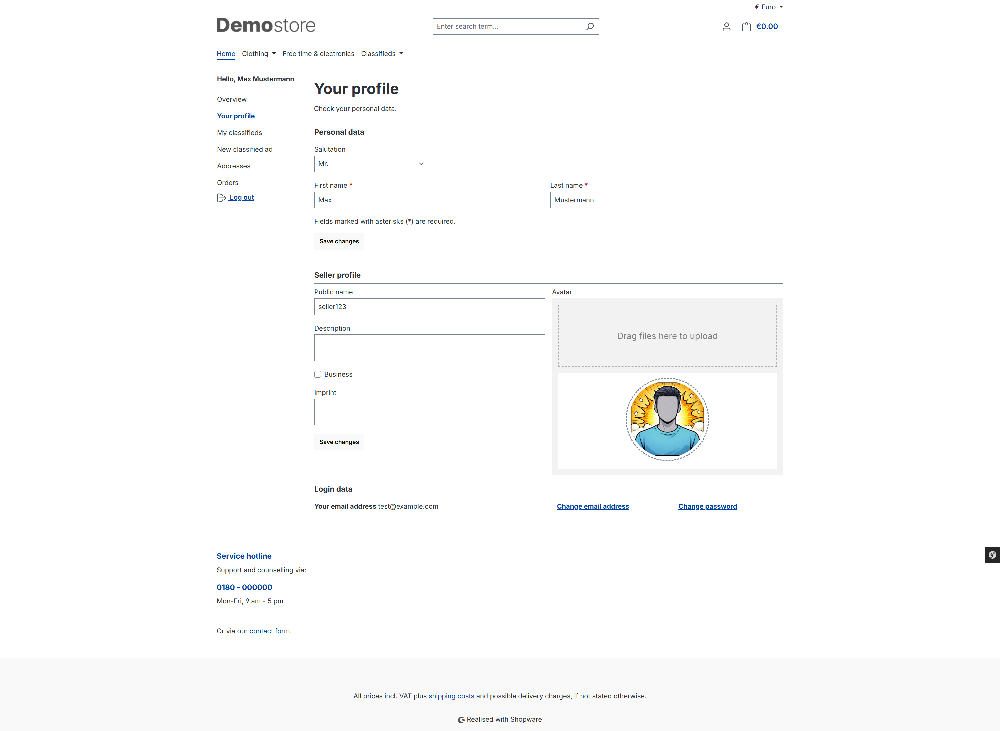
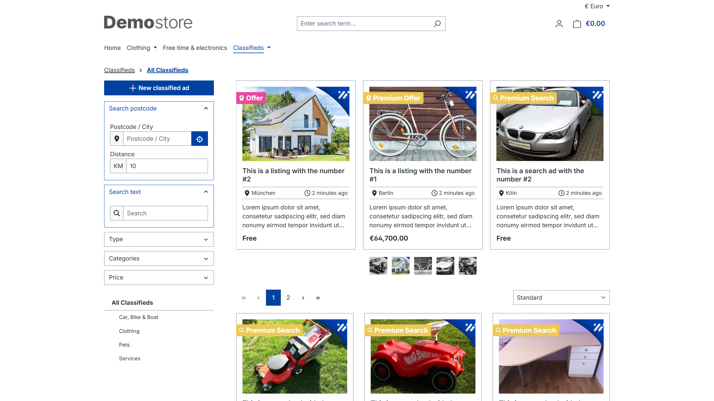
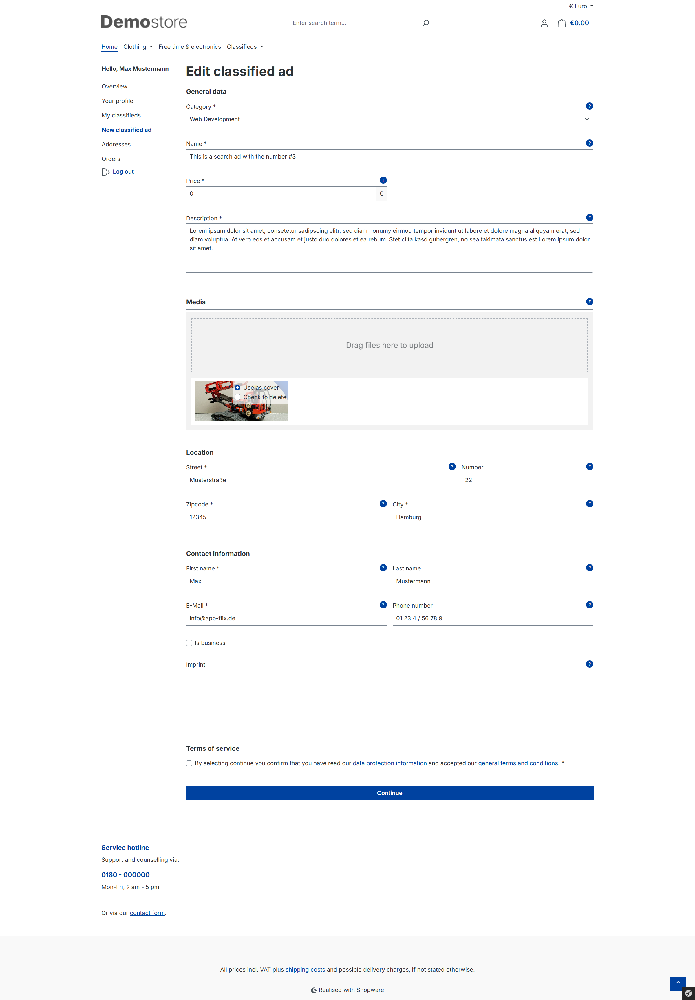
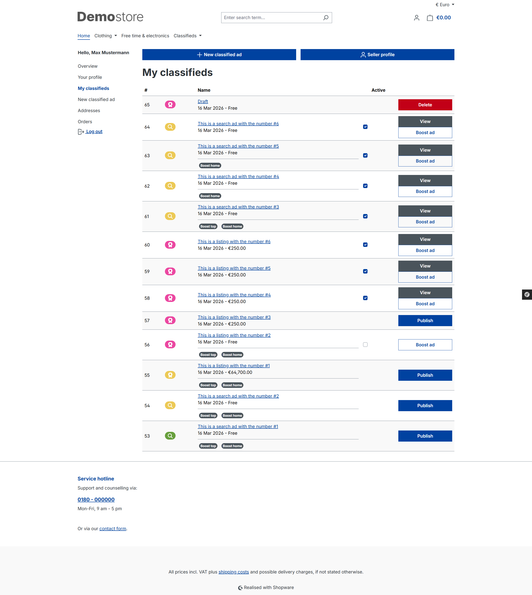

# Storefront

The category selector in the ad form supports branches of different depths. Every loaded category can be selected and is displayed with its full path, for example `Vehicles → Cars → Classics → Parts`.

The plugin setting `Category selection depth` controls how many levels below the configured all classifieds category are loaded per sales channel. The default is 10 and the minimum is 1. Increase this value for deeper category structures.

Customers can create their own ads. To do so, a seller profile is created.

A new classified ad can be created via the listing of all classified ads (button at the top left) or via the customer menu under `New Classified Ad`.

The customer first selects the ad type and then completes all further details in the next step.

In the overview (`My Classified Ads` in the customer menu), the customer can publish their classified ads or delete incomplete classified ads. Paid ads and boosts are only activated once the customer has ordered and paid for these options.

