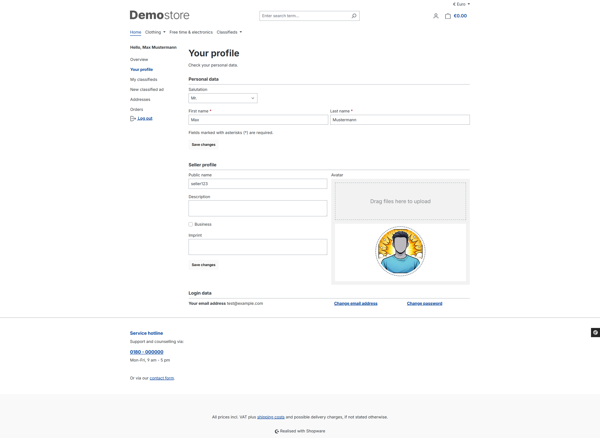
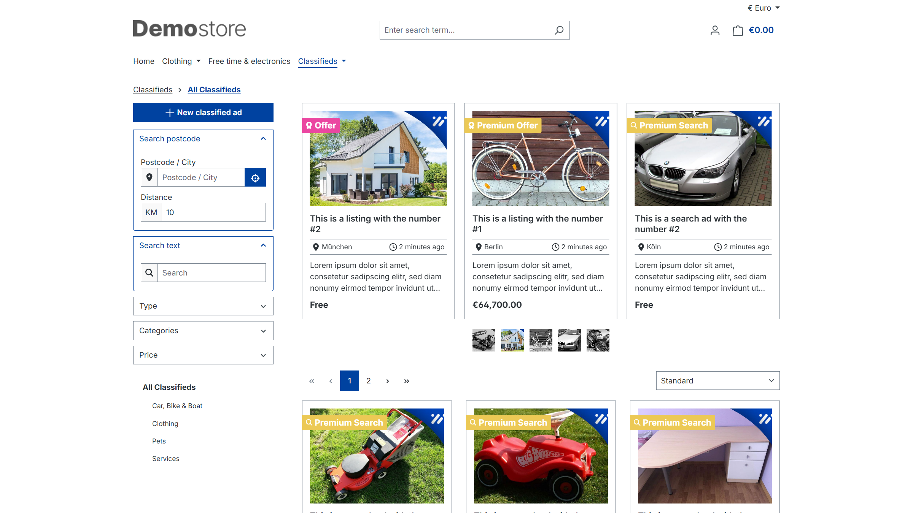
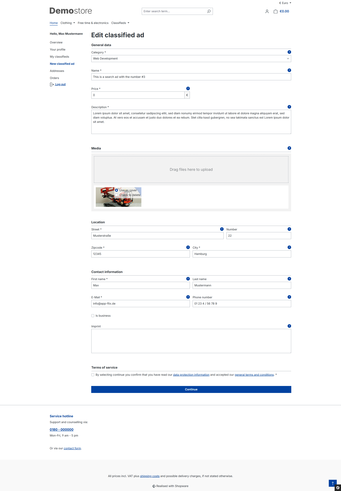
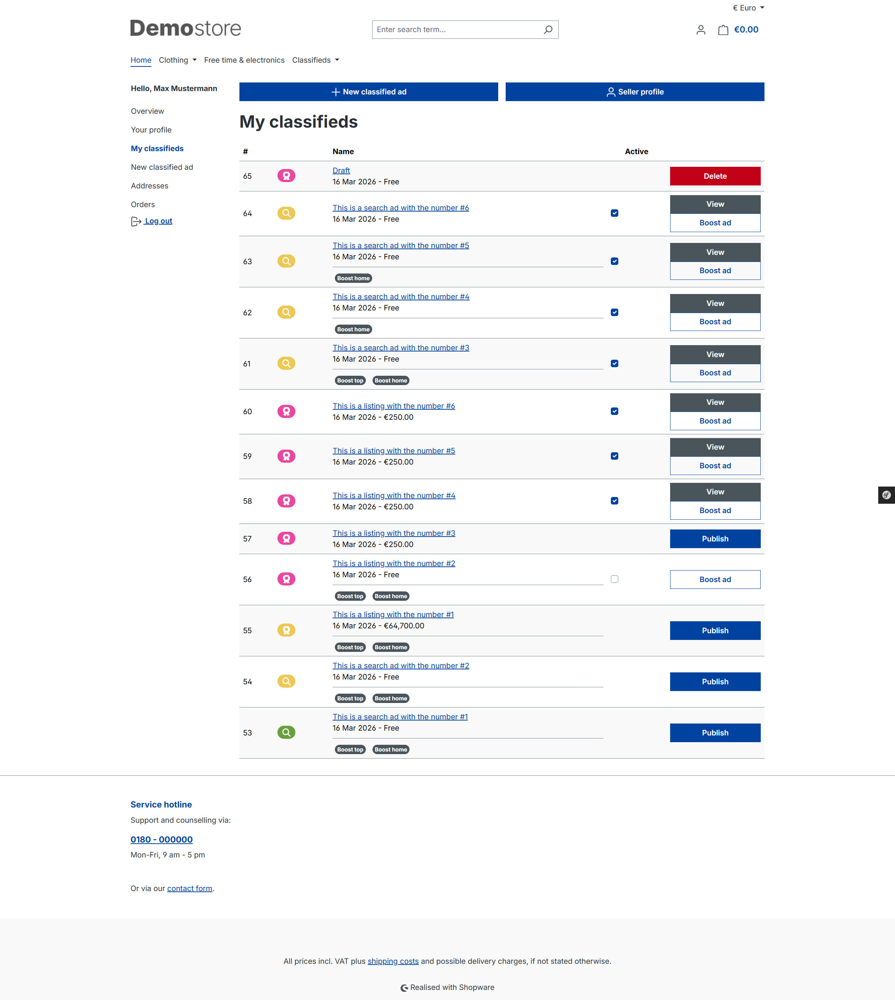

# Storefront

Die Kategorieauswahl im Anzeigenformular unterstützt unterschiedlich tiefe Kategorieäste. Jede geladene Kategorie ist auswählbar und wird mit ihrem vollständigen Pfad angezeigt, zum Beispiel `Fahrzeuge → Autos → Oldtimer → Ersatzteile`.

Die Plugin-Einstellung `Tiefe der Kategorieauswahl` bestimmt pro Verkaufskanal, wie viele Ebenen unterhalb der konfigurierten Kategorie mit allen Anzeigen geladen werden. Der Standardwert ist 10, der Mindestwert 1. Für tiefere Strukturen kann der Wert erhöht werden.

Der Kunde kann eigene Anzeigen erstellen. Dazu wird ein Verkäuferprofil angelegt.

Eine neue Kleinanzeige kann über das Listing aller Kleinanzeigen (Button oben links) oder im Kundenmenü unter `Neue Kleinanzeige` erstellt werden.

Der Kunde wählt zuerst den Typ der Anzeige und vervollständigt im nächsten Schritt alle weiteren Angaben.

In der Übersicht (Kundenmenü `Meine Kleinanzeigen`) kann der Kunde seine Kleinanzeigen veröffentlichen oder unvollständige Kleinanzeigen löschen. Kostenpflichtige Anzeigen und Boosts werden erst freigegeben, wenn der Kunde diese Optionen bestellt und bezahlt hat.

