# Download center

Nested directories, private and public downloads, digital products, CMS elements, management of serial numbers and static links, Amazon S3, FTP, WebDAV and Nextcloud

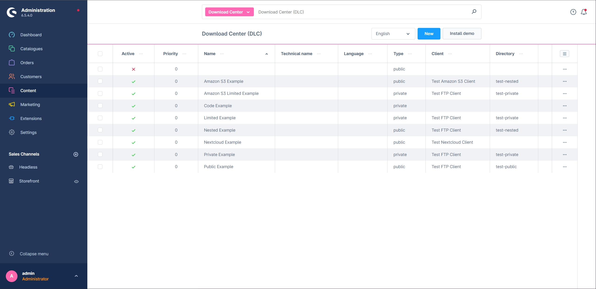

---

## Plugin erwerben

Dieses Plugin kann im offiziellen **Shopware Community Store** erworben werden.

- [Shopware Community Store](https://store.shopware.com/de/search?search=MoorlDownloadCenter)


**Wichtiger Hinweis:** Sie benötigen das Foundation Plugin, welches Ihnen kostenlos zur Verfügung steht: [moori Foundation](../MoorlFoundation/index.md)


---

## Initial setup

### Available file systems

* Local file system
* FTP
* SSH
* Amazon S3
* WebDAV
* Nextcloud
* Azure (available on request)
* Google Storage (available on request)

The Shopware media manager is not used. The following plugin can, for example, be used to set up a WebDAV connection:
https://store.shopware.com/frosh11030048018f/webdav.html

### Installing additional services

Some services require Composer packages. Run the following commands in the root directory of your Shopware 6 installation:

```text
composer require league/flysystem-ftp
composer require league/flysystem-webdav
```

### Overview

The overview provides a summary of all downloads. In this example, the demo package is already installed.


### Configuring a Download Center

#### Plugin configuration

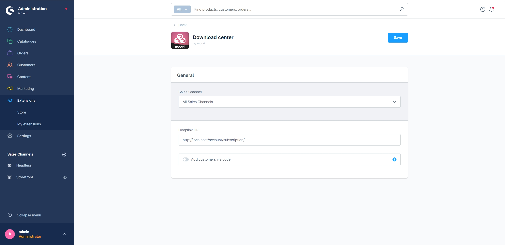

- **Deeplink URL**: The base URL for personal links to download subscriptions, especially for guest customers. Enter your domain including `/account/subscription/`.
- **Add customers with code**: Shows the input field in the customer account that customers can use to redeem a download code.

#### Basic configuration

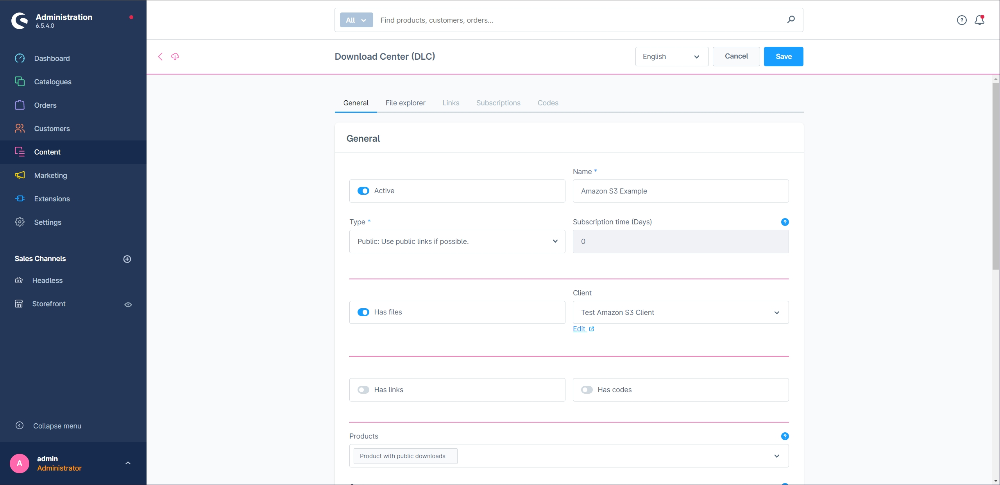
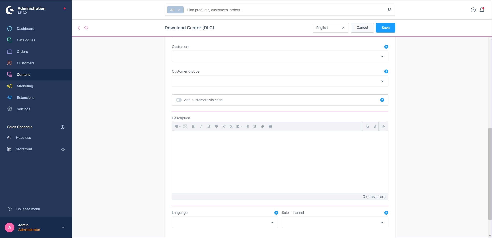

- **Active**: Enables the Download Center.
- **Name**: The name of the Download Center.
- **Type**: Private downloads are only available to authorised customers. Public downloads are visible on the product detail page.
- **Has files**: Enables client selection and the file explorer.
- **Client**: The file system client from which files are loaded.
- **Has links**: Enables the section for external links.
- **Has codes**: Enables the management of codes and licence keys.
- **Products**: Links products to the Download Center. Access to private downloads is enabled after purchase.
- **Customers** and **customer groups**: Assign downloads directly to individual customers or customer groups.
- **Create customer downloads via code**: Allows customers to activate personal downloads using a code. These codes are not intended as serial numbers for ESD products.
- **Language** and **sales channel**: Restrict download visibility to a language or sales channel.

#### File explorer

Select the directory that should be available for download. Subdirectories remain accessible to authorised customers and can, for example, be used for categories or languages.

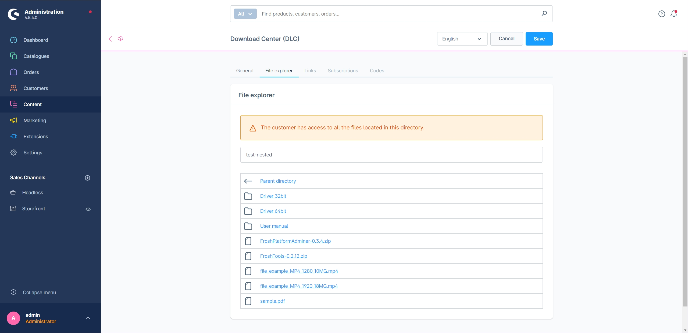

#### Links

You can add external links, for example when you provide a licence key for a Microsoft product but do not host the file yourself. This reduces your bandwidth requirements.

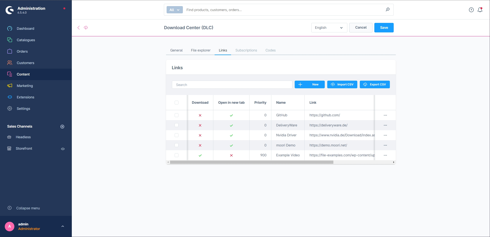

#### Purchases

This section provides an overview of customer purchases. You can also create or adjust subscriptions manually when needed.

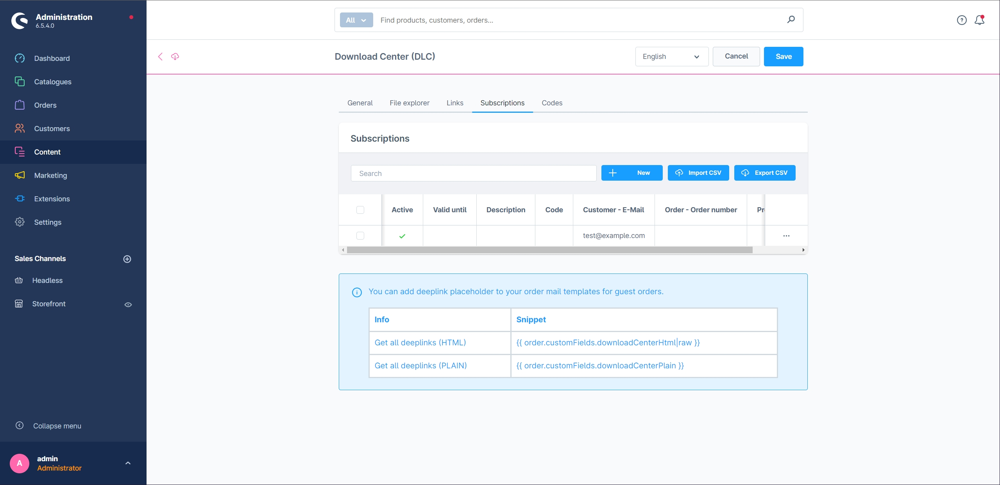

#### Codes

Manage serial numbers and volume licence keys for your software products in this section. A volume licence key can be sold multiple times.

For personal customer downloads, create a new code; it is generated automatically.

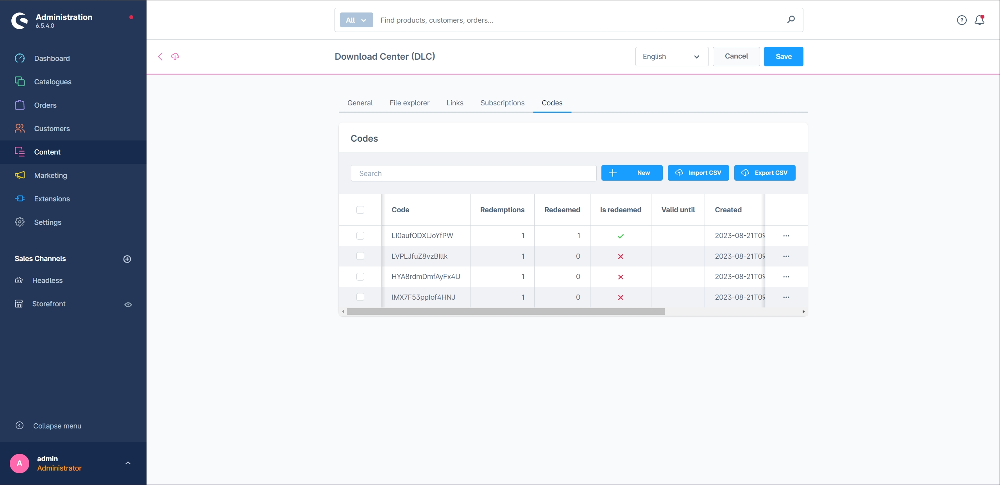

#### Additional configuration options

Use a `metadata.xml` file in the directory to configure individual files:

- `visibility`: Hides a file, for example the metadata file itself.
- `description`: Adds a file description.
- `image`: Sets an image URL or Base64 image for the icon.

```xml
<files>
    <file name="_metadata.xml">
        <visibility>private</visibility>
        <description>Hides this XML file</description>
    </file>
    <file name="FroshTools-0.2.12.zip">
        <visibility>private</visibility>
    </file>
    <file name="sample.pdf">
        <description>A PDF from the internet</description>
        <image>data:image/png;base64,(...)</image>
    </file>
    <file name="FroshPlatformAdminer-0.3.4.zip">
        <description>A useful tool for managing databases</description>
        <image>https://avatars.githubusercontent.com/u/36633261?s=200&amp;v=4</image>
    </file>
</files>
```

## Storefront

### Shopping Experiences

This example embeds a Download Center as a CMS element.

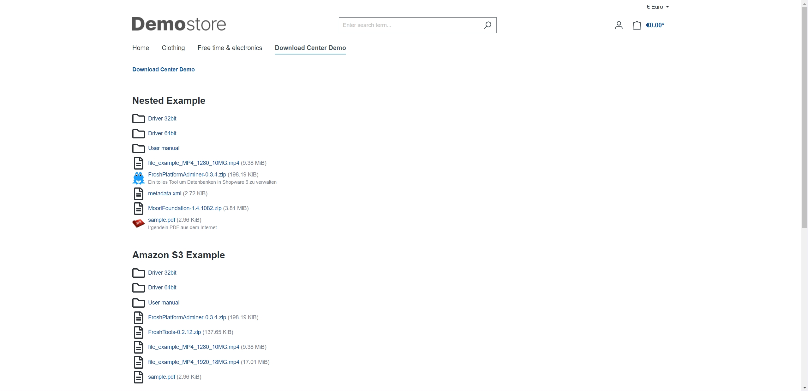

Opening a subdirectory:

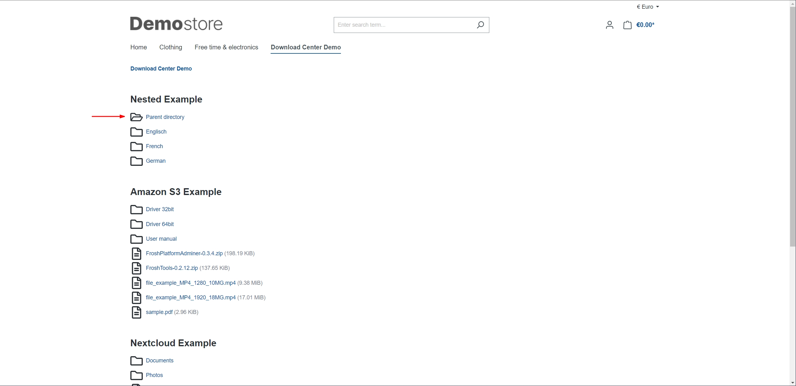

### Products

An ESD product can contain a download, a code, or both.

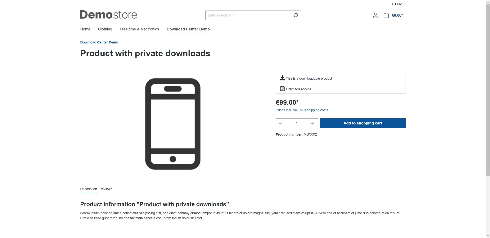

A product with public downloads, for example manuals:

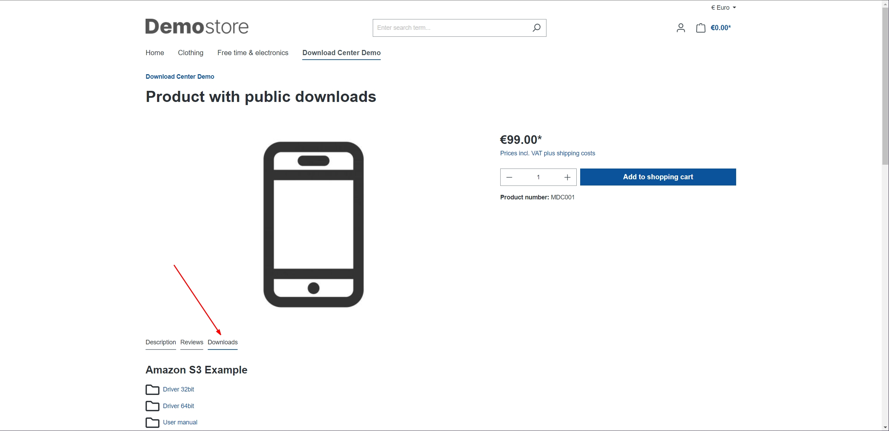

!!! note

      You can combine private and public downloads in one product.

### Purchasing ESD products

#### Cart

In this example, the cart contains a free ESD product, a product with codes, and a paid ESD product.

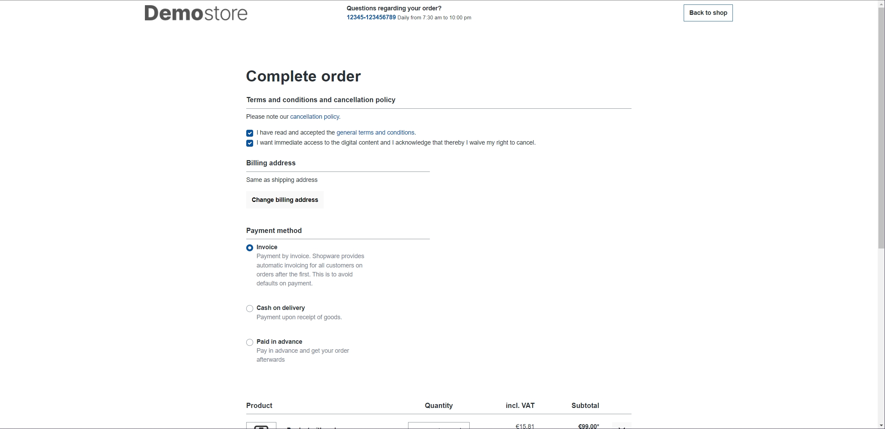
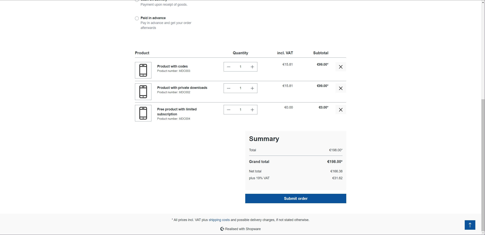

#### My purchases

The **My purchases** page in the customer account displays download subscriptions alongside the order overview.

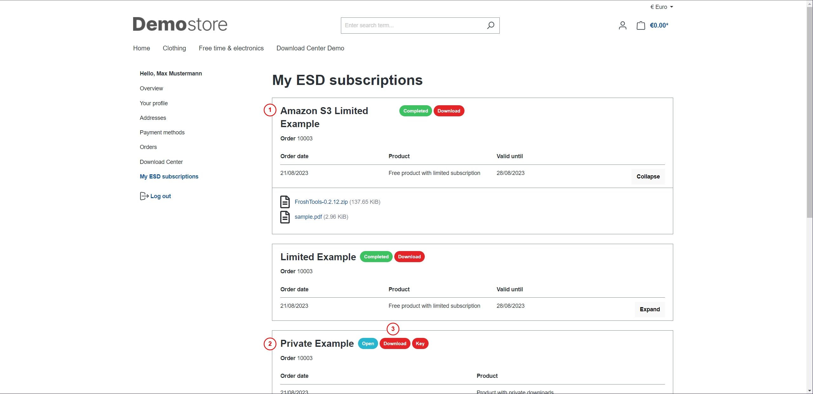

1. Free ESD products are activated immediately; access may be time-limited.
2. Paid ESD products become available once the order reaches the **paid** payment status.
3. The subscription displays its status and contents.

After setting the payment status to **paid**, downloads and codes become available.

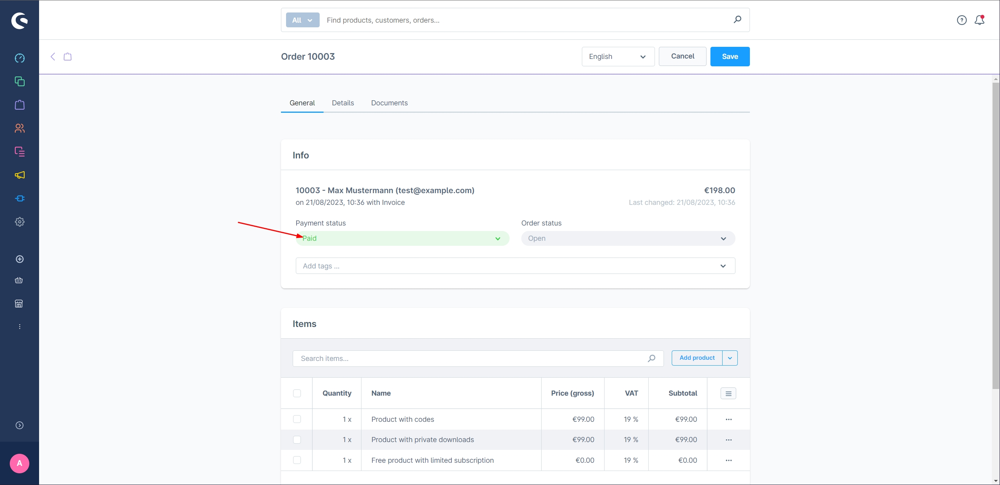
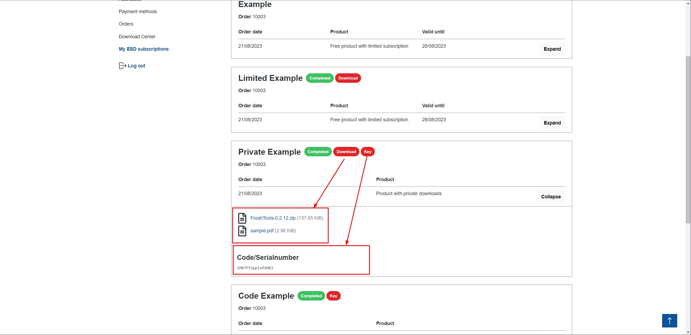

### Flow Builder and email notifications

Dedicated Flow Builder events are available for download subscriptions. They allow you to send email notifications independently of the order email.

| Event | Triggered when |
| --- | --- |
| `EsdCreated` | a download subscription is created |
| `EsdActivated` | a subscription is activated (`active = true`) |
| `EsdDeactivated` | a subscription is deactivated (`active = false`) |

When a subscription is created, `EsdCreated` is followed by the activation or deactivation event that matches its status.

Create a Flow Builder flow for one of these events and add the **Send email** action. The supplied **Download notice** email template is available in German and English.

The following variables are available in the email templates:

```twig
{{ customer.firstName }}
{{ customer.lastName }}
{{ esd.downloadCenter.translated.name }}
{{ deeplink }}
```

`{{ deeplink }}` contains the complete URL to **My purchases** and the subscriptions. It consists of the **Deeplink URL** plugin setting and the subscription's personal token, so it also works for guest customers.

!!! note

      The previous order subscriber that stores links as custom fields on the order is deprecated. Use the Flow Builder events and email templates for new notifications.

### Personal downloads

In addition to subscriptions, downloads can be assigned directly to customers or customer groups. Eligible customers can access these downloads in their customer account.

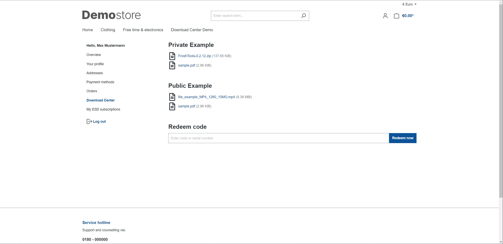

The field for redeeming a code can be enabled or disabled through the plugin configuration.

## Guest customers

Guest customers can purchase ESD products and access their downloads through a personal deeplink. The following custom fields remain available for older order email templates:

For the plain-text content:

```text
{{ order.customFields.downloadCenterPlain }}
```

For the HTML content:

```html
{{ order.customFields.downloadCenterHtml|raw }}
```

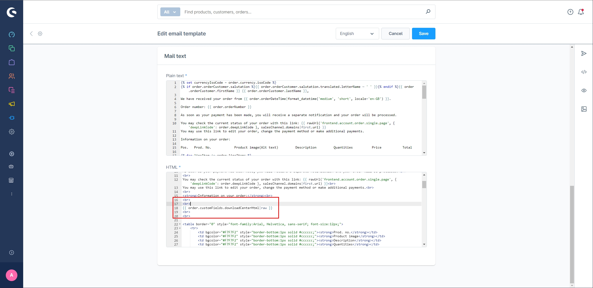

The link takes guest customers directly to their download subscriptions.

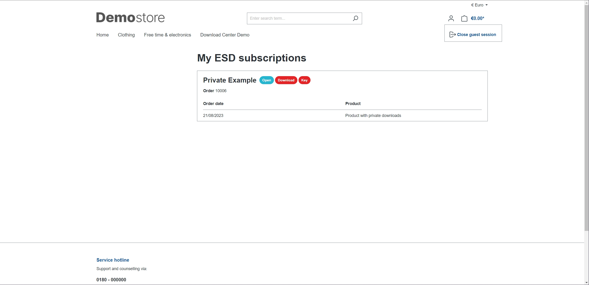
