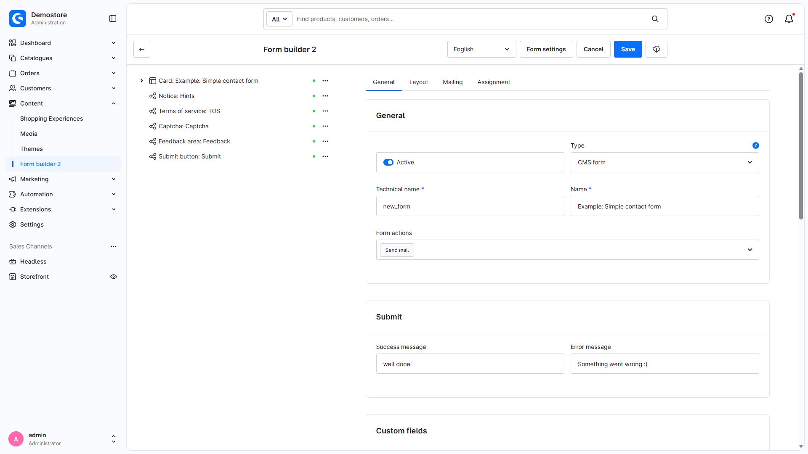
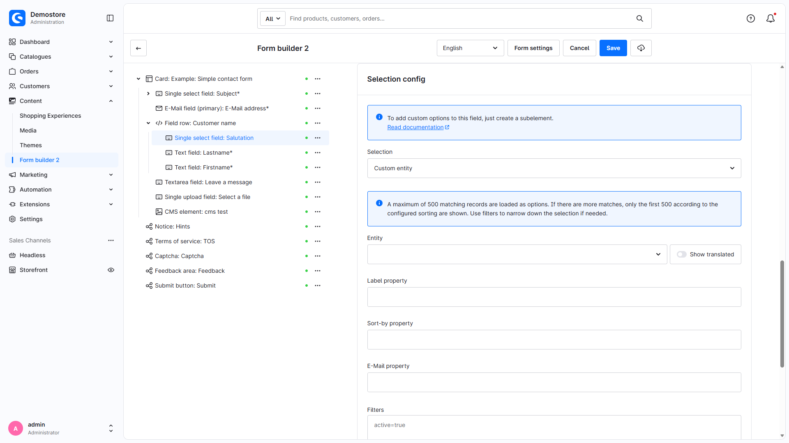
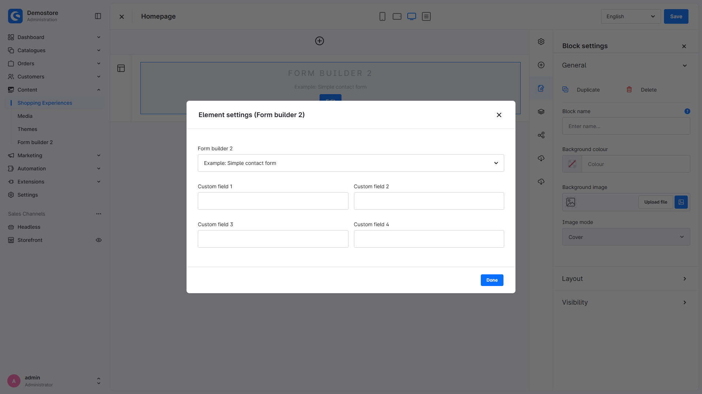
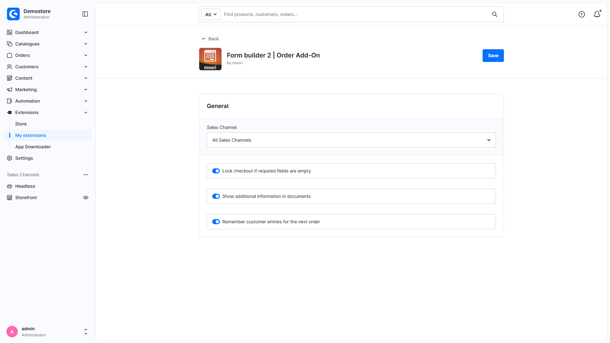

# Administration screenshots in Full HD

The **30 English administration views** were freshly recaptured after a full browser reload. The previous red Critical indicator is absent. UI and content language are `en-GB`; every PNG is **1920 × 1080 pixels** at device scale factor 1. No visible error notification was present at capture time; errors were not hidden to obtain a picture. Normal update notifications and the Symfony debug toolbar were dismissed/hidden.

The German FHD variants and obsolete login/configuration-error images have been removed. Both language versions of this documentation now use this same English image set. [Deutsche Beschreibung](admin-screenshots.md).

Only MoorlForms and MoorlFormsOrder are active. CustomProducts remains disabled; the other add-ons remain unregistered in this shop. The capture scope therefore covers the base editor, CMS integration and Order settings. No plugins were installed, activated or updated.

Custom entity selection and receipt confirmation were temporary, unsaved editor selections. The stored form was verified afterwards: selection `salutation`, actions `mail`, `mail-copy`, `captcha`. No form, CMS page or plugin settings were saved, and no mail/checkout/integration was triggered.

The [manifest](admin-screenshots.json) records the new timestamps, routes, language and dimensions.

## MoorlForms

| View | Screenshot | Notes |
| --- | --- | --- |
| Form list | [PNG](images/admin-fhd/en/admin-list.png) | Fresh English capture |
| Create and import forms | [PNG](images/admin-fhd/en/admin-new-import.png) | Fresh English capture |
| General form settings | [PNG](images/admin-fhd/en/admin-form-general.png) | Fresh English capture |
| Form layout | [PNG](images/admin-fhd/en/admin-form-layout.png) | Fresh English capture |
| Mailing | [PNG](images/admin-fhd/en/admin-form-mail.png) | Fresh English capture |
| Form assignment | [PNG](images/admin-fhd/en/admin-form-assignment.png) | Fresh English capture |
| Text field | [PNG](images/admin-fhd/en/admin-element-text.png) | Fresh English capture |
| Element layout | [PNG](images/admin-fhd/en/admin-element-layout.png) | Fresh English capture |
| Element assignment | [PNG](images/admin-fhd/en/admin-element-assignment.png) | Fresh English capture |
| Selection field | [PNG](images/admin-fhd/en/admin-element-selection.png) | Fresh English capture |
| Upload field | [PNG](images/admin-fhd/en/admin-element-upload.png) | Fresh English capture |
| Embedded CMS element | [PNG](images/admin-fhd/en/admin-element-cms.png) | Fresh English capture |
| Embedded CMS element settings | [PNG](images/admin-fhd/en/admin-element-cms-settings.png) | Fresh English capture |
| Upload settings | [PNG](images/admin-fhd/en/admin-element-upload-settings.png) | Fresh English capture |
| Field comparison and regular expression | [PNG](images/admin-fhd/en/admin-element-validation.png) | Fresh English capture |
| Dynamic selection settings | [PNG](images/admin-fhd/en/admin-element-selection-settings.png) | Fresh English capture |
| Base plugin configuration | [PNG](images/admin-fhd/en/admin-plugin-config-general.png) | Fresh English capture |
| Base modal settings | [PNG](images/admin-fhd/en/admin-plugin-config-modal.png) | Fresh English capture |
| Select CMS block | [PNG](images/admin-fhd/en/admin-cms-page.png) | Fresh English capture |
| CMS form element settings | [PNG](images/admin-fhd/en/admin-cms-element-settings.png) | Fresh English capture |
| CMS form selection | [PNG](images/admin-fhd/en/admin-cms-form-selection.png) | Fresh English capture |
| Custom entity selection (unsaved) | [PNG](images/admin-fhd/en/admin-element-custom-entity.png) | Temporary editor selection; not saved. |
| Field settings | [PNG](images/admin-fhd/en/admin-element-field-settings.png) | Fresh English capture |
| Available form actions | [PNG](images/admin-fhd/en/admin-form-actions.png) | Fresh English capture |
| Receipt confirmation (unsaved) | [PNG](images/admin-fhd/en/admin-form-mail-receipt-draft.png) | Temporary editor selection; not saved. |

## MoorlFormsOrder

| View | Screenshot | Notes |
| --- | --- | --- |
| General Order form settings | [PNG](../MoorlFormsOrder/images/admin-fhd/en/admin-form-general.png) | Fresh English capture |
| Order form information | [PNG](../MoorlFormsOrder/images/admin-fhd/en/admin-form-order-settings.png) | Fresh English capture |
| Order form assignment | [PNG](../MoorlFormsOrder/images/admin-fhd/en/admin-form-assignment.png) | Fresh English capture |
| Order plugin configuration | [PNG](../MoorlFormsOrder/images/admin-fhd/en/admin-plugin-config.png) | Fresh English capture |
| Date field settings | [PNG](../MoorlFormsOrder/images/admin-fhd/en/admin-element-date.png) | Fresh English capture |

## Examples

