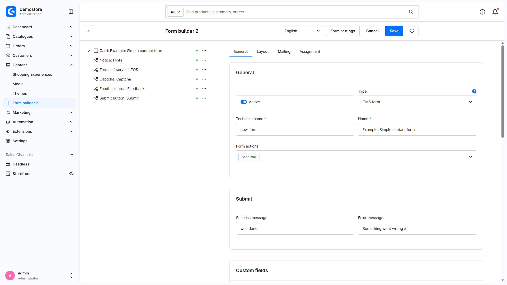
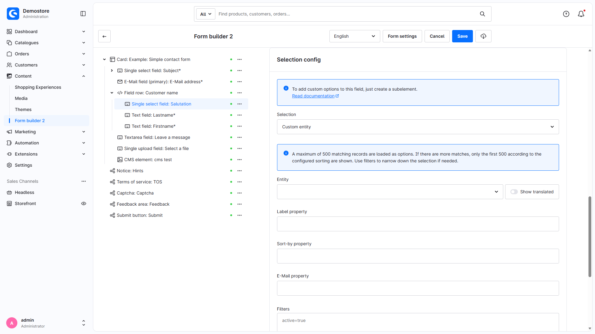
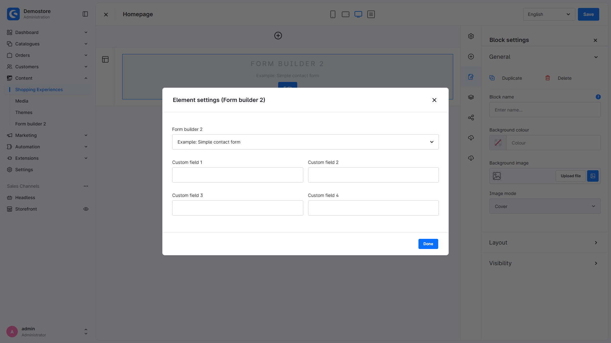
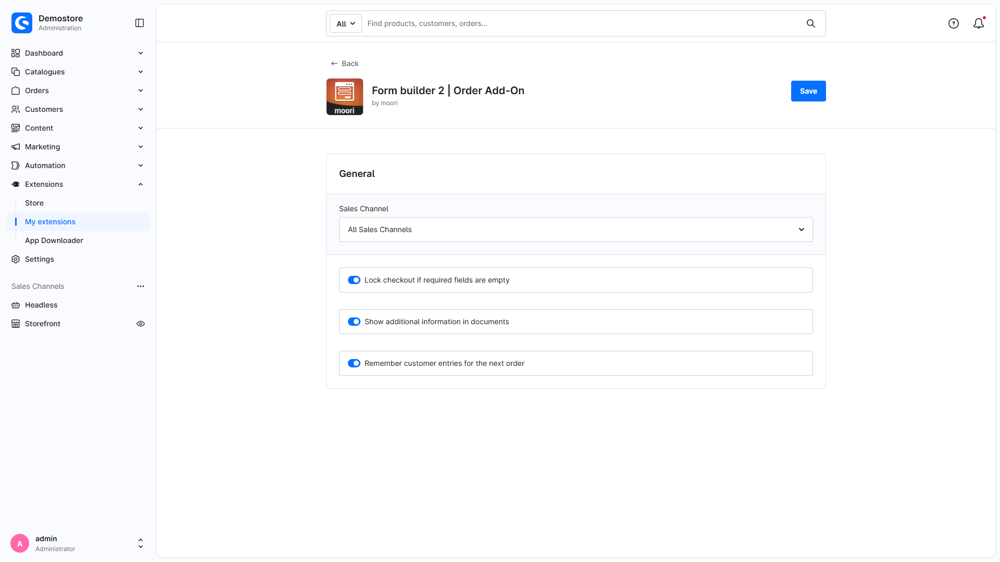

# Admin-Screenshots in Full HD

Die **30 englischen Adminansichten** wurden nach einem vollständigen Neuladen des Browsers erneut aufgenommen. Die vorherige rote Critical-Anzeige ist verschwunden. Oberfläche und Inhaltssprache: `en-GB`; alle PNGs haben **1920 × 1080 Pixel** bei Device Scale Factor 1. Vor jeder Aufnahme wurde auf sichtbare Fehlerbenachrichtigungen geprüft; Fehler wurden nicht für die Aufnahme ausgeblendet. Normaler Updatehinweis und Symfony-Debugtoolbar wurden geschlossen bzw. ausgeblendet.

Die deutschen FHD-Varianten sowie alte Login-/Konfigurationsfehlerbilder wurden entfernt. Beide Sprachfassungen der Dokumentation verwenden nun dieselben neuen englischen Bilder. [English gallery](admin-screenshots.en.md).

Im laufenden Shop sind Basis und Order aktiv. CustomProducts bleibt deaktiviert; die übrigen Add-ons sind nicht registriert. Die Aufnahmen zeigen deshalb den Basiseditor, die CMS-Einbindung und die Order-Einstellungen. Plugins wurden nicht installiert, aktiviert oder aktualisiert.

Eigene Entity und Empfangsbestätigung wurden ausschließlich temporär im Editor ausgewählt und nicht gespeichert. Danach wurde der ursprüngliche Formularstand per Repository bestätigt: `salutation`, Aktionen `mail`, `mail-copy`, `captcha`. Keine Formulare, Erlebniswelten oder Plugin-Einstellungen wurden gespeichert; kein Versand, Checkout oder Integrationslauf wurde ausgelöst.

Das [Manifest](admin-screenshots.json) enthält die neuen Zeitpunkte, Routen, Sprachkennungen und Abmessungen.

## MoorlForms

| Ansicht | Screenshot | Hinweis |
| --- | --- | --- |
| Form list | [PNG](images/admin-fhd/en/admin-list.png) | Neue englische Aufnahme |
| Create and import forms | [PNG](images/admin-fhd/en/admin-new-import.png) | Neue englische Aufnahme |
| General form settings | [PNG](images/admin-fhd/en/admin-form-general.png) | Neue englische Aufnahme |
| Form layout | [PNG](images/admin-fhd/en/admin-form-layout.png) | Neue englische Aufnahme |
| Mailing | [PNG](images/admin-fhd/en/admin-form-mail.png) | Neue englische Aufnahme |
| Form assignment | [PNG](images/admin-fhd/en/admin-form-assignment.png) | Neue englische Aufnahme |
| Text field | [PNG](images/admin-fhd/en/admin-element-text.png) | Neue englische Aufnahme |
| Element layout | [PNG](images/admin-fhd/en/admin-element-layout.png) | Neue englische Aufnahme |
| Element assignment | [PNG](images/admin-fhd/en/admin-element-assignment.png) | Neue englische Aufnahme |
| Selection field | [PNG](images/admin-fhd/en/admin-element-selection.png) | Neue englische Aufnahme |
| Upload field | [PNG](images/admin-fhd/en/admin-element-upload.png) | Neue englische Aufnahme |
| Embedded CMS element | [PNG](images/admin-fhd/en/admin-element-cms.png) | Neue englische Aufnahme |
| Embedded CMS element settings | [PNG](images/admin-fhd/en/admin-element-cms-settings.png) | Neue englische Aufnahme |
| Upload settings | [PNG](images/admin-fhd/en/admin-element-upload-settings.png) | Neue englische Aufnahme |
| Field comparison and regular expression | [PNG](images/admin-fhd/en/admin-element-validation.png) | Neue englische Aufnahme |
| Dynamic selection settings | [PNG](images/admin-fhd/en/admin-element-selection-settings.png) | Neue englische Aufnahme |
| Base plugin configuration | [PNG](images/admin-fhd/en/admin-plugin-config-general.png) | Neue englische Aufnahme |
| Base modal settings | [PNG](images/admin-fhd/en/admin-plugin-config-modal.png) | Neue englische Aufnahme |
| Select CMS block | [PNG](images/admin-fhd/en/admin-cms-page.png) | Neue englische Aufnahme |
| CMS form element settings | [PNG](images/admin-fhd/en/admin-cms-element-settings.png) | Neue englische Aufnahme |
| CMS form selection | [PNG](images/admin-fhd/en/admin-cms-form-selection.png) | Neue englische Aufnahme |
| Custom entity selection (unsaved) | [PNG](images/admin-fhd/en/admin-element-custom-entity.png) | Temporäre Auswahl; nicht gespeichert. |
| Field settings | [PNG](images/admin-fhd/en/admin-element-field-settings.png) | Neue englische Aufnahme |
| Available form actions | [PNG](images/admin-fhd/en/admin-form-actions.png) | Neue englische Aufnahme |
| Receipt confirmation (unsaved) | [PNG](images/admin-fhd/en/admin-form-mail-receipt-draft.png) | Temporäre Auswahl; nicht gespeichert. |

## MoorlFormsOrder

| Ansicht | Screenshot | Hinweis |
| --- | --- | --- |
| General Order form settings | [PNG](../MoorlFormsOrder/images/admin-fhd/en/admin-form-general.png) | Neue englische Aufnahme |
| Order form information | [PNG](../MoorlFormsOrder/images/admin-fhd/en/admin-form-order-settings.png) | Neue englische Aufnahme |
| Order form assignment | [PNG](../MoorlFormsOrder/images/admin-fhd/en/admin-form-assignment.png) | Neue englische Aufnahme |
| Order plugin configuration | [PNG](../MoorlFormsOrder/images/admin-fhd/en/admin-plugin-config.png) | Neue englische Aufnahme |
| Date field settings | [PNG](../MoorlFormsOrder/images/admin-fhd/en/admin-element-date.png) | Neue englische Aufnahme |

## Beispiele

