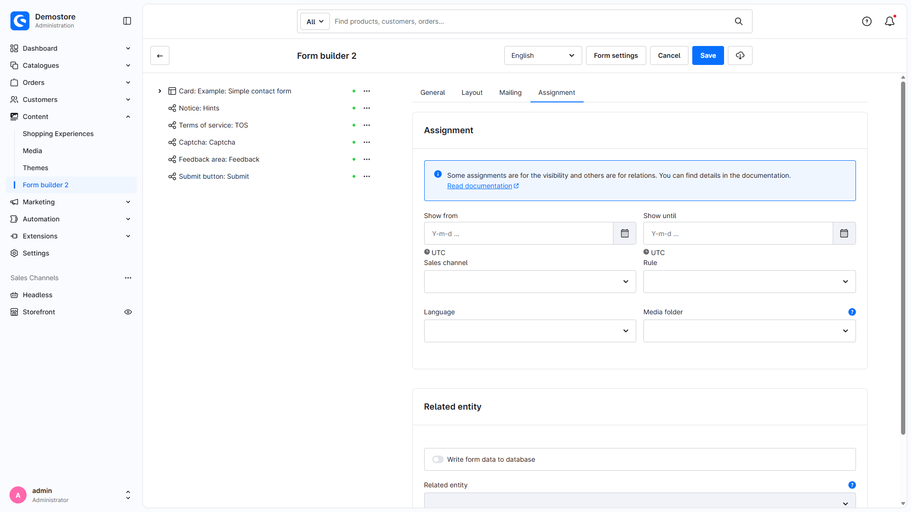
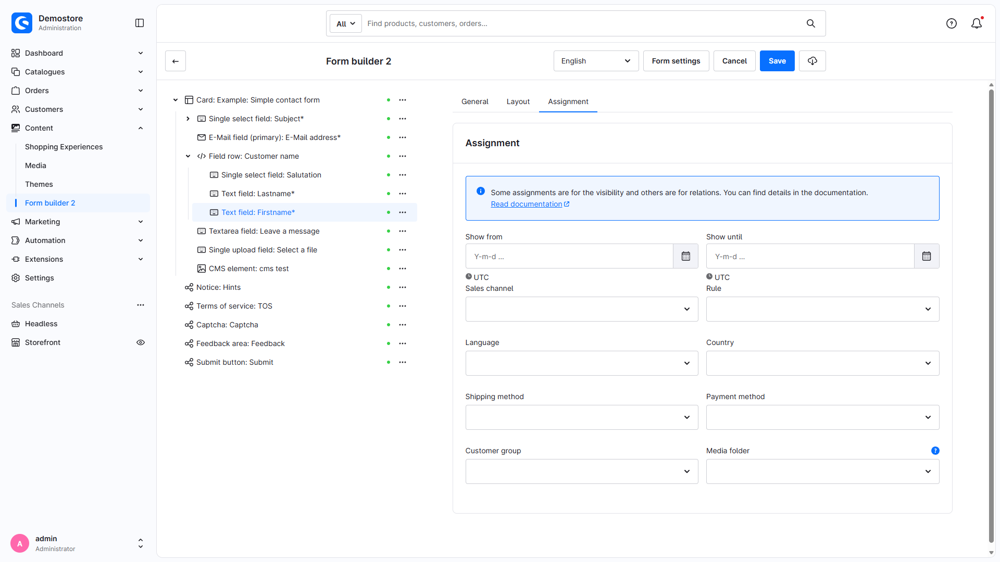
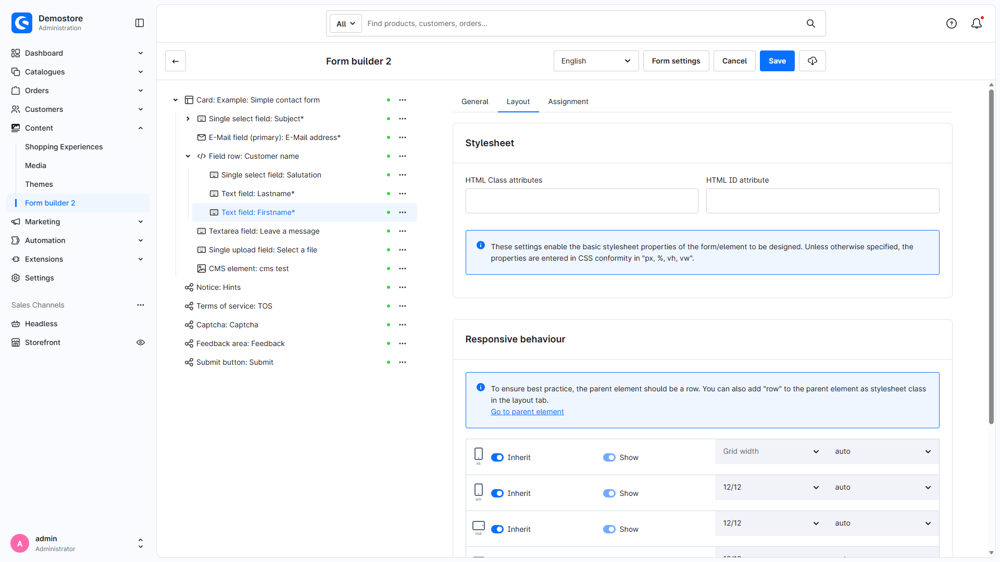
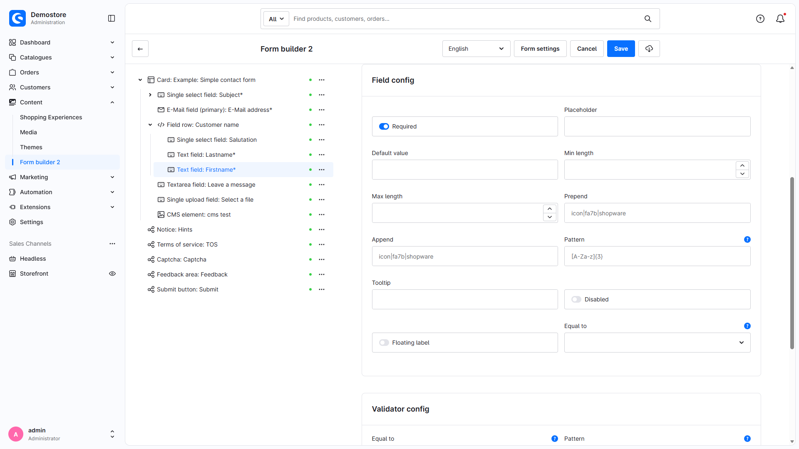

# Form Builder 2 | How-To

## Insert form into Twig template

**Basic version**

For theme developers and programmers, there is a special Twig snippet to integrate self-created forms directly into a template.

Simply use the snippet ````.

You can pass the technical name or the exact ID of the form as a parameter.

## Use SVG icons in input fields

**Basic version**

You can use SVG icons inside input fields. Foundation supplies the SVG assets. In the current Foundation version, older pack aliases are mapped to the bundled FontAwesome 7 assets.

Enter `icon|<pack>|<name>`.

- pack: Icon pack name, for example `fa7r`, `fa7s`, `fa7b`. Current Foundation maps legacy aliases `far`, `fas`, `fab`, `fa6r`, `fa6s`, `fa6b` to FontAwesome 7. Shopware icons are available in packs such as `default`.
- name: Name of the icon

To determine the appropriate name, go to the following pages:

- FontAwesome 5: [https://fontawesome.com/v5/search](https://fontawesome.com/v5/search)
- FontAwesome 6: [https://fontawesome.com/v6/search](https://fontawesome.com/v6/search)
- FontAwesome 7: [https://fontawesome.com/v7/search](https://fontawesome.com/v7/search)
- Shopware: [https://developer.shopware.com/resources/meteor-icon-kit/](https://developer.shopware.com/resources/meteor-icon-kit/)

## Fill database with forms

**Basic version**

You can write your own database entries in Shopware 6 with the help of the Form Builder 2.

Useful features are available for this purpose. To do this, go to the "Assignment" tab in the form settings and select a table.



Then you can assign an input field to a table column.



Please make sure that you mark mandatory fields accordingly.

Also enable database writing and map inputs to actual target attributes. The base supports existing DAL entities and custom fields; it does not create arbitrary SQL tables. All other mandatory target attributes must also be valid. Standalone submissions attempt the write before the success event; errors are logged and reported as processing warnings. Add-ons creating customers/orders have their own storage lifecycle. See [Processing results](https://docs.moori.net/en/plugin/MoorlForms/processing-results/).

You can find an example form here: [Entity mapping form](examples/entity-mapping-form.json)

## Individualise send button

**Basic version**

You can give the send button its own stylesheet classes.

To do this, go to the "Stylesheet" tab and insert the desired classes accordingly.



## Use Twig and context variables as default value

**Basic version**

If the customer wants to make a product enquiry, for example, it makes things a little easier if the product number is already filled in on the form. It is much better if a customer who is already logged in does not have to fill in their personal data again in the form.

To do this, you can simply insert a Twig variable in the "Default value" field.

You could use the following example variables
```html
{{ context.customer.email }}
{{ page.product.productNumber }}
```



!!! note

    The normal `field.html.twig` input template marks default values containing `context` for asynchronous loading. The endpoint returns these values for logged-in customers. This does not apply to every element type: hidden fields render Twig synchronously, and textareas currently do not inherit the asynchronous input marker. Check customer-specific defaults with the actual field type and an active HTTP cache; other Twig values may become part of the cached page.

## Product requests only for products that are not in stock

**Product Request Add-On**

With the Product Request Add-On you can assign matching forms using the dynamic product group.

Create a new dynamic product group with the rule `stock is less than 1`.

Deactivate the "Add to cart" button, your customer can now alternatively request the product.

This setting changes storefront presentation. It does not establish a general server-side purchase restriction for other cart/API calls. Also check the Product Request add-on's `keepProductUntouched` setting.

In the form settings you make an assignment for the dynamic product group.

## Write custom fields for newsletter subscriptions

**Classic Add-On**

With the element "Nested fields" you can use structured input fields. With this you can also write custom fields for newsletter registration, among other things.

The `nested-fields` element already belongs to the base plugin. Classic adds the newsletter workflow and its `subscribe-newsletter` action.

In Shopware itself, structured input fields can also be found in the addresses for customer registration.

Use the element "Nested Fields" and use the technical name `customFields`. There you create further input elements.

The generated inputs use structured names such as `customFields[myField]`.

If the data was entered validly, the column `custom_fields` is filled with the correct data.

!!! note

    This function only supports input of type `string` and `boolean`.
