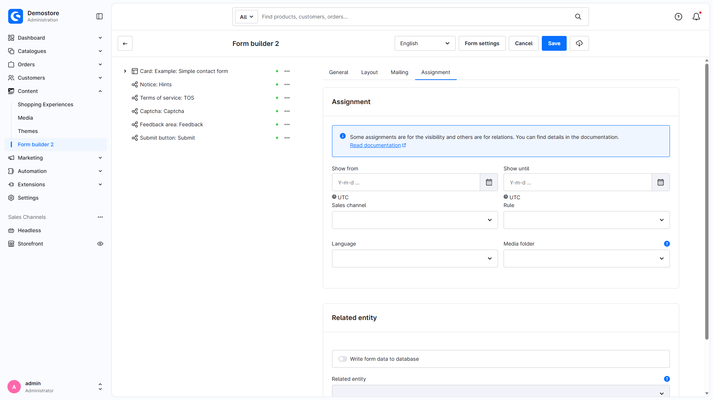
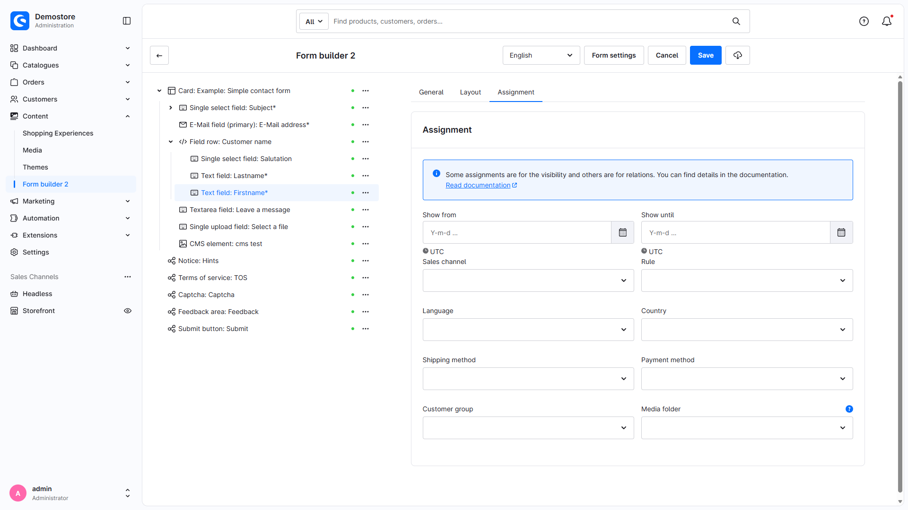
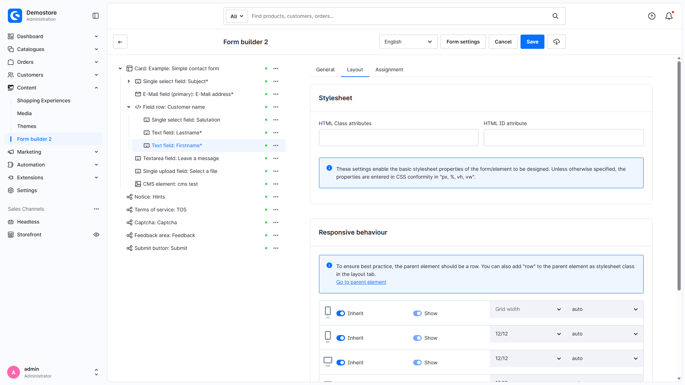
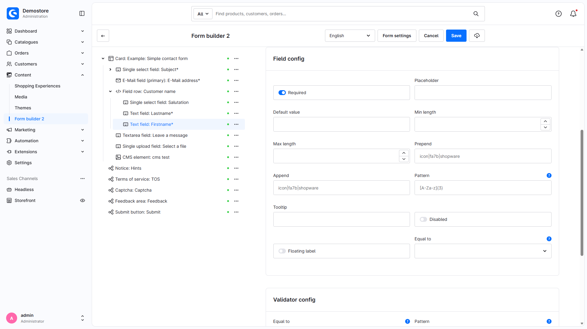

# Formular Baukasten 2 | Anleitungen

## Formular in Twig Template einbauen

**Basis Version**

Für Theme-Entwickler und Programmierer gibt es ein spezielles Twig-Snippet, um selbst erstellte Formulare direkt in ein Template einzubinden.

Nutze dazu das einfach das Snippet ````.

Du kannst den technischen Namen oder die exakte ID des Formulars als Parameter übergeben.

## In Eingabefeldern SVG Icons nutzen

**Basis Version**

Du kannst SVG Icons innerhalb der Eingabefelder nutzen. Das Foundation-Plugin liefert die dafür verwendeten SVG-Assets. Die ältere Packschreibweise wird im aktuellen Foundation auf die mitgelieferten FontAwesome-7-Assets abgebildet.

Gib dazu `icon|<pack>|<name>` ein.

- pack: Name des Icon-Pakets, z. B. `fa7r`, `fa7s`, `fa7b`; ältere Aliase `far`, `fas`, `fab`, `fa6r`, `fa6s`, `fa6b` werden im aktuellen Foundation auf FontAwesome 7 abgebildet. Für Shopware-Icons ist etwa `default` verfügbar.
- name: Name des Icons

Um den passenden Namen zu ermitteln, gehe dazu auf folgende Seiten:

- FontAwesome 5: [https://fontawesome.com/v5/search](https://fontawesome.com/v5/search)
- FontAwesome 6: [https://fontawesome.com/v6/search](https://fontawesome.com/v6/search)
- FontAwesome 7: [https://fontawesome.com/v7/search](https://fontawesome.com/v7/search)
- Shopware: [https://developer.shopware.com/resources/meteor-icon-kit/](https://developer.shopware.com/resources/meteor-icon-kit/)

## Datenbank mit Formularen befüllen

**Basis Version**

Du kannst mithilfe des Formular Baukasten 2 selbst Datenbank-Einträge in Shopware 6 schreiben.

Dazu stehen dir nützliche Features zur Verfügung. Gehe dazu in den Formular-Einstellungen in den Reiter "Zuweisung" und wähle eine Tabelle aus.



Anschließend kannst du ein Eingabefeld zu einer Tabellenspalte zuweisen.



Bitte achte darauf, dass du Pflichtfelder entsprechend kennzeichnest.

Aktiviere außerdem „In Datenbank schreiben“ und ordne die Eingabefelder den tatsächlichen Zielattributen zu. Die Basis unterstützt vorhandene DAL-Entities und Custom Fields; sie erzeugt keine beliebigen SQL-Tabellen. Weitere Pflichtattribute der Ziel-Entity müssen ebenfalls erfüllt sein. Bei eigenständig abgesendeten Formularen erfolgt der Schreibversuch vor dem Erfolgsereignis; Fehler werden geloggt und als Verarbeitungswarnung gemeldet. Add-ons mit eigener Kunden-/Bestellerstellung besitzen einen gesonderten Speicherablauf. Siehe [Verarbeitungsergebnisse](https://docs.moori.net/plugin/MoorlForms/processing-results/).

Du findest hier ein Beispiel-Formular: [Entity Mapping Formular](examples/entity-mapping-form.json)

## Absende-Button individualisieren

**Basis Version**

Du kannst dem Absende-Button eigene Stylesheet-Klassen geben.

Gehe dazu in den Reiter "Stylesheet" und füge entsprechend die gewünschten Klassen ein.



## Twig und Kontext Variablen als Standardwert verwenden

**Basis Version**

Wenn der Kunde zum Beispiel eine Produktanfrage stellen möchte, erleichtert es ein wenig Arbeit, wenn die Produktnummer im Formular bereits ausgefüllt ist. Viel besser ist es, wenn ein bereits eingeloggter Kunde seine persönlichen Daten nicht erneut im Formular ausfüllen muss.

Dazu kannst du im Feld "Standardwert" einfach eine Twig-Variable einfügen.

Folgende Beispiel Variablen könntest du verwenden
```html
{{ context.customer.email }}
{{ page.product.productNumber }}
```



!!! note

    Das normale Inputtemplate `field.html.twig` markiert Standardwerte mit `context` für asynchrones Nachladen. Der zugehörige Endpunkt liefert diese Werte bei angemeldeten Kunden. Dieser Pfad gilt nicht pauschal für jeden Elementtyp: Versteckte Felder rendern Twig synchron, und Textbereiche übernehmen den asynchronen Inputmarker derzeit nicht. Kundenspezifische Vorgaben deshalb am tatsächlich verwendeten Feldtyp und mit aktivem HTTP-Cache prüfen; andere Twigwerte können Teil der zwischengespeicherten Seite sein.

## Produkt Anfragen nur für Produkte, die nicht lagernd sind

**Produkt-Anfrage Add-On**

Mit dem Produkt-Anfrage Add-On kannst du mithilfe der dynamischen Produktgruppe passende Formulare zuweisen.

Lege eine neue dynamische Produktgruppe mit der Regel `Lagerbestand ist kleiner als 1` an.

Deaktiviere den "In den Warenkorb" Button, dein Kunde kann nun Alternativ das Produkt anfragen.

Diese Einstellung ändert die Storefront-Darstellung. Sie stellt keine allgemeine serverseitige Kaufsperre für andere Warenkorb-/API-Aufrufe dar. Beachte außerdem die Einstellung `keepProductUntouched` des Produkt-Anfrage-Add-ons.

In den Formular-Einstellungen machst du eine Zuweisung für die dynamische Produktgruppe.

## Custom-Felder für Newsletter-Anmeldungen schreiben

**Classic Add-On**

Mit dem Element "Verschachtelte Felder" lassen sich strukturierte Eingabefelder nutzen. Damit kannst du unter anderem auch Custom-Felder für die Newsletter-Anmeldung schreiben.

Das Strukturelement `nested-fields` gehört bereits zur Basis. Der Newsletter-Ablauf einschließlich der Aktion `subscribe-newsletter` wird durch Classic ergänzt.

In Shopware selbst kommen strukturierte Eingabefelder unter anderem auch in den Adressen der Kunden-Registrierung vor.

Verwende das Element "Verschachtelte Felder" und nutze den technischen Namen `customFields`. Darin erstellst du weitere Eingabe-Elemente.

Die erzeugten Eingabefelder verwenden strukturierte Namen wie `customFields[meinFeld]`.

Sofern die Daten valide eingegeben wurden, ist die Spalte `custom_fields` mit den richtigen Daten befüllt.

!!! note

    Diese Funktion unterstüzt ausschließlich Eingaben vom typ `string` und `boolean`.
