# Form builder 2 | Base version

The Form Builder makes it child's play to create complex forms with independent task areas. It has a modular structure and can be used flexibly for any cases.

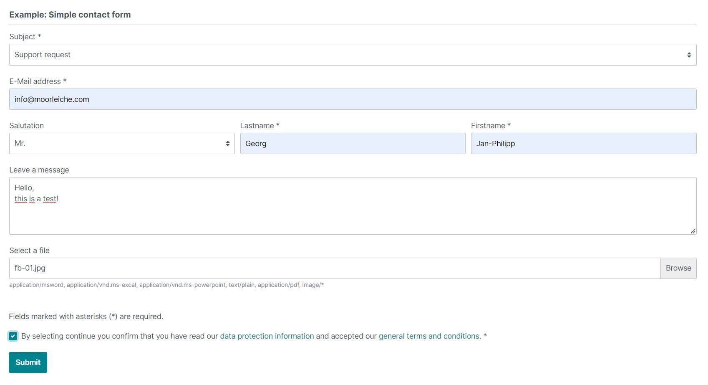

---

## Purchase the Plugin

This plugin can be purchased in the **Shopware Community Store**.

- [Shopware Community Store](https://store.shopware.com/en/search?search=MoorlForms)

**Important note:** You need the Foundation Plugin, which is available free of charge: [moori Foundation](../MoorlFoundation/index.md)

---

## Custom forms for Shopware 6

- You want to create your own forms in Shopware?
- You don't have a Shopware Professional subscription, but don't want to do without this essential feature?
- The possibilities of the Shopware Professional form builder are not enough?
- You build complex forms and are looking for a good basis for your individual adjustments?

If you can answer one of these questions with "yes", then you are definitely on the right track!

## Example forms for download

- [Simple contact form](examples/simple-contact-form.json)
- [Entity mapping form](examples/entity-mapping-form.json)
- [Responsive form](examples/responsive-form.json)
- [All features](examples/all-features.json)

Further examples can be found in the respective documentation of the add-ons!

## Add-Ons

This plugin has been shortened in its basic version by some functions, so that it can be offered at an affordable price.
affordable price. All further functions can be obtained.

The complete [feature overview](all-features.en.md) covers the base plugin and all add-ons. The [audit report](plugin-audit.md) distinguishes source findings from verified administration views. Each plugin directory contains a `CODEX.md` documenting its extension contracts and limits.

1. [Classic Add-On](../MoorlFormsClassic/index.en.md): Conditions, repeaters, additional fields, submission history, printing and additional actions
2. [Exit-Intent-Popups Add-On](../MoorlFormsPopup/index.md): Use forms as popup
3. [Slides Add-On](../MoorlFormsSlides/index.md): Use slides
4. [Customer-Forms Add-On](../MoorlFormsCustomer/index.md): Customised forms for registration and customer area
5. [Product-Configurator Add-On](../MoorlFormsCustomProducts/index.md): Additional information on products incl. price calculation
6. [Order Add-On](../MoorlFormsOrder/index.en.md): Additional checkout inputs, optional checkout lock and storage on the order
7. [Product-Request Add-On](../MoorlFormsProduct/index.md): Product-specific enquiry forms
8. [CSV Add-On](../MoorlFormsCsv/index.en.md): Write mapped form inputs to CSV files
9. [Hubspot Add-On](../MoorlFormsHubspot/index.en.md): Send data using a configured HubSpot integration
10. [Mautic Add-On](../MoorlFormsMautic/index.en.md): Mautic form/contact integration
11. [Webhook Add-On](../MoorlFormsWebhook/index.en.md): Configurable HTTP requests with form data
12. Custom add-ons on request

(\* In development, \*\* In concept phase)

## Example Add-On for developers

[Example Add-On](https://github.com/moorl/MoorlFormsExample). Its local version contains outdated method signatures and must be adapted to the current base interfaces before activation. See its `CODEX.md` and the [feature overview](all-features.en.md).

## What is this plugin good for?

The Shopware 6 _Form Builder 2_ plugin makes it child's play to create complex forms with independent
task areas.

It is modular, so processes and individual fields can be expanded as desired.

## Installation

!!! note

    If you have any problems with the plugin, please note the following [notes](../) in the FAQ section.

1. install
   [Foundation](../MoorlFoundation/index.md)
2. install Form Builder 2 in the Plugin Manager
3. go to: Contents | Form Builder 2

Here you can create or import a new form.

## Settings

Current [Full HD administration screenshots](admin-screenshots.en.md) were captured on 10 November 2026 (English UI). Remaining JPGs illustrate earlier versions. The receipt-confirmation image shows a temporary, unsaved action selection; see the gallery for capture conditions.

### Basic configuration

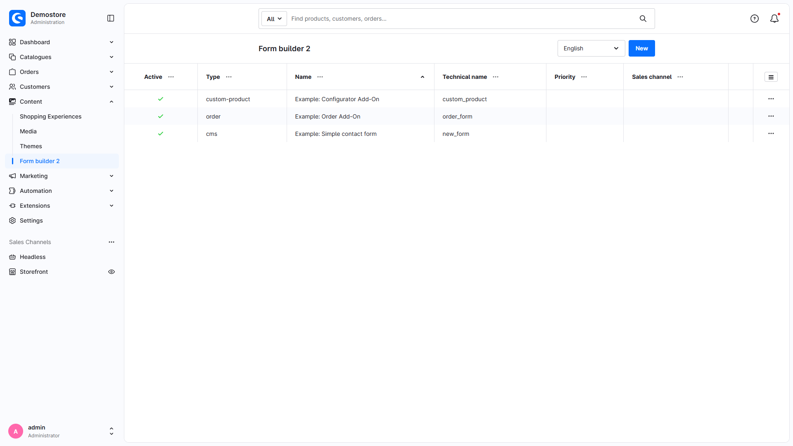

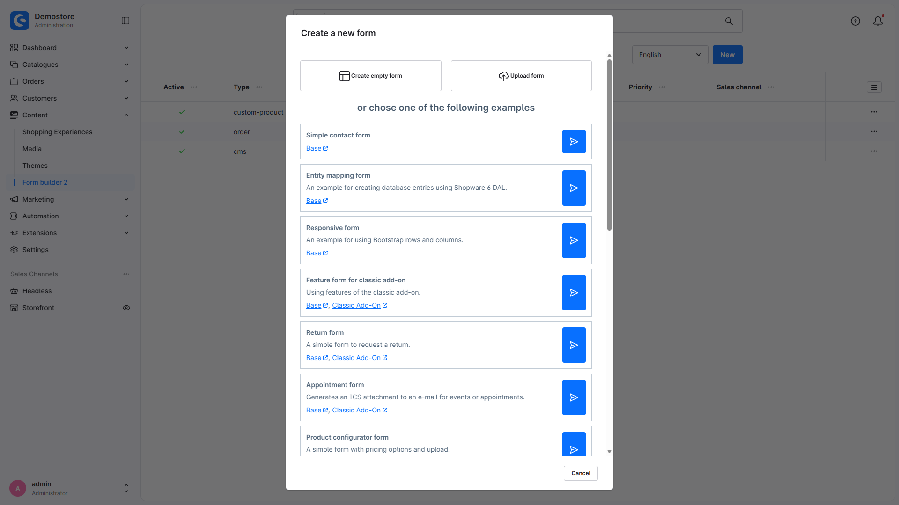

1. create new form
2. import

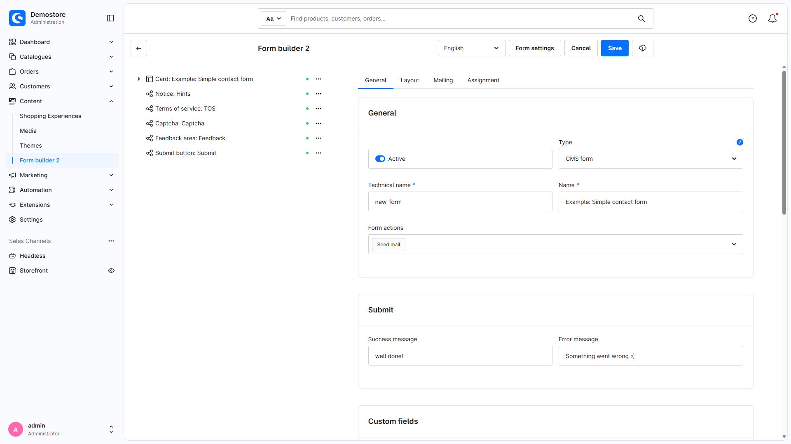

1. form settings
2. save form
3. export
4. structure area of the form elements
5. settings area (form/element)

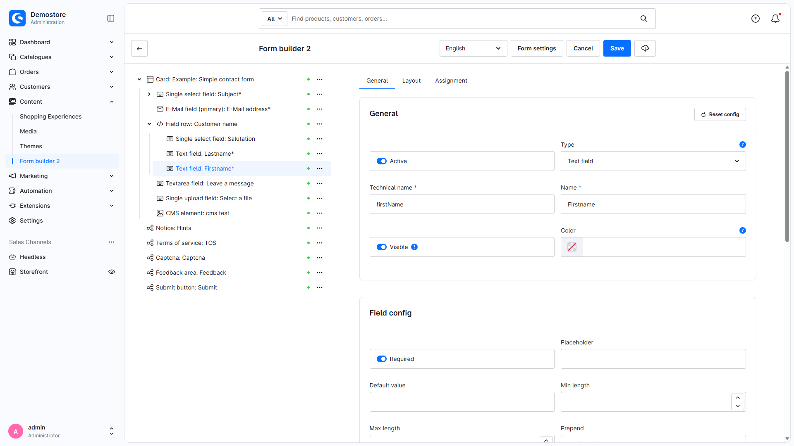

1. context menu for creating, deleting or duplicating elements
2. general element settings

### Settings in detail

#### Assignments of elements and forms

You can generally configure the visibility of forms and elements here.

Show a form/element...

- show only in a certain period of time
- only display in a certain sales channel
- show only for a selected delivery country
- show only for a selected shipping method or payment method
- Display only for a selected customer group

A product-specific form...

- can be assigned to a product stream

An element of the group Sections...

- can be assigned to a background image here

Some of these assignments are only available in the Form Builder 2 Add-Ons!

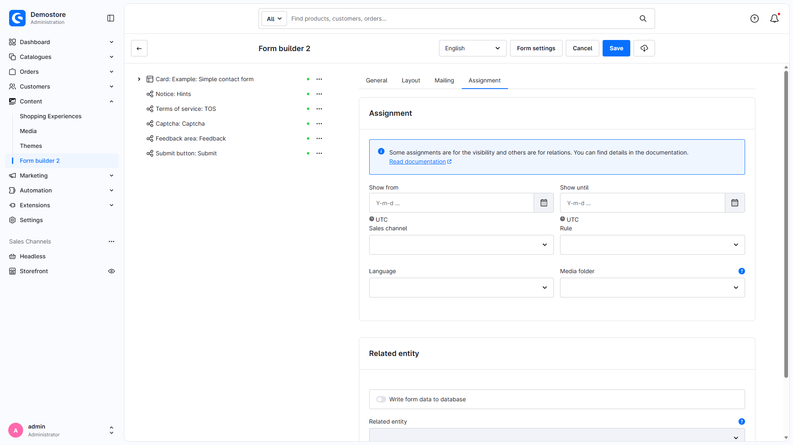

#### Layout and stylesheet settings

You can assign stylesheet attributes to each form/element.

The CSS options vary depending on the type of form/element.

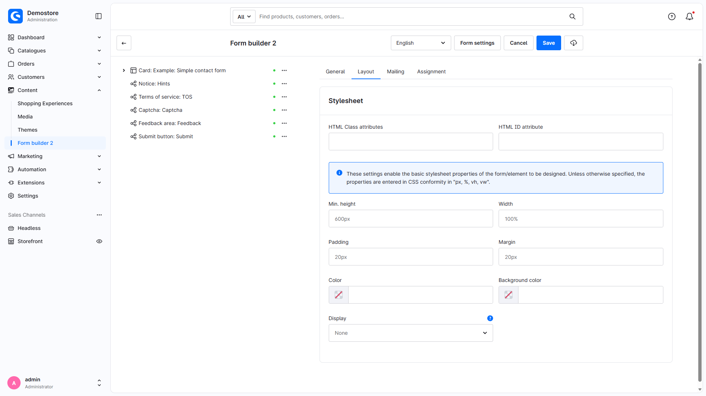

### Settings for elements

#### Field configuration

All elements from the Field and Multi-Field group can have additional properties in this configuration.

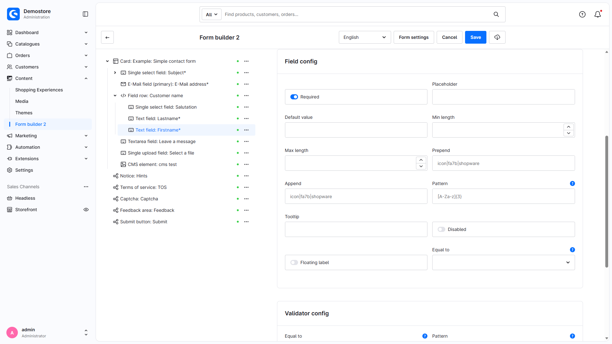

#### Selection Configuration

All elements from the Multi-Field group can receive database-specific values. Add-ons offer more possibilities here.

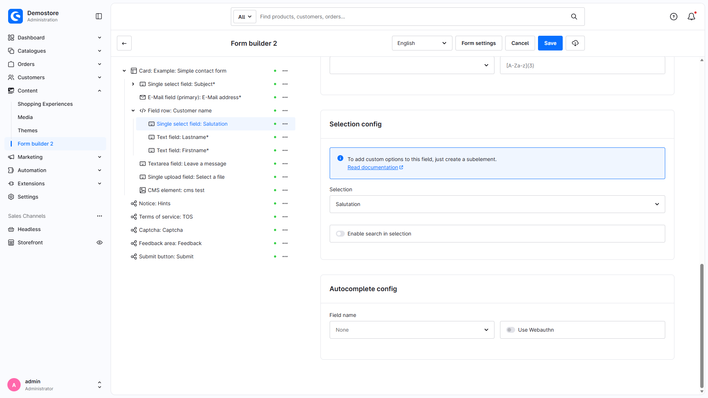

#### Responsive behaviour

If the parent element is from the Rows group, all elements contained in it can be given responsive properties.
The rule "Mobile-First" applies here, the properties are always passed on.

The distribution is as follows.

Viewport (xs to xxl) | Inherited (Yes/No) | Display (Yes/No) | Width | Sorting/Arrangement

#### Configuration Upload Field

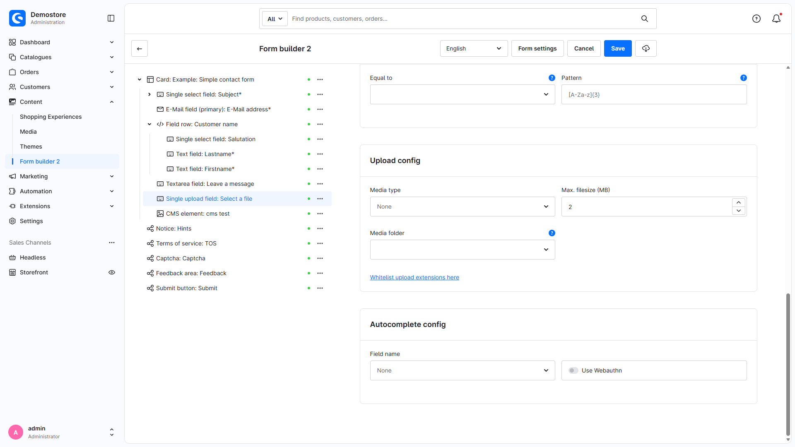

#### Configuration Date

#### Configuration Time

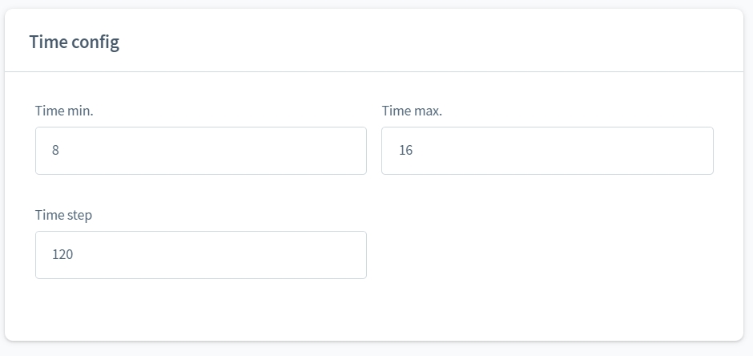

#### Configuration number

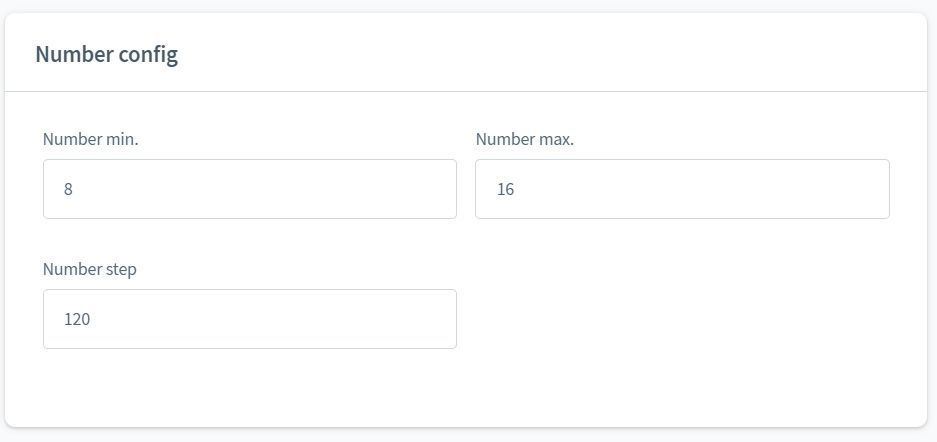

#### Configuration HTML (language related)

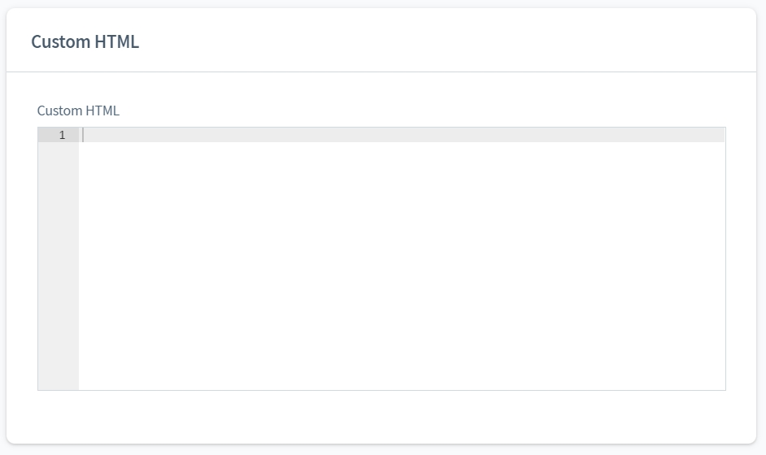

#### Configuration Card Section

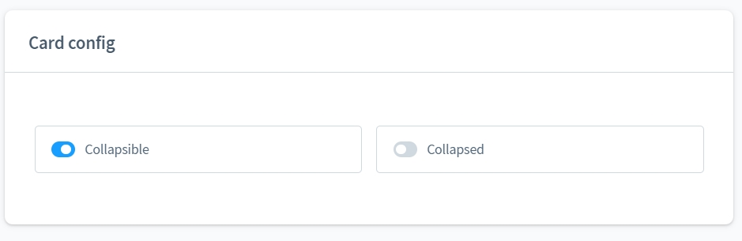

### Settings for forms

#### Configuration e-mail

Here you can configure the e-mail recipient. If no value is entered, the shop's standard e-mail address will be used.
of the shop is used.

The base plugin already provides `receipt-confirmation` for an acknowledgement and resolves recipients from form settings, translations, suitable selected options or entity context. Classic adds a full mail copy with its own template and optional customer checkbox. An acknowledgement and a full copy are different features.

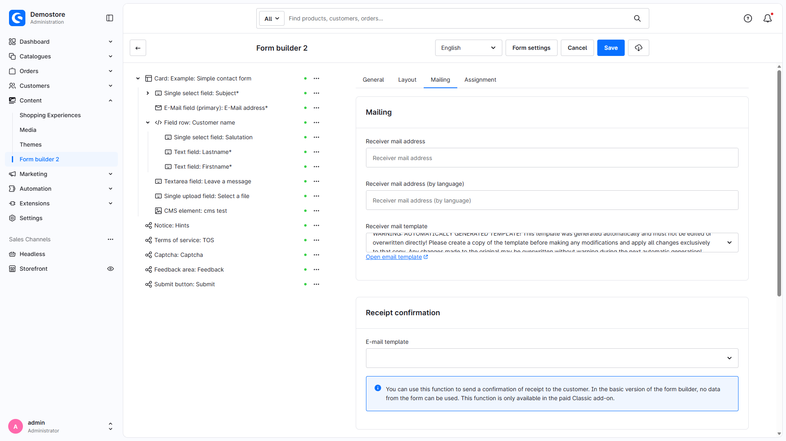

## CMS settings

The form does not have its own block, but can be accessed via the "Replace element" icon!

After the CMS element has been inserted, you can assign forms of type CMS or Test to the CMS page.

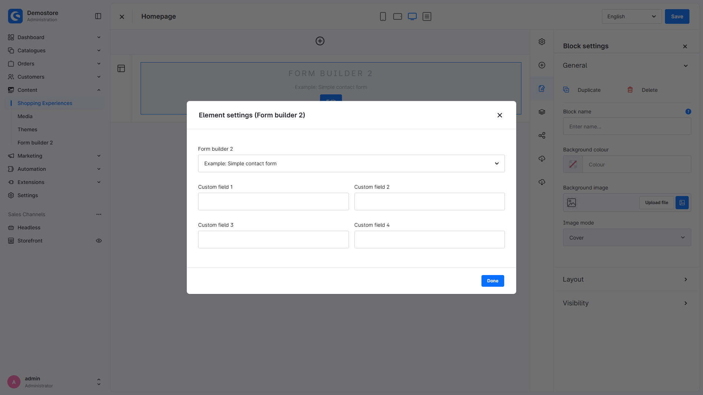

## Output in the storefront

### Form validation

The example form is of type "Test" the client-side validation is deactivated.
The Form Builder 2 supports recursive server-side validation of the input fields!

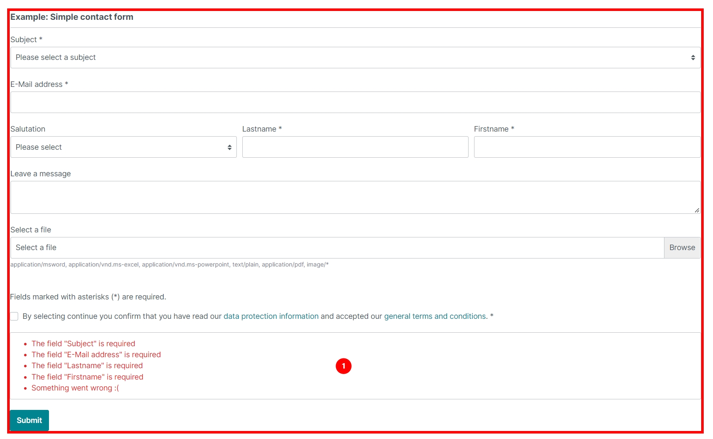

The client-side validation is active again. Now the form is validated twice.

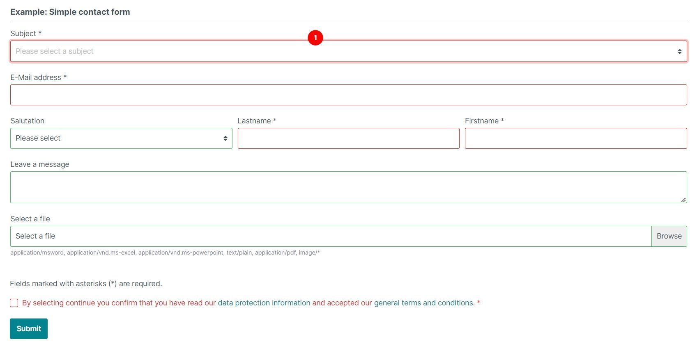

### Sending an e-mail

In this example I show you how the e-mail is sent in the standard.

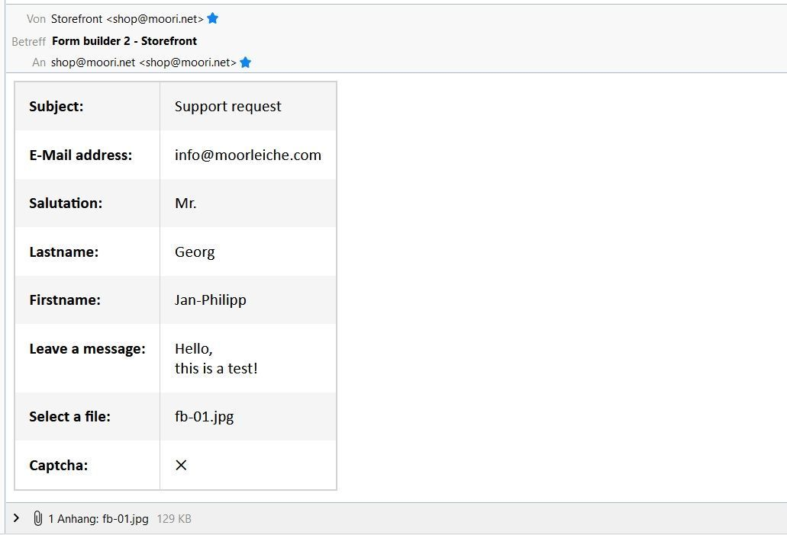

## Security

- The formatted HTML summary escapes input values. Custom HTML/Twig and integrations still require configuration appropriate to their use; not every browser constraint has a corresponding server-side domain validator. See the [feature overview](all-features.en.md).
