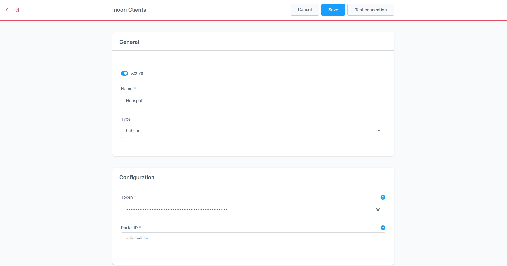
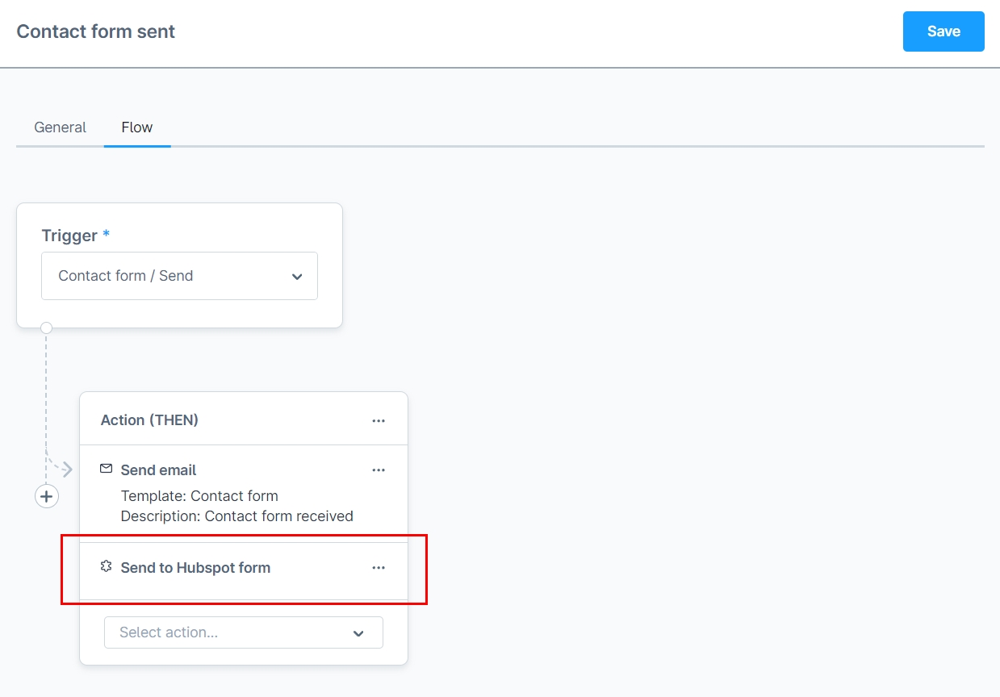
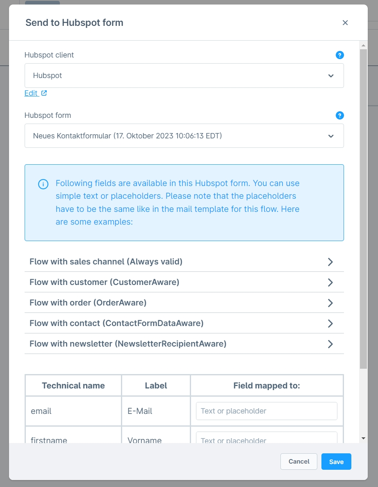
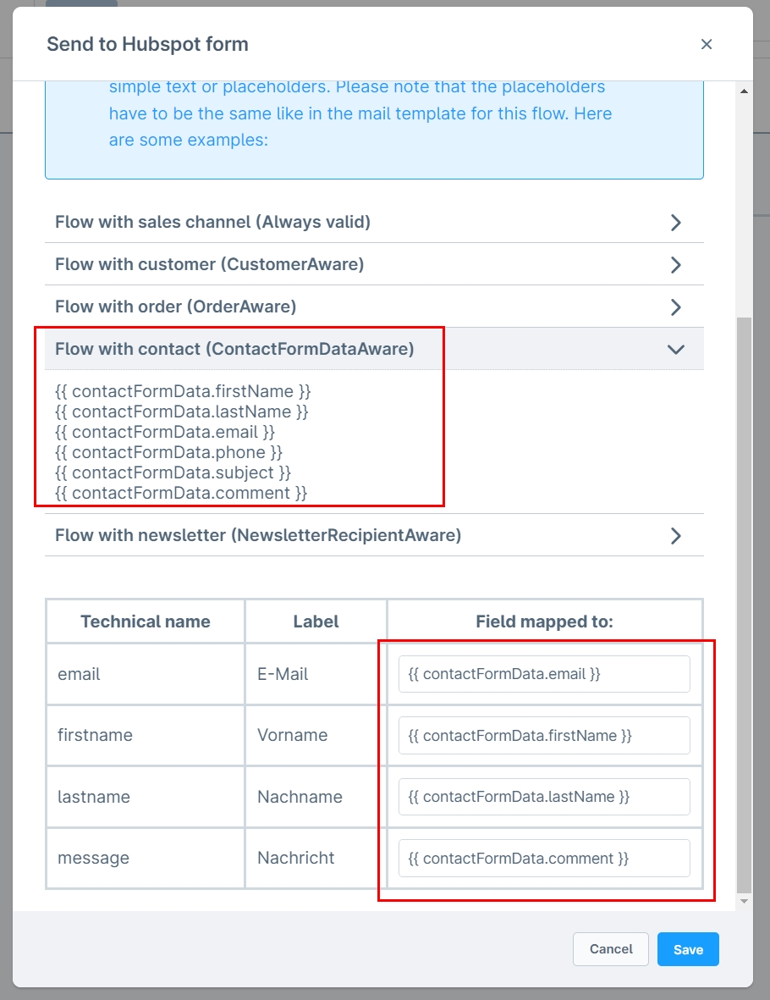
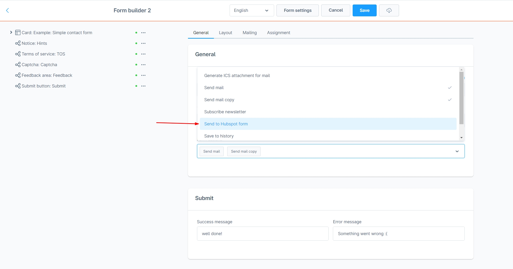
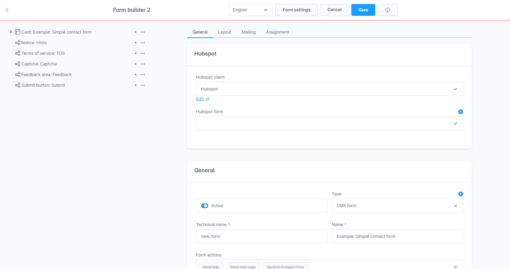
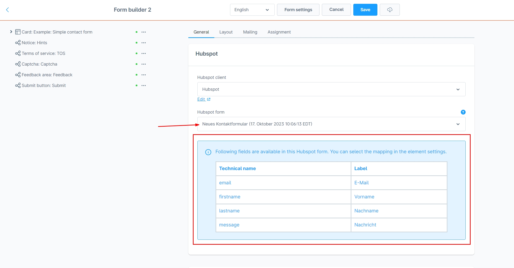
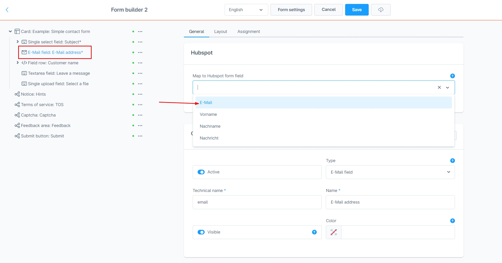
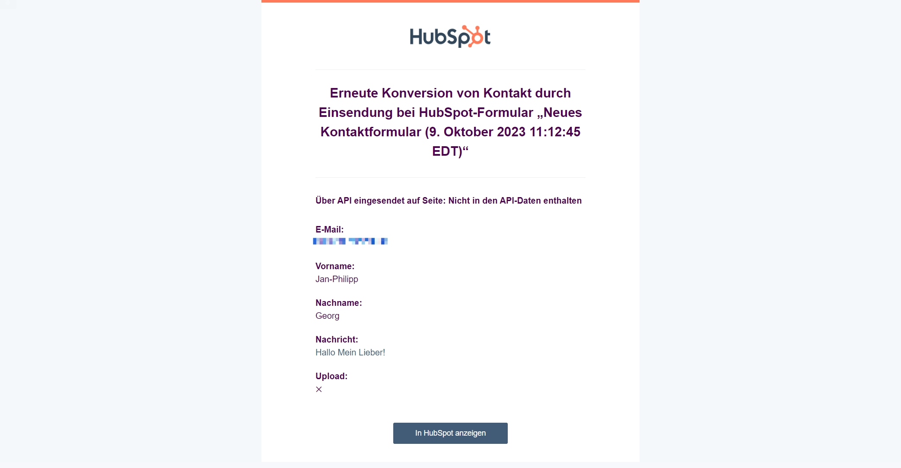

# Flow Builder Aktion | Hubspot Formular

Diese Erweiterung ist mit [Formular Baukasten 2](../MoorlForms/index.md) kompatibel

## Installation

!!! note

      Falls du Probleme mit dem Plugin hast, bitte beachte folgende [Hinweise](../) im FAQ Bereich.

1. Installiere
   [Foundation](../MoorlFoundation/index.md)
2. Installiere Hubspot Formulare Integration im Plugin Manager

## Einrichtung

Diese Erweiterung übermittelt zugeordnete Werte an ein vorhandenes HubSpot-Formular. Welche Kontakte, Benachrichtigungen oder weiteren Abläufe daraus entstehen, bestimmt dessen Konfiguration in HubSpot. Eine eigene Ticket- oder Dateiuploadfunktion ist im Plugin nicht implementiert.

Die folgenden HubSpot-Menüangaben und Bilder sind historische Einrichtungsbeispiele; sie wurden nicht gegen eine aktuelle externe HubSpot-Oberfläche geprüft.

### Hubspot Account erstellen

Du kannst relativ einfach einen Hubspot Account erstellen. Nutze dazu z.B. deinen Google-Account und wähle einen kostenlosen Plan aus!

### Eine private Hubspot App erstellen

- Gehe dazu in "Profil & Einstellungen".
- In der linken Sidebar unter "Account-Setup" -> "Integration" -> "Private Apps" erstellst du eine neue App.
- Die App benötigt folgende Berechtigungen: forms-uploaded-files, forms, crm.objects.contacts.write, crm.objects.contacts.read
- Kopiere den Token und wechsle nun in den Shopware Admin

### Einen Hubspot client in Shopware anlegen

- Navigiere zu "Einstellungen" -> "Erweiterungen" -> "moori Clients"
- Erstelle einen neuen Client vom Typ „Hubspot“ (technisch `api-hubspot`)
- Gebe den Token deiner privaten Hubspot App ein
- Die Portal-ID findest du im Account-Menü von Hubspot unter deinem Benutzernamen
- Teste den Client

### Erstelle ein Formular in Hubspot

- Navigiere vom Hauptmenü in Hubspot zu "Marketing" -> "Formulare"
- Erstelle ein neues Formular vom Typ "Eingebettet", du kannst zum Testen die Vorlage für Kontaktformulare verwenden
- Speichere das Formular, ohne Änderungen durchzuführen

Mit diesem Formular werden bereits automatisch in Hubspot Kontakte angelegt, sobald es ausgefüllt und abgesendet wird.

### Hubspot Formular mit Flow-Builder verbinden

- Navigiere zum Flow-Builder und öffne z.B. "Kontaktformular wurde verschickt"
- Gehe in den Reiter "Flow"
- Füge die Aktion "An Hubspot-Formular senden" hinzu
- Wähle deinen Hubspot Client aus
- Wähle dein in Hubspot erstelltes Formular aus
- Erstelle die Datenzuordnungen, in unserem Beispiel kann man die Platzhalter für "Flow mit Kontakt" verwenden

Prüfe die Zuordnungen anhand der Daten des gewählten Flow-Ereignisses. Twig- und HTTP-Fehler werden von dieser Integration nicht abgefangen; die Verarbeitung kann fehlschlagen. Ein fehlendes oder vollständig leeres Mapping führt dagegen zu keinem Versand.

### Hubspot Formular mit Formular Baukasten 2 Formular verbinden

- Öffne dein Formular im Shopware Admin
- In den Formulareinstellungen wählst du bei „Formular Aktionen“ **An Hubspot-Formular senden** aus
- Öffne den Reiter **Hubspot** in den Formulareinstellungen
- Wähle deinen Hubspot Client aus
- Wähle dein in Hubspot erstelltes Formular aus
- Ordne die verfügbaren Zielfelder direkt in der zentralen Mappingtabelle zu
- Verwende Formularplatzhalter mit technischem Feldnamen und `.value`, z. B. `{{ email.value }}`
- Ordne weitere Felder wie Vorname, Nachname und Nachricht zu und speichere das Formular

Die aktuelle Implementierung verwendet keine einzelne Hubspot-Zuordnung in den Elementeinstellungen. Die älteren Bilder unten dienen nur als Beispiele.

## Technischer Umfang

Die Formularaktion heißt `hubspot-form`, die Flow-Aktion `action.send.hubspot` und benötigt `MailAware`. Beide verwenden `clientId`, `formId` und `mapping`; neue Formularzuordnungen beginnen mit `null`, `null` und `[]`. Die Zugangsdaten `token` und `portalId` liegen im Foundation-Client.

Die Formularliste wird über `/marketing/v3/forms/` gelesen. Gemappte Werte werden per Twig gerendert und an den sicheren HubSpot-Formular-Submission-Endpunkt gesendet. Flow-Platzhalter beziehen sich auf verfügbare Eventdaten, beispielsweise `{{ contactFormData.email }}`. Leere Mappingwerte werden ausgelassen, auch der reine Text `0` nach PHPs Leerprüfung.

Die Integration implementiert keine Dateiverarbeitung, eigene Kontakt-/Ticketverwaltung oder automatische Seitennachladung der Formularliste. Der Verbindungstest des Foundation-Clients liest Kontakte und prüft damit einen anderen API-Pfad als die Formularübermittlung. Im Service bleibt der erste erfolgreich initialisierte Client erhalten; mehrere unterschiedliche Clients in einem Service-Lebenszyklus erfordern eine gesonderte Prüfung.

Die beschriebenen Scope-Namen stammen aus der vorhandenen Einrichtungsdokumentation und dem Foundation-Client. Sie sind keine hier extern geprüfte Zusage über aktuell erforderliche HubSpot-Berechtigungen.

## Test

Prüfe nach einer bewusst durchgeführten Übermittlung im vorgesehenen Testkonto den Eingang und die Feldwerte des HubSpot-Formulars. Eine E-Mail entsteht nur bei entsprechenden Benachrichtigungen oder Automatisierungen in HubSpot; das Plugin garantiert sie nicht.

