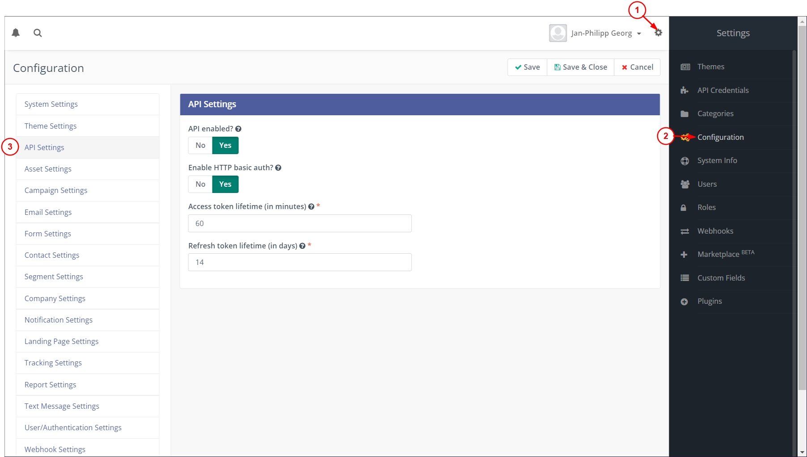
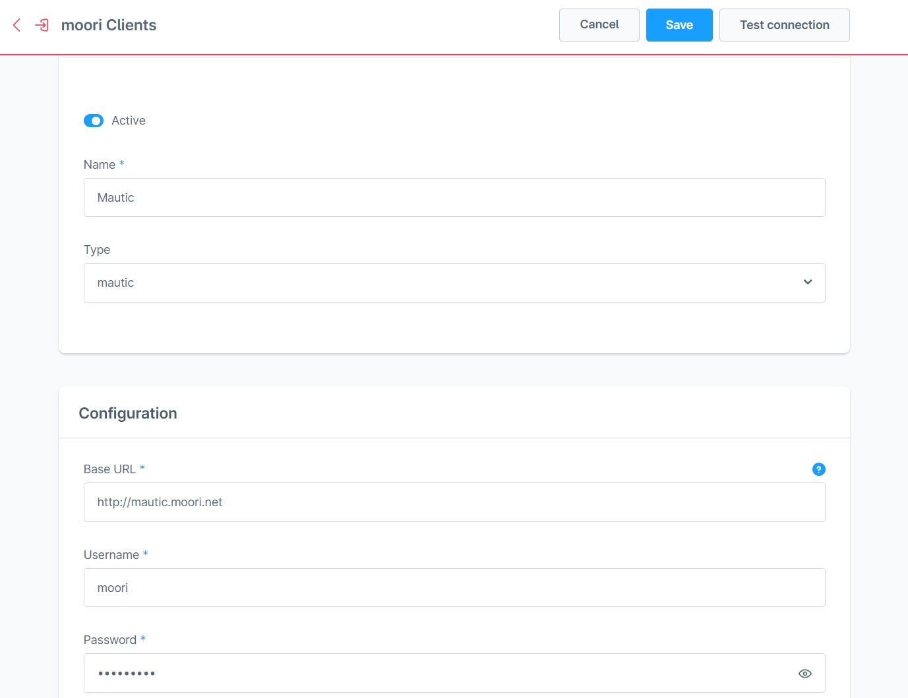
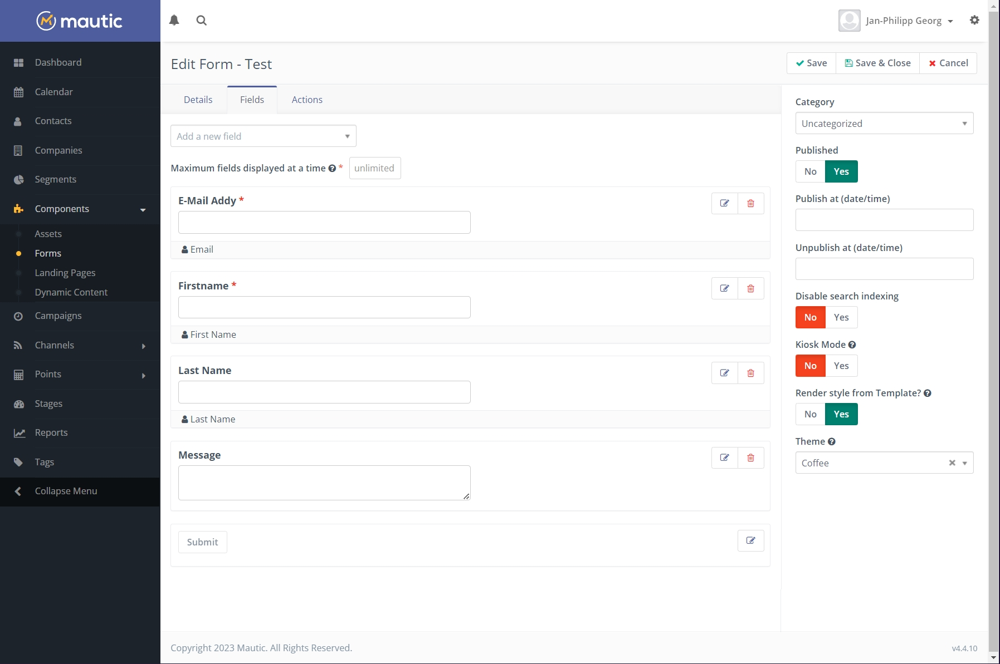
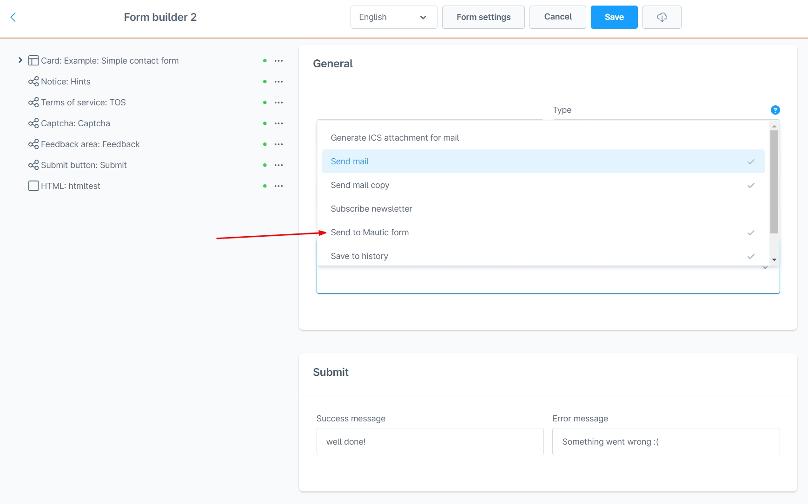
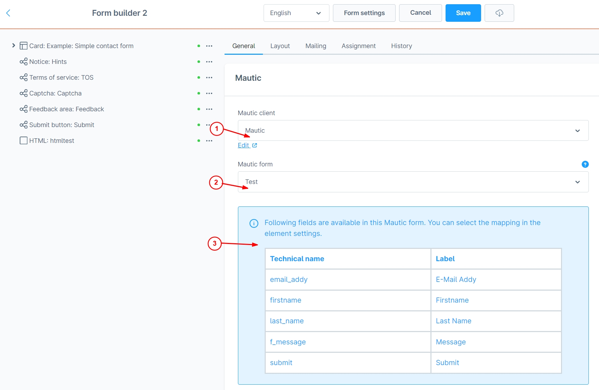
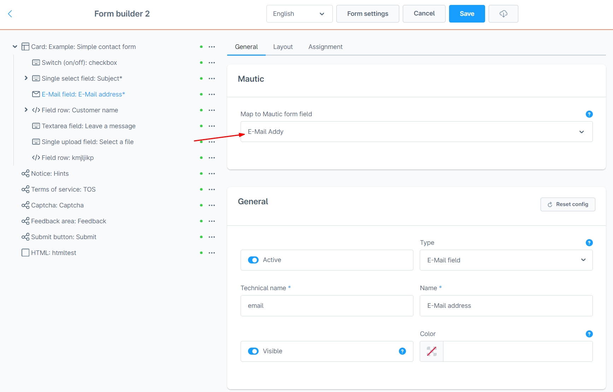
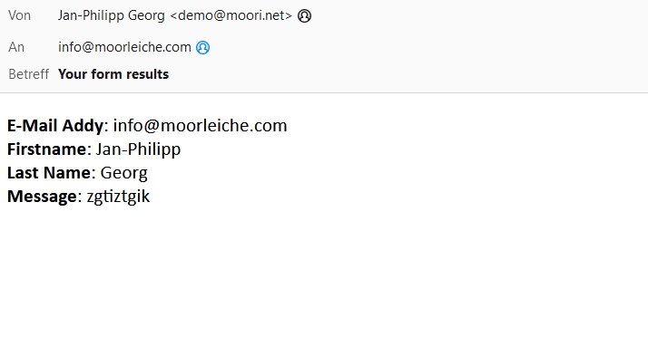

# Form Builder 2 | Mautic Add-On

This add-on submits mapped form or Flow data to an existing Mautic form. Foundation is required; the form integration also requires [Form Builder 2](../MoorlForms/index.md).

## What is Mautic?

Mautic is an open source marketing automation software. With Mautic, website visitors can be tracked and converted into identified contacts using forms.

## Setup

The external menus and images in these instructions come from Mautic version 4. They are historical examples and have not been checked against a current Mautic interface. An existing Mautic installation is required.

### Activate Mautic API

- Click on the cogwheel in the top right corner
- A navigation will open on the right side, click on "Configuration".
- Click on "API Settings" in the navigation on the left side
- Activate the API and "HTTP basic auth".

With this method you can connect to the API with your username and password. I recommend to create another admin for this case, which is only for the API.

### Create a Mautic client in Shopware

- Navigate to "Settings" -> "Extensions" -> "moori Clients".
- Create a new client of type “Mautic” (technical type `api-mautic`)
- Enter the URL, username and password, there must not be a "/" after the URL.
- Test the client

### Create a form in Mautic

- Navigate from the main menu in Mautic to "Components" -> "Forms".
- Create a new form of the type "Campaign Form"
- Enter the basic data and create the input fields
- e.g. e-mail, first name and last name
- For the input fields you can make an assignment in the tab "Contact Field", e.g. "Email".

The contact field assignments and actions of this Mautic form determine how incoming data is associated with contacts and which further processes run.

### Connect Mautic form with form builder 2 form

- Open your form in the Shopware Admin
- In the basic settings of the form, select the option "Send to Mautic form" under "Form Actions"
- Open the **Mautic** tab in the form settings
- Select your Mautic client
- Select the form you created in Mautic
- Assign the available target fields directly in the central mapping table
- Use technical form field names with `.value`, for example `{{ email.value }}`
- Assign further fields and save the form

The current implementation does not assign individual Mautic fields in the element settings. The older images below are examples.

## Connect Flow Builder

Open a Flow with a `MailAware` event and add **Send to Mautic form** (`action.send.mautic`). Select the client and Mautic form, then assign the target fields in the mapping table. Use the data available for the selected event, for example `{{ contactFormData.email }}` for the corresponding contact form event, and save the action.

## Authentication, mapping and limitations

The form action is `mautic-form`. Its `config.mautic` contains `clientId`, `formId`, `mapping`; new settings start with `null`, `null`, `[]`. The Foundation client contains `baseUrl`, `userName` and `password`.

The form list is read with **HTTP Basic Auth** through `{baseUrl}/api/`. The Foundation client's connection test reads contacts. Actual form submission instead uses `escopecz/mautic-form-submit` with the base URL, form ID and mapped data; the plugin does not pass the REST credentials to that submission call.

Target field names come from Mautic form aliases. Mapping values are rendered with Twig. Empty assignments are omitted, including plain text `0` under PHP's empty-value check. No submission occurs without a client ID, form ID or mapping. The integration does not catch Twig/submission errors and does not guarantee error-free or silent processing.

There is no plugin-level file transfer, campaign management or automatic pagination. The many classes under `src/Api` are API helpers, not separately registered Shopware features. The first successfully initialized client remains in the service; different clients in one service lifetime require separate verification.

## Test

After a deliberate submission to your designated test system, inspect the form results and mapped values in Mautic. Contact creation/updates and emails depend on its form actions and contact field assignments; an email after every submission is not guaranteed by the plugin.

