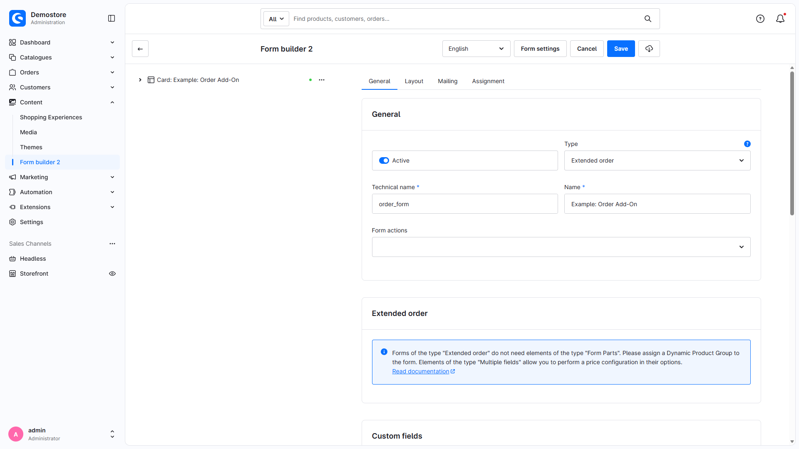
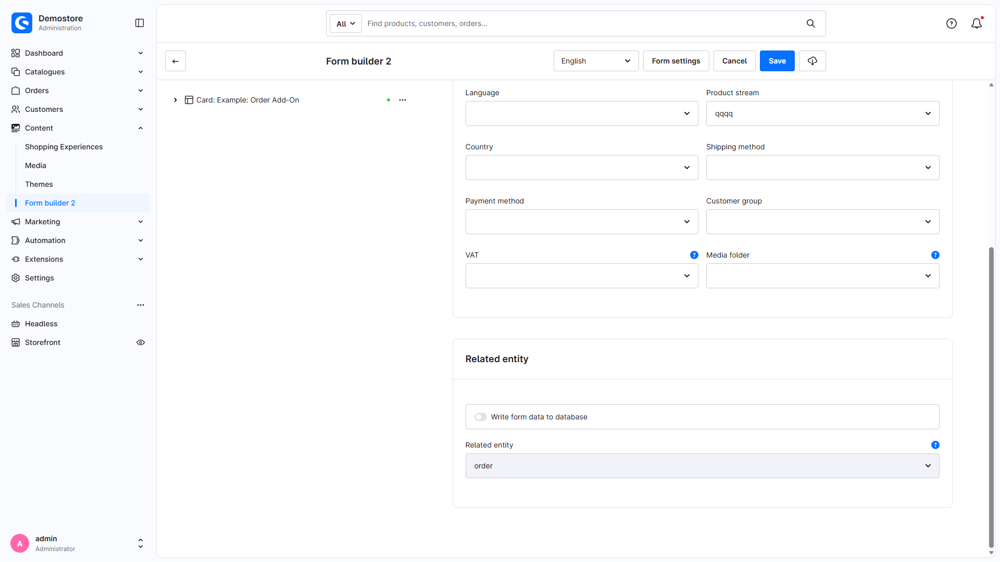
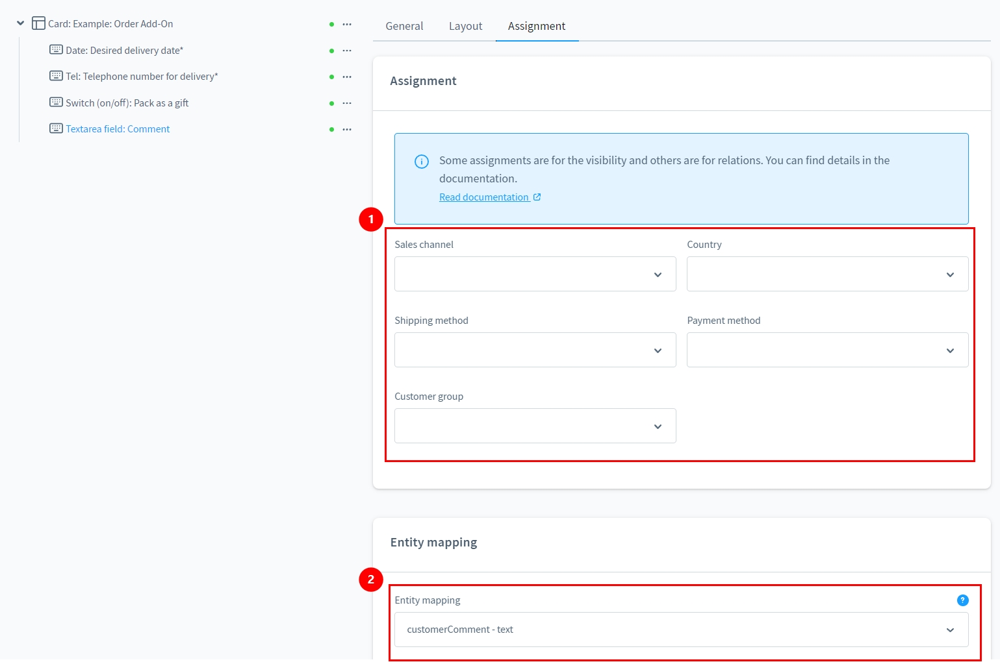
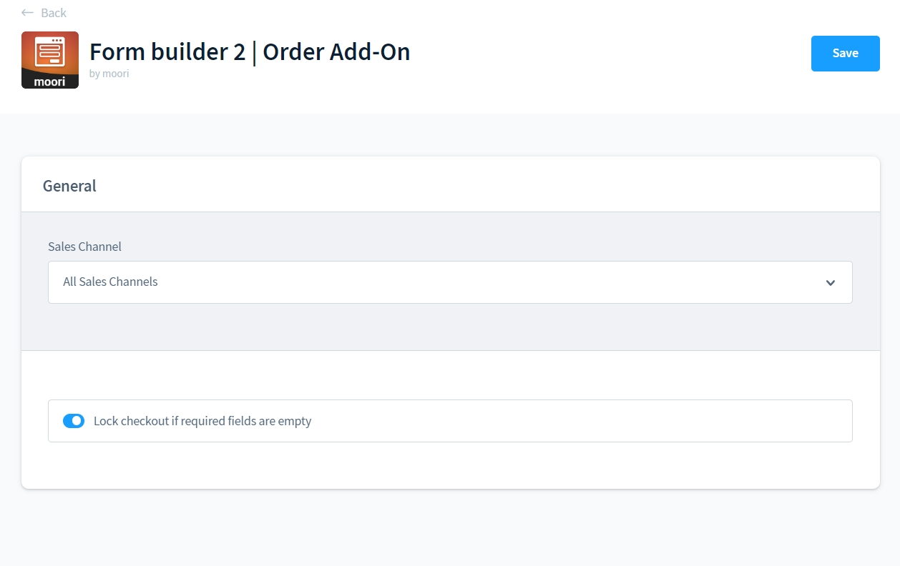
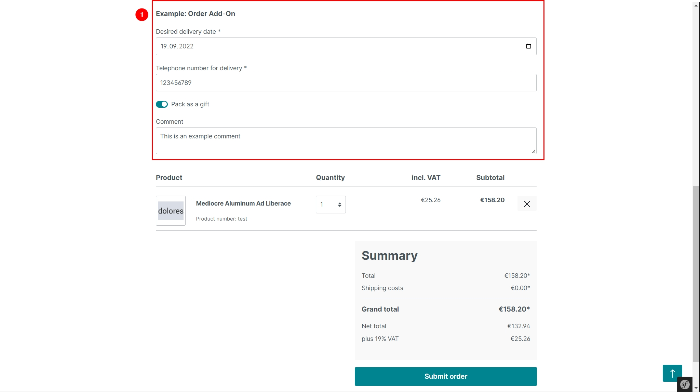
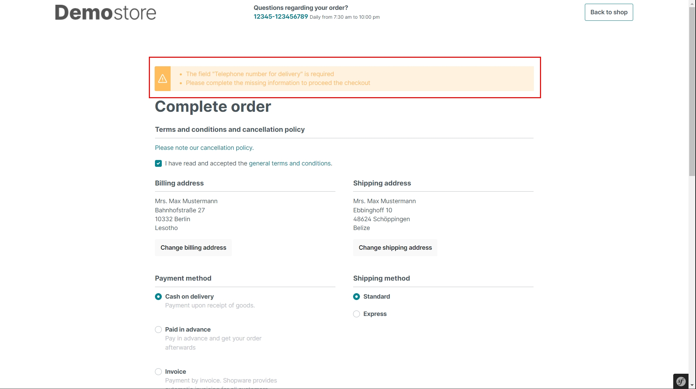
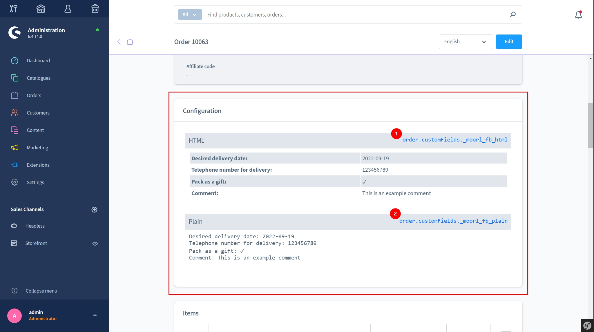
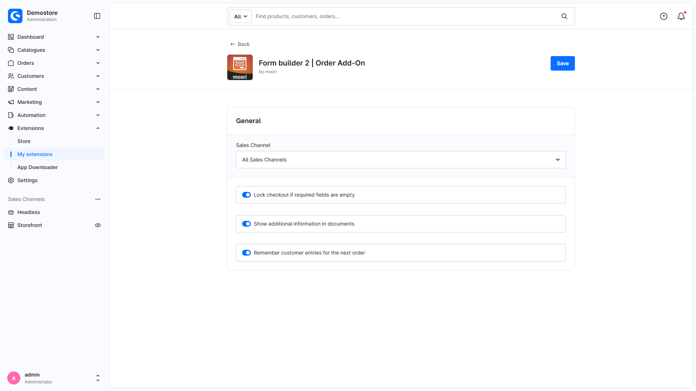

# Form Builder 2 | Order Add-On

With this add-on for [Form Builder 2](../MoorlForms/index.md), you can collect additional checkout information, optionally restrict it to certain products and save it to the order after checkout.

This description was checked against the local source of version 2.7.3 on 10 November 2026. New PNG captures show the current local administration; remaining JPGs illustrate earlier versions. Capture conditions and the registered plugin version are documented under “Current administration screenshots”. The plugin package requires Shopware `~6.7.8`, MoorlFoundation `~1.7.29` and MoorlForms `~2.7.0`.

## Example forms for download

- [Order Add-On](examples/order-add-on.json)

The example includes a delivery date, delivery contact phone number, comment and gift-wrapping switch. Check the product group and required mappings after importing. An actual import through the current interface was not performed for this documentation review.

## New form of type "Extended orders".

With this form you are much more equipped for B2B or personalised customers. You can enter any customer data in the checkout and process it further. You can completely determine when and which data is collected.

## Settings

Under **Content → Form builder 2**, create a new form of type “Extended order” (`order`). Its related entity is `order`. The add-on uses the base editor and has no separate administration navigation.

Optionally restrict the form through a dynamic product group. It then appears only when the cart contains a matching product. Without a product-group assignment, it is considered a general checkout form, provided its other availability conditions are met.

Now you can insert your input fields into the form. No technical fields, such as a submit button, are necessary.

Automatic submission first saves entries in the browser session and restores them after the page reloads. Mapping to the order happens only after successful checkout. A separate submit button is unnecessary.

1. you can specifically show or hide the input fields. For example, if the customer chooses a specific shipping method, you could store a phone number for the delivery person.
2. if you need the input for a technical processing, the assignment into predefined fields is suitable.

Open **Extensions → My extensions → Order Add-On → Configure** for these settings:

| Setting | Default | Effect |
| --- | --- | --- |
| Lock checkout if required fields are empty | Off | Validates current forms on the server and blocks ordering if validation fails |
| Show additional information in documents | Off | Adds the plain-text summary through the supplied delivery-note template |
| Remember customer entries for the next order | On | Keeps entries in the same session after checkout |

“Remember” does not mean permanent storage in the customer account or transfer to other devices. When disabled, entries and validation feedback are removed from the session after the order is enriched.

The form interface also exposes price settings. However, the Order Add-On implements no cart price calculation for them; do not rely on them for surcharges or discounts. Product configurations that affect prices are handled by the separate Product Configurator Add-On.

## Output in the storefront

The form appears directly in the checkout.

The form submits automatically when values change, then reloads the checkout confirmation. Stored values and field-level validation messages are shown again; general messages also appear as notices. With the checkout lock disabled, these form errors alone do not introduce an additional order block.

## View order details

Open **Orders → Order → Details** in the administration. The current extension adds a configuration card before the shipping section. The older illustration shows a former position above the order items; the current Shopware structure does not guarantee that placement.

Use the stored custom fields in e-mail and custom document templates:

1. HTML: `{{ order.customFields._moorl_fb_html }}`
2. Plain text: `{{ order.customFields._moorl_fb_plain }}`

The add-on also provides `_moorl_fb_json`, `_moorl_fb_xml` and `_moorl_fb_media_ids`. Individual mappings write to the corresponding order fields; they do not automatically change customer master data. E-mail templates and other document types are not updated automatically.

## Flow Builder

After checkout, `moorl_form.order_placed` is dispatched for each matching form. It provides form data and supports form-related Flow Builder conditions. The event itself has no `order` entity and is not a complete replacement for Shopware's order events. Configure flows and actions as required; the add-on does not install a default notification.

## Current administration screenshots

Captured on 10 November 2026 in Shopware 6.7.15.1 with the Order add-on active. Plugin registration reports version 2.7.2; the local source audited here is 2.7.3. New PNGs show the actual administration; remaining JPGs illustrate earlier versions. No form settings or orders were saved.

[All current screenshots and capture conditions](../MoorlForms/admin-screenshots.en.md).
