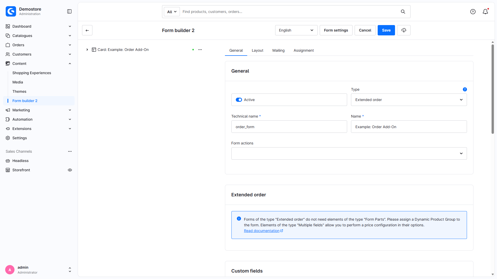
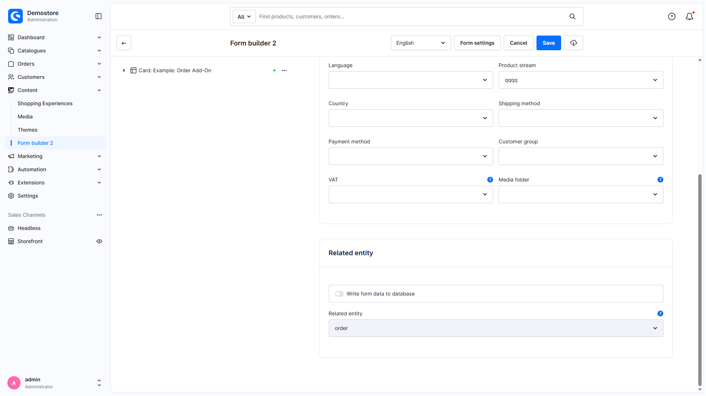
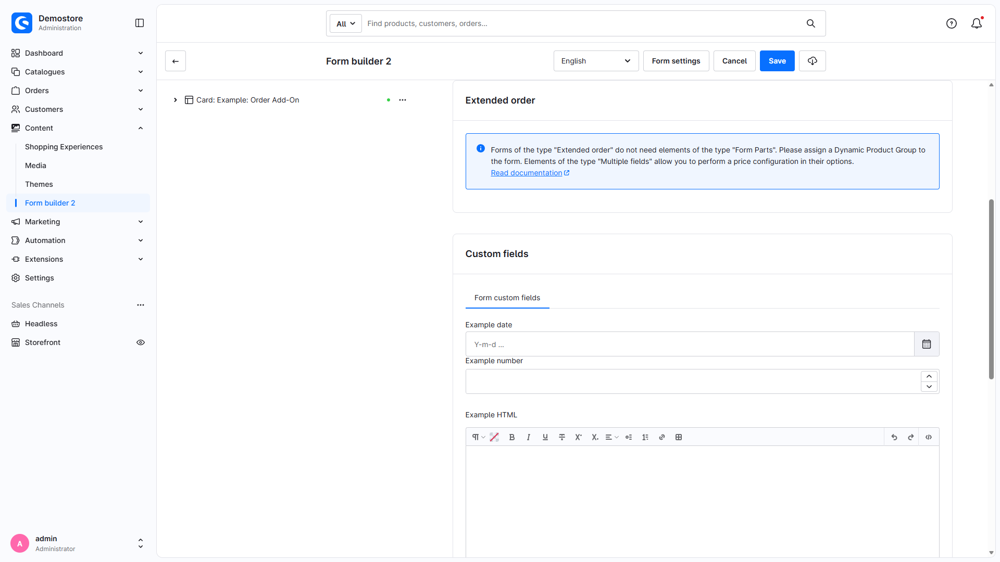
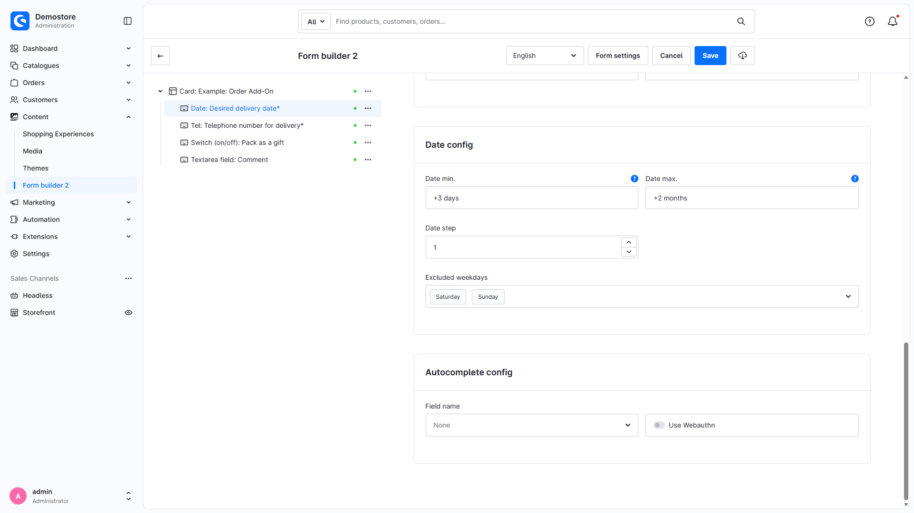
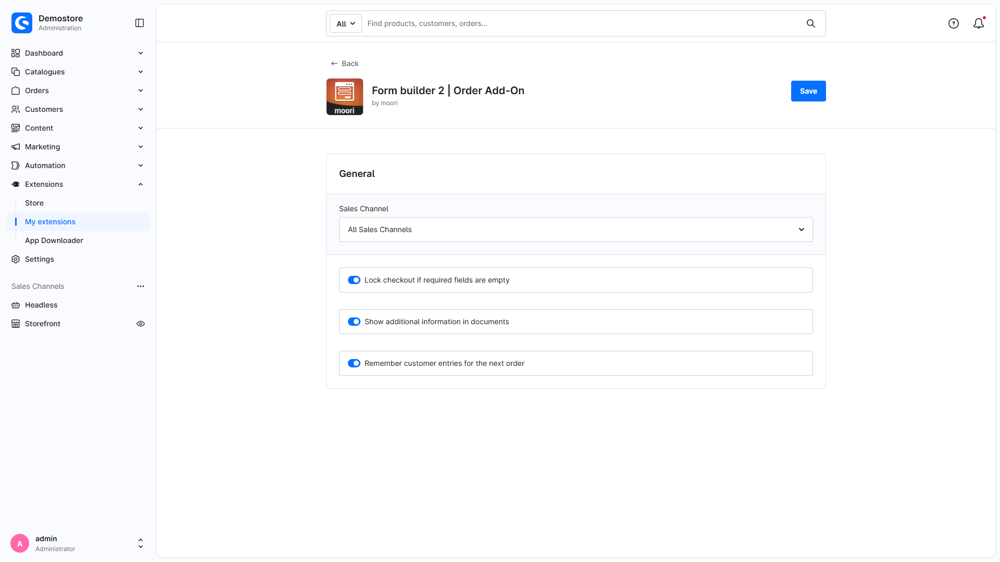

# Formular Baukasten 2 | Bestellung Add-On

Mit diesem Add-On für [Formular Baukasten 2](https://docs.moori.net/plugin/MoorlForms/) kannst du zusätzliche Angaben im Checkout erfassen, optional auf bestimmte Produkte begrenzen und nach Bestellabschluss an der Bestellung speichern.

Die Beschreibung wurde am 10.11.2026 mit dem lokalen Quellcode der Version 2.7.3 abgeglichen. Englische Full-HD-Aufnahmen zeigen den aktuellen lokalen Admin. Aufnahmebedingungen und registrierter Pluginstand stehen im Abschnitt „Aktuelle Admin-Aufnahmen“. Das Plugin-Paket setzt Shopware `~6.7.8`, MoorlFoundation `~1.7.29` und MoorlForms `~2.7.0` voraus.

## Beispiel Formulare zum Download

- [Bestellung Add-On](examples/order-add-on.json)

Das Beispiel enthält Liefertermin, Telefonnummer für den Zusteller, Kommentar und Geschenkverpackung. Prüfe nach dem Import die Produktgruppe und benötigte Mappings. Ein echter Import in der aktuellen Oberfläche wurde für diesen Dokumentationsabgleich nicht durchgeführt.

## Neues Formular von Typ "Erweiterte Bestellungen"

Mit diesem Formular bist du weit mehr für B2B oder personifizierte Kundschaft gerüstet. Du kannst im Checkout beliebige Kundendaten erfassen und weiter verarbeiten. Die Möglichkeiten wann und welche Daten erfasst werden, kannst du vollständig selbst bestimmen.

## Einstellungen

Erstelle unter **Inhalte → Formular Baukasten 2** ein neues Formular. Wähle den Typ „Erweiterte Bestellung“ (`order`) aus. Die zugeordnete Entität ist `order`. Das Add-On nutzt den Basiseditor und hat keine eigene Admin-Navigation.

Optional kannst du die Anzeige über eine dynamische Produktgruppe einschränken. Dann erscheint das Formular nur, wenn ein passendes Produkt im Warenkorb liegt. Ohne Produktgruppenzuweisung wird es als allgemeines Checkout-Formular berücksichtigt, sofern seine übrigen Verfügbarkeitsbedingungen erfüllt sind.

Die formulartypbezogenen Einstellungen steuern das Checkout-Formular. Die hier sichtbaren Preiseinstellungen implementieren keine Warenkorbpreisberechnung.

Nun kannst du deine Eingabefelder in das Formular einfügen. Es sind keine technischen Felder, wie z.B. ein Absende-Button notwendig.

Die Eingaben werden beim automatischen Absenden zunächst in der Browsersitzung gespeichert und nach dem Neuladen wieder angezeigt. Das Mapping in die Bestellung erfolgt erst nach erfolgreichem Bestellabschluss. Ein eigener Absende-Button ist dafür nicht notwendig.

1. Du kannst die Eingabefelder spezifisch ein- oder ausblenden. Wenn der Kunde z.B. eine bestimmte Versandart wählt, könnte man eine Telefonnummer für den Zusteller hinterlegen.
2. Wenn du die Eingaben für eine technische Weiterverarbeitung benötigst, eignet sich die Zuweisung in vordefinierte Felder.

Unter **Erweiterungen → Meine Erweiterungen → Bestellung Add-On → Konfigurieren** stehen folgende Einstellungen zur Verfügung:

| Einstellung | Standard | Wirkung |
| --- | --- | --- |
| Checkout sperren, wenn erforderliche Angaben fehlen | Aus | Prüft die aktuellen Formulare serverseitig und blockiert den Bestellabschluss bei Validierungsfehlern |
| Zusätzliche Angaben in Dokumenten anzeigen | Aus | Ergänzt die Textzusammenfassung im mitgelieferten Lieferschein-Template |
| Eingaben des Kunden für die nächste Bestellung merken | An | Behält die Daten nach Bestellabschluss in derselben Sitzung |

„Merken“ bedeutet keine dauerhafte Ablage im Kundenkonto oder Übernahme auf andere Geräte. Ist es ausgeschaltet, werden Eingaben und Validierungsfeedback nach der Bestellübernahme aus der Sitzung entfernt.

Die Formularoberfläche bietet auch Preiseinstellungen an. Im Bestell-Add-On ist dafür jedoch keine Warenkorbpreisberechnung implementiert; plane damit keine Auf-/Abschläge ein. Produktbezogene Konfigurationen mit Preiswirkung übernimmt das separate Produkt-Konfigurator Add-On.

### Datumsfelder

Das Liefertermin-Beispiel verwendet das Datumselement des Basiseditors.

## Ausgabe in der Storefront

Das Formular erscheint direkt im Checkout.

Das Formular wird bei Änderungen automatisch abgesendet und die Checkout-Bestätigung anschließend neu geladen. Gespeicherte Werte und feldbezogene Validierungsmeldungen werden wieder angezeigt. Allgemeine Meldungen erscheinen zusätzlich als Hinweis. Bei ausgeschalteter Checkout-Sperre erzeugen solche Formularfehler allein keine zusätzliche Bestellsperre.

## Angaben zur Bestellung einsehen

Öffne im Admin **Bestellungen → Bestellung → Details**. Die aktuelle Erweiterung zeigt dort eine Konfigurationskarte vor dem Versandbereich.

Für E-Mail- und eigene Dokumentvorlagen kannst du die gespeicherten Custom Fields verwenden:

1. HTML: `{{ order.customFields._moorl_fb_html }}`
2. Text: `{{ order.customFields._moorl_fb_plain }}`

Zusätzlich werden `_moorl_fb_json`, `_moorl_fb_xml` und `_moorl_fb_media_ids` bereitgestellt. Individuelle Feldmappings schreiben in die passenden Felder der Bestellung; sie verändern nicht automatisch die Kundenstammdaten. E-Mail-Vorlagen und andere Dokumenttypen werden nicht automatisch angepasst.

## Flow Builder

Nach Bestellabschluss wird pro passendem Formular das Ereignis `moorl_form.order_placed` ausgelöst. Es stellt Formulardaten bereit und unterstützt formularbezogene Bedingungen im Flow Builder. Das Ereignis enthält selbst keine `order`-Entity und ist kein vollständiger Ersatz für Shopwares Bestellereignisse. Flows und Aktionen müssen eingerichtet werden; das Add-On installiert keine Standardbenachrichtigung.

## Aktuelle Admin-Aufnahmen

Aufgenommen am 10.11.2026 in Shopware 6.7.15.1 bei aktivem Order-Add-on. Die Pluginregistrierung meldet 2.7.2; der hier geprüfte lokale Quellstand ist 2.7.3. Beide Dokumentationssprachen verwenden dieselben englischen Full-HD-Bilder. Es wurden weder Formulareinstellungen noch Bestellungen gespeichert.

