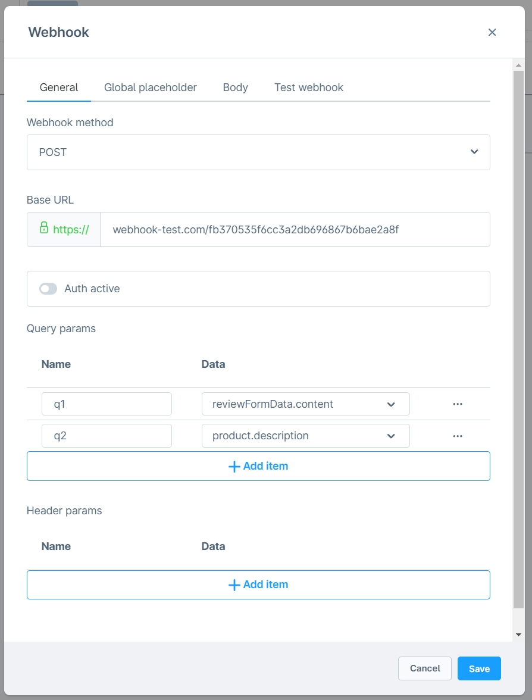
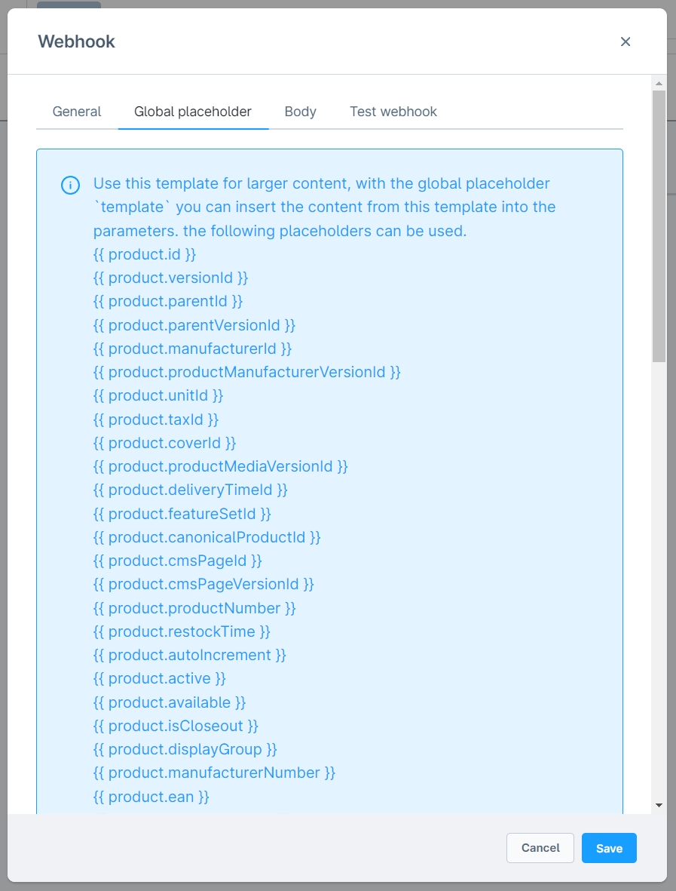
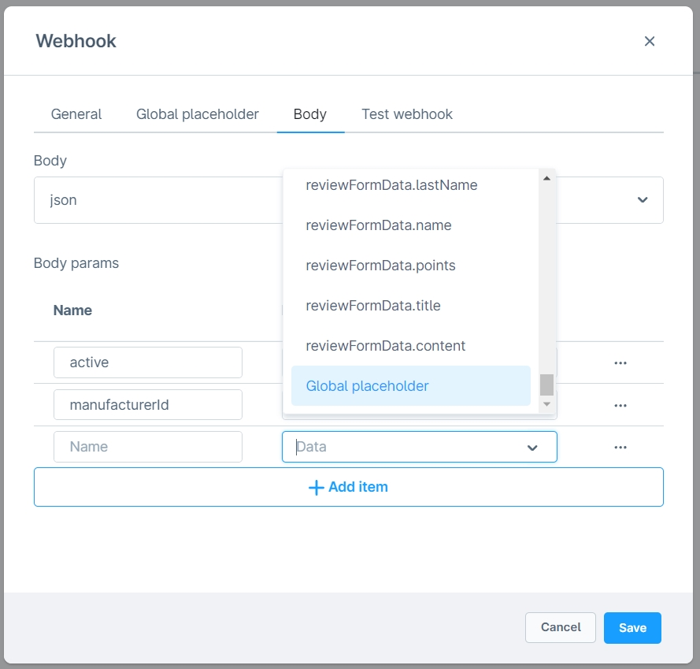
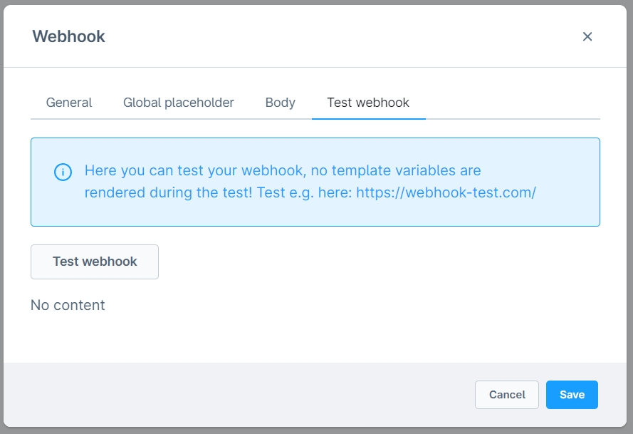
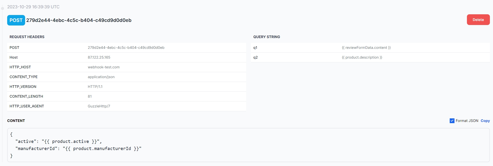

# Webhook integration

This extension is compatible with [Form Builder 2](../MoorlForms/index.md)

## Installation

!!! note

      If you have problems with the plugin, please read the following [notes](../) in the FAQ section.

1. install
   [Foundation](../MoorlFoundation/index.md)
2. install Webhook Integration in the Plugin Manager

## Setup

### Create Webhook

There are countless uses for webhooks, you can test [here](https://webhook-test.com/) webhooks.

### Examples

#### Notifications to your Amazon Echo device

https://zeropointdevelopment.com/sending-notifications-to-amazon-echo-using-webhooks/

#### Send messages to your Discord channel via webhook

https://support.discord.com/hc/en-us/articles/228383668-Intro-to-Webhooks

### Set up Webhook with Flow-Builder

- Navigate to the flow builder and open e.g. "Contact form has been sent".
- Go to the "Flow" tab
- Add **Webhook** (`action.send.webhook`); the event must implement `MailAware`
- Enter the data of your webhook
- Tip: For longer texts, you can use a global placeholder as a template.
- The “Test webhook” tab makes a real request; use it only with a designated destination. Twig variables are not rendered during the test

During normal execution, Twig errors become error-message text in parameter values. HTTP request errors are logged and caught, without a plugin-specific error message for the customer. Check mappings, destination responses and the plugin log. Other configuration-building errors are not necessarily covered by that handling.

### Connect a Form Builder 2 form

- Open your form in the Shopware Admin
- In form settings, select **Call webhook** (`webhook-form`) under “Form actions” and open the **Webhook** tab
- Enter the data of your webhook
- Tip: For longer texts you can use a global placeholder as template
- Use form field placeholders with a technical name and `.value`, for example `{{ email.value }}`
- A test request sends the entered values to the destination without Twig rendering
- Save the form

## Methods, body and authentication

The UI offers `GET` and `POST`. Defaults are `GET`, an empty destination URL, disabled authentication, empty query/header lists, body type `json` and empty body parameters. Username, password, raw body and global template start with `null`.

A body is built only for `POST`:

| Body type | Processing |
| --- | --- |
| `empty` | No explicit body. |
| `plain` | Unmodified raw text; **no Twig rendering**. |
| `json` | Mapped parameter values are encoded as a JSON object. |
| `x-www-form-urlencoded` | Mapped parameter values are sent as form data. |

Query, header and JSON/form parameter values are rendered with Twig during normal execution. The global template is rendered first and can be inserted in those values with `{{ template }}`. URL, username, password and raw body are not rendered. Empty mapping values are omitted, including text `0` under PHP's empty-value check. Multipart/file transfer is not implemented.

Enabled authentication uses Guzzle Basic Auth with username and password. Both connection and request timeout are fixed at 10 seconds. No request is sent without a destination URL. The plugin implements no automatic retry or separate queue.

## Test output and logging

The test makes a real HTTP request without template rendering and does not recreate form/Flow runtime data. The service already reads the response stream for logging, so the test display can show “No content” even if the destination supplied a body. This text alone is not a reliable success indication.

Plugin setting `MoorlFormsWebhook.config.loggerLevel` defaults to `400/ERROR`; options are `100/DEBUG`, `200/INFO`, `250/NOTICE`, `300/WARNING`, `400/ERROR`, `1000/DISABLED`. A rotating handler writes to `var/log/moorl_forms_webhook_<environment>.log`.

INFO records configuration, request options and response; error logs can also contain configuration and options. Credentials, headers and payload data are not masked. Include no real secrets or customer data in screenshots or diagnostic output.

The images and external examples come from older documentation versions. They do not confirm a current interface or successful network test.

## Test

An example for a sent webhook.

