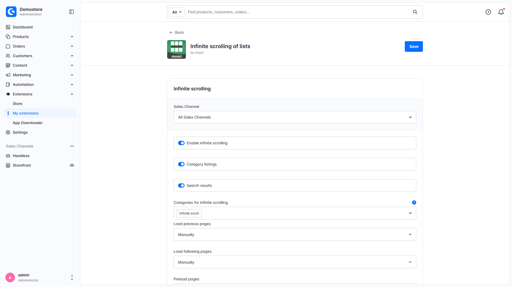
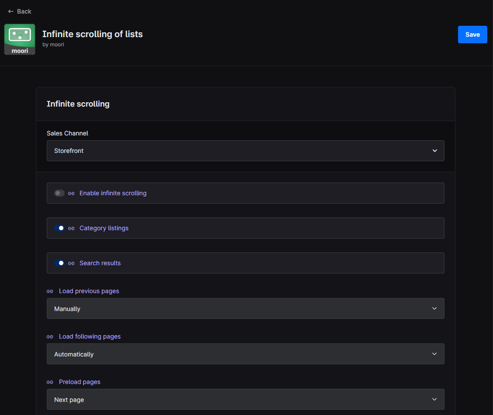
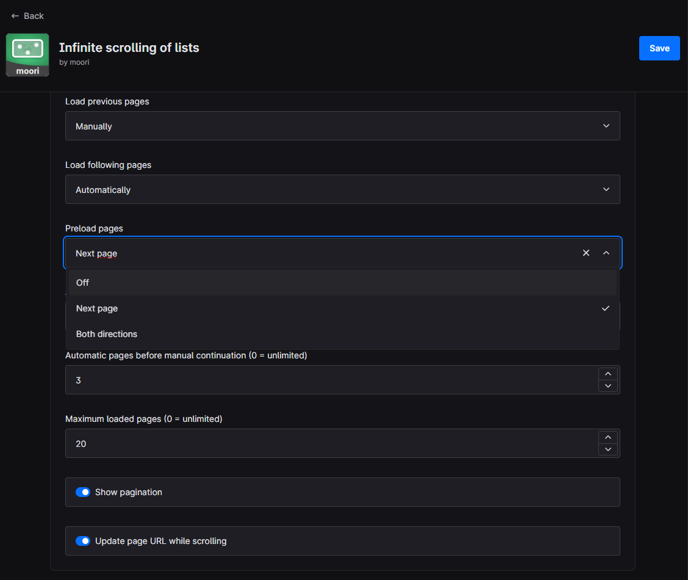

# Infinite scrolling of lists

Load product listings manually or automatically in both directions, with page preloading, a progress bar and support for listing interrupters from MoorlInterrupter.

When used with [MoorlInterrupter](../MoorlInterrupter/index.en.md), listing interrupters remain on their configured pages and at their intended positions. Each loaded page keeps its own product section.

**Important note:** You need the Foundation Plugin, which is available free of charge: [moori Foundation](../MoorlFoundation/index.md)

## Purchase the Plugin

This plugin can be purchased in the **Shopware Community Store**.

- [Shopware Community Store](https://store.shopware.com/en/search?search=MoorlScrolling)

## Installation and activation

1. Install [Foundation](../MoorlFoundation/index.en.md) if it is not already available.
2. Install and activate MoorlScrolling under **Extensions > My extensions**.
3. Open **Configuration** from the plugin's menu.
4. Select the required sales channel or **All sales channels**.
5. Enable **Enable infinite scrolling** and save the configuration.

**Category listings** and **Search results** determine where the feature applies. Both are selected by default; infinite scrolling itself is initially disabled.

*Example of the default configuration in the Shopware administration.*

## Sales-channel settings

Choose **All sales channels** to set global defaults. Selecting a specific sales channel initially inherits those values.

To change an individual setting for the selected channel, remove its inheritance using the link symbol next to the field. Enter the channel-specific value and save. The inheritance control also lets you return to the global default.

For example, one sales channel can load products automatically while another uses manual loading or disables the feature.

*The “Storefront” sales channel inherits the global settings in this example.*

All settings use Shopware's existing SystemConfig. No additional database tables are required. The selected sales channel also determines the settings used for loading and preloading.

## Loading previous and following pages

**Load previous pages** controls the upper boundary; **Load following pages** controls the lower boundary. Each direction supports:

| Mode | Behavior |
| --- | --- |
| Manually | Customers use “Load previous products” or “Load more products” to insert the adjacent page. |
| Automatically | Scrolling toward the boundary inserts the adjacent page. The manual link remains available. |

Previous pages load **manually** by default; following pages load **automatically**.

Opening page 5 directly initially displays that page only. Customers can add page 4 above it or page 6 below it. Inserting earlier products preserves the position of the product currently being viewed.

Automatic loading above requires scrolling down and then back up. Opening a later page therefore does not immediately insert all earlier pages.

## Preloading pages

Preloading reduces the wait for the next loading action. Prepared pages remain in the background until the customer requests them manually or automatic loading inserts them.

| “Preload pages” option | Effect |
| --- | --- |
| Off | Adjacent pages are requested when needed. |
| Next page | Prepares the immediately following page. This is the default. |
| Both directions | Prepares the immediately previous and following pages, where available. |

*Preloading and visible loading are separate settings. Manual loading can still benefit from a prepared page.*

**Automatic loading distance in pixels** controls how early automatic loading may start before the boundary enters view. The default is **600 pixels**. A value of **0** waits until the boundary reaches the visible area.

Preloading does not change the visible listing or its page URL. Speculative preloading is skipped while offline, when data saving is enabled, or when the browser reports a very slow connection.

## Automatic loading limits

The two limits serve different purposes:

| Setting | Default and behavior |
| --- | --- |
| Automatic pages before manual continuation | Each direction pauses after **3** automatically inserted pages. A click on the loading link resumes loading. **0** removes this automatic quota. |
| Maximum loaded pages | After **20** inserted pages in total, the adjacent-page link opens the regular shop page. **0** allows further insertion through the actual listing end. |

Limiting inserted pages keeps long listings manageable. Products remain available through regular pagination when the limit is reached.

A compact progress bar above the lower loading link shows, for example, **24 of 120 products**. Progress includes all pages up to the last page inserted below, including pages preceding a direct entry. Loading earlier pages or preloading does not increase it. At the listing end, the bar remains at 100%, for example **120 of 120 products**. Only the loading link disappears.

## Pagination and filters

**Show pagination** keeps the standard page navigation visible alongside incremental loading. Clicking an inserted page scrolls to its products. A page outside the loaded range becomes the new starting point. When pagination is hidden, separate first- and last-page links remain available.

**Update page URL while scrolling** follows the product page currently being viewed, allowing it to be linked or opened directly. When disabled, the address remains at the last explicitly opened page.

Filter, sorting and page-size changes restart the listing at page 1. Browser Back and Forward restore the corresponding filters and saved position.

## Loading errors

If a request fails, existing products remain usable. Use the retry link to repeat the request, or **Open page directly** to navigate to the regular shop page.

If the listing has visibly changed between requests, the plugin offers a refresh.

## Listing interrupter compatibility

MoorlInterrupter is optional. When used together, its page rules, widths and positions continue to apply within each listing page. An interrupter configured for page 3 appears there even when that page is loaded later from page 5. Interrupters assigned to multiple pages appear on each matching page.

Supports one primary category or search listing per document on Shopware 6.7. Additional independent listings, wishlists, product sliders and cross-selling are outside the extension's scope. Check themes and other plugins that replace the listing together before production use.
