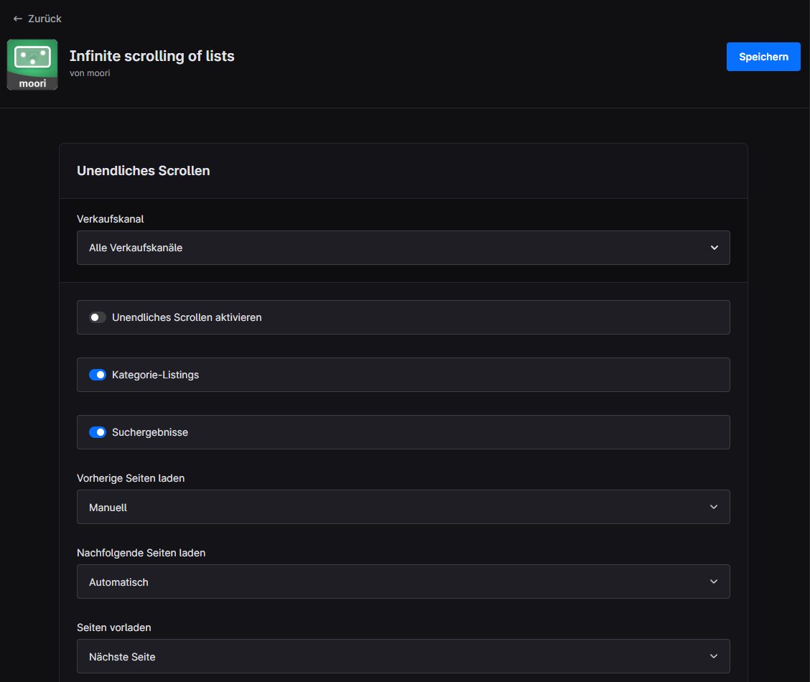
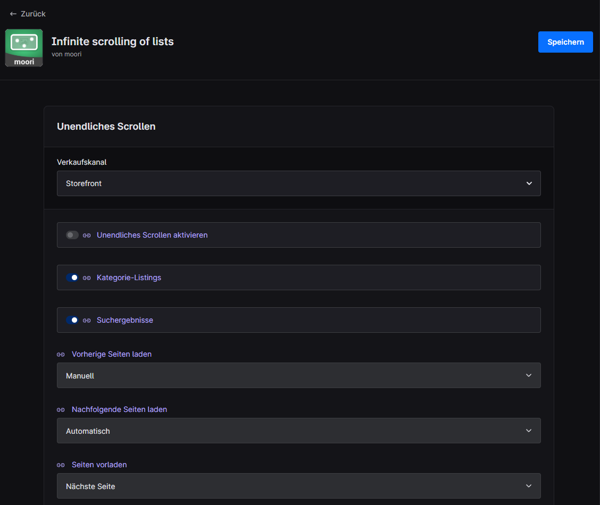
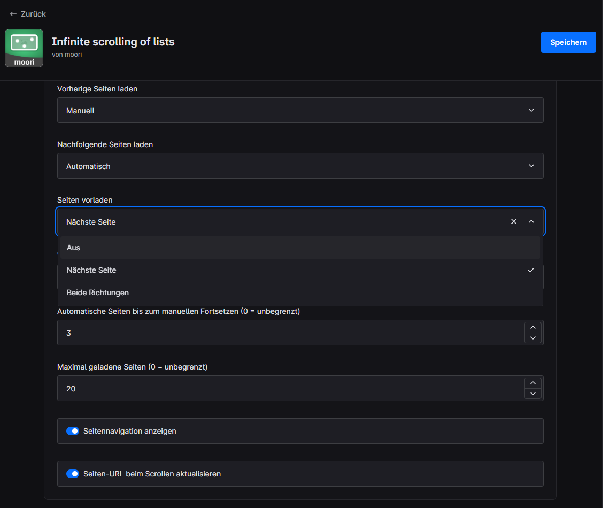

# Unendliches Scrollen von Listen

Produktlisten manuell oder automatisch in beide Richtungen nachladen. Mit Seiten-Vorladung, Fortschrittsanzeige und Unterstützung für Listing-Störer von MoorlInterrupter.

In Verbindung mit [MoorlInterrupter](../MoorlInterrupter/index.md) bleiben deine Listing-Störer auf den vorgesehenen Seiten und an ihren eingestellten Positionen. Jede nachgeladene Seite behält ihren eigenen Produktbereich.

**Wichtiger Hinweis:** Sie benötigen das Foundation Plugin, welches Ihnen kostenlos zur Verfügung steht: [moori Foundation](../MoorlFoundation/index.md)

## Plugin erwerben

Dieses Plugin kann im offiziellen **Shopware Community Store** erworben werden.

- [Shopware Community Store](https://store.shopware.com/de/search?search=MoorlScrolling)

## Installation und Aktivierung

1. Installiere [Foundation](../MoorlFoundation/index.md), sofern es noch nicht vorhanden ist.
2. Installiere und aktiviere MoorlScrolling unter **Erweiterungen > Meine Erweiterungen**.
3. Öffne über das Menü des Plugins die **Konfiguration**.
4. Wähle oben den gewünschten Verkaufskanal oder **Alle Verkaufskanäle**.
5. Schalte **Unendliches Scrollen aktivieren** ein und speichere die Konfiguration.

Über **Kategorie-Listings** und **Suchergebnisse** bestimmst du, in welchen Produktlisten die Funktion verwendet wird. Beide Bereiche sind standardmäßig ausgewählt; das unendliche Scrollen selbst ist nach der Installation zunächst ausgeschaltet.

*Beispielansicht der Standardkonfiguration in der Shopware-Administration.*

## Einstellungen je Verkaufskanal

Unter **Alle Verkaufskanäle** legst du die allgemeinen Vorgaben fest. Wählst du einen einzelnen Verkaufskanal, übernimmt dieser zunächst die globalen Werte.

Um eine Einstellung nur für diesen Verkaufskanal anzupassen, löse ihre Vererbung über das Verknüpfungssymbol am Feld. Anschließend kannst du einen eigenen Wert einstellen und speichern. Über die Vererbungsfunktion lässt sich wieder die globale Vorgabe übernehmen.

So kann beispielsweise ein Verkaufskanal Produkte automatisch nachladen, während du in einem anderen ausschließlich manuelles Nachladen verwendest oder die Funktion ausschaltest.

*Der Verkaufskanal „Storefront“ übernimmt hier die allgemeinen Einstellungen.*

Die Einstellungen werden in Shopwares vorhandener Systemkonfiguration gespeichert. Zusätzliche Datenbanktabellen sind nicht erforderlich. Die Verkaufskanalauswahl gilt auch beim Nachladen und Vorladen.

## Vorherige und nachfolgende Seiten laden

Mit **Vorherige Seiten laden** bestimmst du das Verhalten am oberen Ende der Liste. **Nachfolgende Seiten laden** steuert das untere Ende. Für beide Richtungen stehen dieselben Modi zur Verfügung:

| Modus | Verhalten |
| --- | --- |
| Manuell | Kunden laden die nächste Seite über „Vorherige Produkte laden“ beziehungsweise „Weitere Produkte laden“. |
| Automatisch | Beim Scrollen in Richtung der Ladegrenze wird die nächste Seite eingefügt. Der manuelle Link bleibt ebenfalls nutzbar. |

Standardmäßig werden vorherige Seiten **manuell** und nachfolgende Seiten **automatisch** geladen.

Öffnet ein Kunde beispielsweise Seite 5 direkt, wird zunächst nur diese Seite angezeigt. Oben kann anschließend Seite 4, unten Seite 6 ergänzt werden. Beim Laden oberhalb bleibt das betrachtete Produkt an derselben Bildschirmposition.

Automatisches Laden vorheriger Seiten beginnt erst, nachdem der Kunde nach unten und wieder nach oben gescrollt hat. Dadurch werden beim direkten Einstieg auf einer späteren Seite nicht sofort alle vorherigen Seiten eingefügt.

## Seiten vorladen

Vorladen verkürzt die Wartezeit beim nächsten Nachladevorgang. Die vorbereitete Seite wird zunächst im Hintergrund gehalten und erst angezeigt, wenn der Kunde sie manuell oder automatisch nachlädt.

| Einstellung bei „Seiten vorladen“ | Wirkung |
| --- | --- |
| Aus | Nachbarseiten werden erst bei Bedarf angefordert. |
| Nächste Seite | Die unmittelbar folgende Seite wird vorbereitet. Dies ist der Standard. |
| Beide Richtungen | Die unmittelbar vorherige und die unmittelbar folgende Seite werden vorbereitet, soweit sie existieren. |

*Vorladen und sichtbares Nachladen sind getrennte Einstellungen. Auch bei manuellem Nachladen kann die nächste Seite bereits vorbereitet werden.*

**Vorlauf beim automatischen Laden in Pixeln** legt fest, wie früh vor der Ladegrenze automatisch nachgeladen werden kann. Der Standard beträgt **600 Pixel**. Mit **0** beginnt der Vorgang erst, wenn die Ladegrenze den sichtbaren Bereich erreicht.

Vorgeladene Seiten verändern weder die sichtbare Liste noch die aktuelle Seitenadresse. Bei Offline-Zustand, aktivierter Datensparfunktion oder einer vom Browser gemeldeten sehr langsamen Verbindung verzichtet das Plugin auf spekulatives Vorladen.

## Automatische Ladegrenzen

Die beiden Grenzwerte haben unterschiedliche Aufgaben:

| Einstellung | Standard und Verhalten |
| --- | --- |
| Automatische Seiten bis zum manuellen Fortsetzen | Nach **3** automatisch eingefügten Seiten pausiert die jeweilige Richtung. Ein Klick auf den Nachladelink setzt das Laden fort. **0** hebt dieses automatische Kontingent auf. |
| Maximal geladene Seiten | Nach insgesamt **20** eingebundenen Seiten führt der Nachbarlink zur regulären nächsten oder vorherigen Shopseite. **0** erlaubt weiteres Einfügen bis zum tatsächlichen Listenende. |

Die Begrenzung der gleichzeitig eingebundenen Seiten hält lange Listen überschaubar. Produkte bleiben auch beim Erreichen der Grenze über die normale Seitennavigation erreichbar.

Sobald der untere Nachladelink angezeigt wird, zeigt ein kleiner Fortschrittsbalken darüber beispielsweise **24 von 120 Produkten**. Der Fortschritt zählt bis zum Ende der zuletzt unten eingebundenen Seite; Seiten vor einem direkten Einstieg werden mitgezählt. Nachladen oberhalb und reines Vorladen verändern den Fortschritt nicht. Am Listenende bleibt der Balken mit 100 % stehen, beispielsweise **120 von 120 Produkten**. Nur der Nachladelink verschwindet.

## Seitennavigation und Filter

Mit **Seitennavigation anzeigen** bleibt die klassische Pagination zusätzlich sichtbar. Ein Klick auf eine bereits geladene Seite springt direkt zu deren Produkten. Eine noch nicht geladene Seite wird als neuer Ausgangspunkt geöffnet. Ist die Pagination ausgeblendet, bleiben zusätzliche Links zur ersten und letzten Seite erreichbar.

**Seiten-URL beim Scrollen aktualisieren** führt die Adresse auf die aktuell betrachtete Produktseite nach. So lässt sich diese Seite direkt wieder öffnen oder verlinken. Ohne diese Option bleibt die Adresse bei der zuletzt ausdrücklich geöffneten Seite.

Filter-, Sortierungs- und Seitenlimitänderungen starten die Liste auf Seite 1 neu. Browser-Zurück und -Vorwärts berücksichtigen den jeweiligen Filterzustand und die gespeicherte Position.

## Fehler beim Nachladen

Scheitert eine Anfrage, bleiben bereits angezeigte Produkte nutzbar. Über **Erneut versuchen** kannst du denselben Nachladevorgang wiederholen. **Seite direkt öffnen** wechselt alternativ zur regulären Shopseite.

Ändert sich die Produktliste während des Nachladens erkennbar, bietet das Plugin eine Aktualisierung an.

## Kompatibilität mit Listing Störern

MoorlInterrupter ist optional. Bei gemeinsamer Verwendung gelten dessen Seitenregeln, Breiten und Positionen weiterhin für die jeweilige Listing-Seite. Ein Störer für Seite 3 erscheint auch dann dort, wenn diese Seite später von Seite 5 aus nachgeladen wird. Gilt ein Störer für mehrere Seiten, erscheint er auf jeder dieser Seiten.

Unterstützt wird ein primäres Kategorie- oder Suchlisting je Dokument in Shopware 6.7. Zusätzliche unabhängige Listings auf derselben Seite, Wunschlisten, Produktslider und Cross-Selling gehören nicht zum Funktionsumfang. Themes oder andere Plugins, die das Listing austauschen, sollten vor dem produktiven Einsatz gemeinsam geprüft werden.
