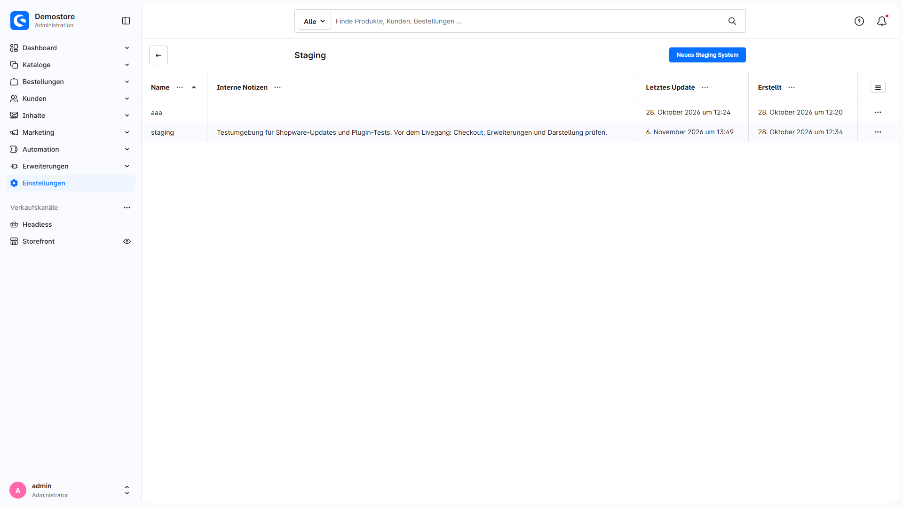
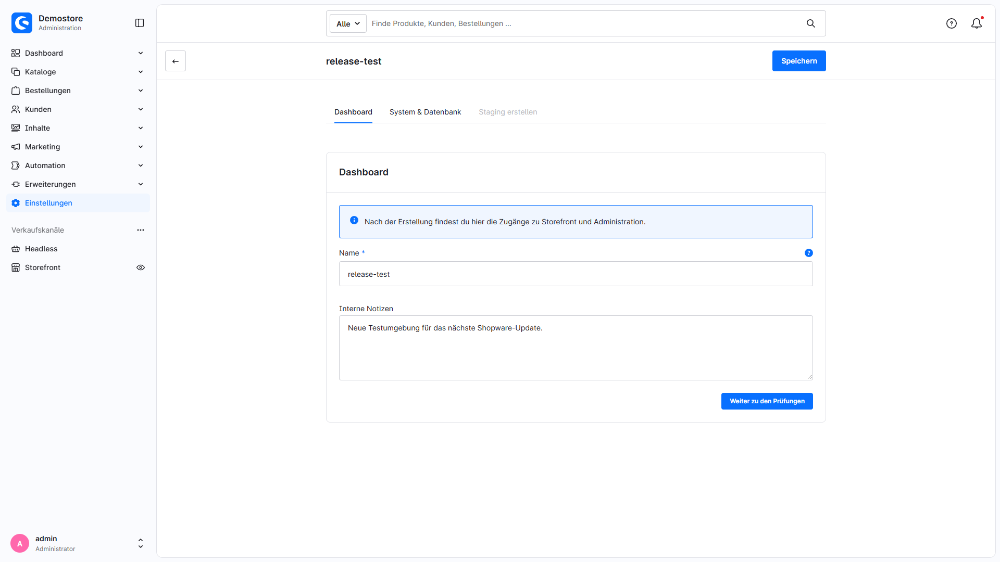
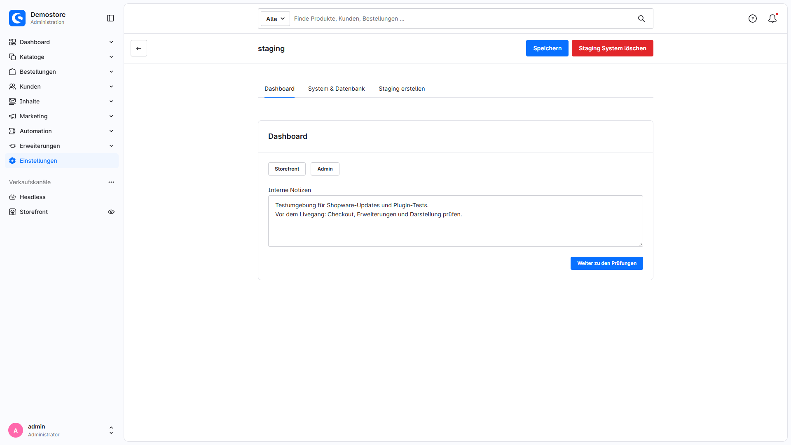
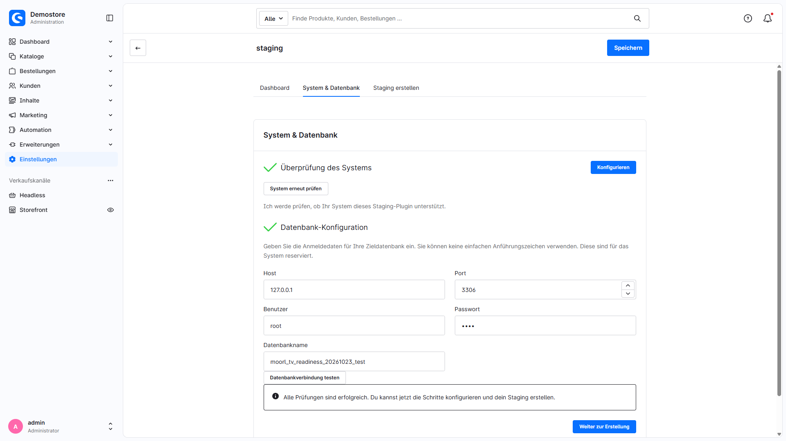
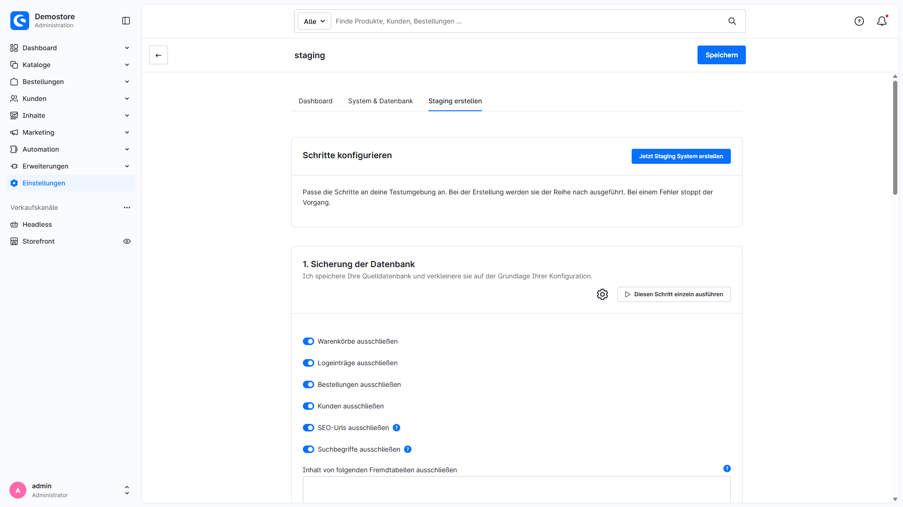
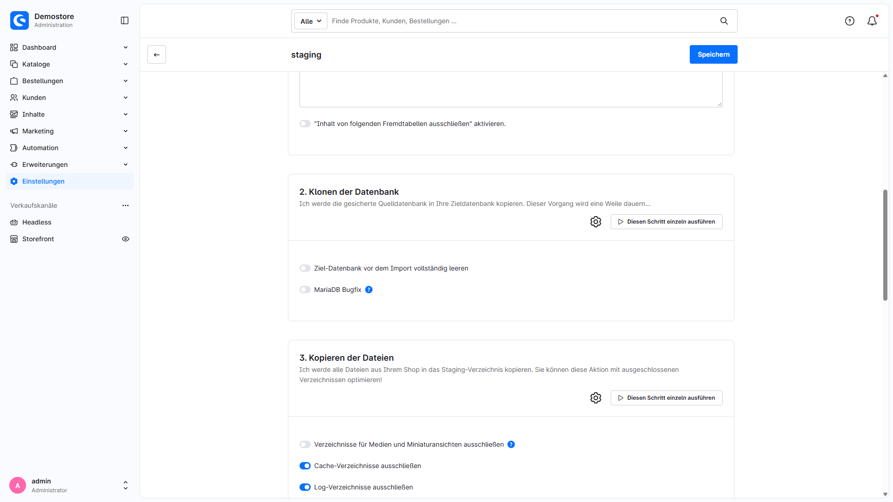
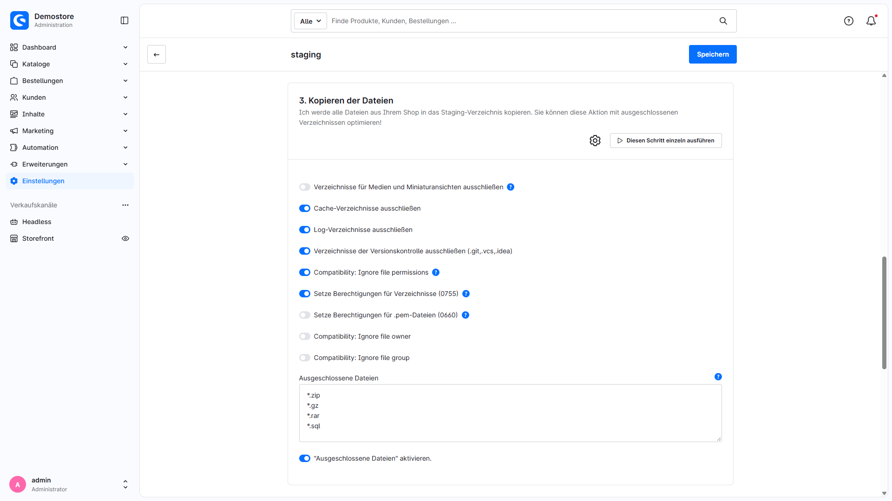
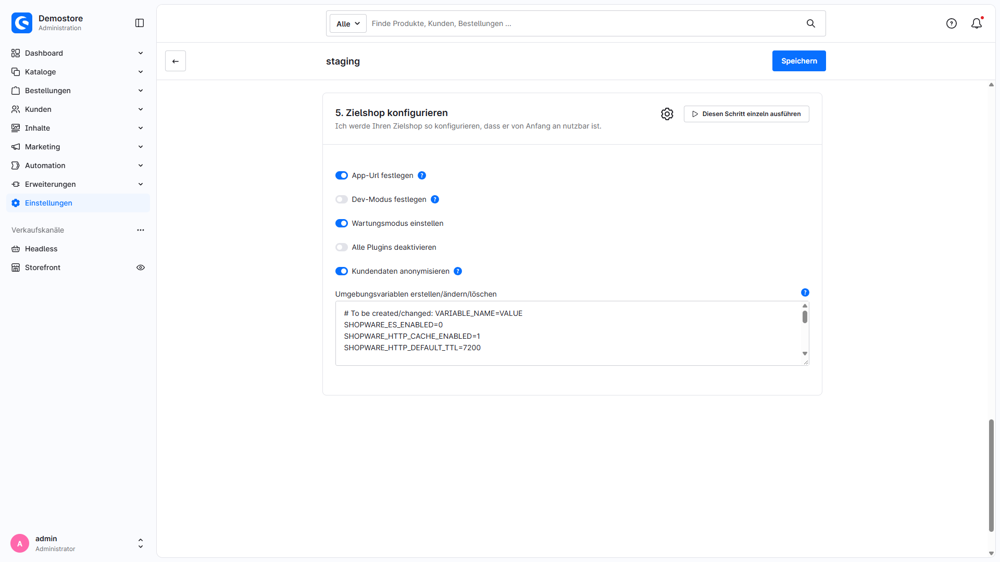

# Create staging / test environments

MoorlStaging creates a copy of your Shopware shop with its own database and shop directory. Test updates, plugins and configuration changes before applying them to production. Configure database contents, file exclusions and destination settings separately for each environment.

The extension requires Shopware 6.7 and a suitable server with shell tools. MoorlFoundation is not required. Copies are created on the same server; SSH methods connect to `localhost:22`. See the [installation and operations manual](manual.en.md) for requirements and setup.

## Create a staging environment

Open **Settings → Extensions → Staging** and select **New staging system**. The detail view provides three tabs:

| Tab | Purpose |
| --- | --- |
| Dashboard | Name for a new environment, internal notes and, after creation, Storefront and Administration links. Also contains the deletion action. |
| System & database | System check and credentials for the separate destination database. Both checks must pass. |
| Create staging | Five configurable steps, a full run and individual step execution. |

### Dashboard

Enter a unique name. It becomes the directory name and URL path; permitted characters are letters `A–Z`, `a–z`, digits, hyphens and underscores. Reserved Shopware public directories such as `media` or `theme` are excluded. The name field is only available when creating a record. Use internal notes for the test purpose, owner and planned changes.

**Continue to checks**, or selecting **System & database**, saves a new record first. A save failure keeps you on the Dashboard. **Save** stores changes without running creation. After successful creation, this tab provides the Storefront and Administration links.

### System & database

Loading a saved record starts the system check and a connection test with the current database credentials in the background. Switching tabs alone does not restart the checks. The system check checks file operations and execution of required tools. It does not validate web server routing or every subsequent copy operation.

Enter the **Host**, **Port**, **User**, **Password** and **Database name** of a separate destination database that you have already created. Replace the example values with your credentials. The extension rejects a database name identical to the source name; use a dedicated database for each environment. The interface rejects a single quotation mark (`'`) in the database password.

Changing database credentials invalidates a successful check. Select **Test connection** again. Only successful, green results for both the system and database checks enable **Continue to creation** and the **Create staging** tab. Reopening a record runs the checks again. Use **Run system check again** after changing the server configuration.

## The five creation steps

The following values are the step defaults. The hosting compatibility mode may adjust initial settings for new environments. Saved individual settings take precedence; review the actual values displayed before each run.

### 1. Database backup

The source database is exported to `backup/backup.sql`. Table structures are included even when their contents are excluded. The staging management table `moorl_staging` is copied without its contents.

| Option | Default | Purpose |
| --- | --- | --- |
| Exclude carts | On | Omit the contents of `cart`. |
| Exclude log entries | On | Omit the contents of `log_entry`. |
| Exclude orders | On | Omit contents of the order tables listed in the step, including order customers and order addresses. |
| Exclude customers | On | Omit contents of `customer` and `customer_address`. |
| Exclude SEO URLs | On | Omit contents of `seo_url`. |
| Exclude search keywords | On | Omit contents of `product_search_keyword`; copy or rebuild these when testing search. |
| Exclude contents of additional tables | Empty / disabled | Enter exact table names on separate lines and enable the associated switch. |

Exclusions apply to specific tables and do not automatically cover all related tables or data held by other extensions. Review relationships and required test data when choosing exclusions.

### 2. Clone database

The backup is imported into the destination database. **Completely empty the destination database before import** is off by default. Enabling it deletes every table in the destination database. A normal import can also overwrite existing tables; use a database dedicated exclusively to this environment.

The optional **MariaDB bugfix**, off by default, removes collation declarations for generated columns from the backup. Enable it only when needed. Choose database tools suitable for the MySQL/MariaDB versions in use.

### 3. Copy files

`rsync` copies the shop into its staging directory. Staging directories themselves are excluded to avoid recursive copies.

| Option | Default | Purpose |
| --- | --- | --- |
| Exclude media and thumbnails | Off | Omit `public/media` and `public/thumbnail`; step 4 can link them to the source. |
| Exclude cache directories | On | Omit contents under `var/cache`. |
| Exclude log directories | On | Omit contents under `var/log`. |
| Exclude version control | On | Omit Git, SVN and IDE files, among others. |
| Do not preserve permissions / owner / group | Each off | Adapt corresponding `rsync` options to the hosting permissions model. |
| Set directory permissions | Off | When permissions are not preserved, recursively apply `u+rwX,go+rX,go-w`. |
| Set .pem file permissions | Off | When permissions are not preserved, set `.pem` files to `0660`. |
| Excluded files | On | Default patterns: `*.zip`, `*.gz`, `*.rar`, `*.sql`; enter custom patterns on separate lines, using `*` as a wildcard. |

**Excluding media while creating symlinks makes the live and staging shops share media and thumbnails. Deleting or changing those files in staging also affects the live shop.** Copy media for independent media tests, and check existing links when reusing a previously created environment.

### 4. Set symlinks

A symlink at `<shopware_root>/public/<name>` points to the destination shop's public directory. If media is excluded, media and thumbnail directories are also linked to the source.

**Use PHP to create the symlink** is on by default. Switching it off uses the shell tool `ln`. **Skip this step** is off by default; skipping also prevents media links from being created. In that case, configure web access and media access yourself.

### 5. Configure destination shop

The destination receives its own `DATABASE_URL` and `APP_ENV` in existing `.env`/`.env.local` files and existing PHP dumps of those files. Sales channel domains are mapped to the staging path while preserving language paths and other subpaths. Internal `default.headless` placeholders are preserved. The configuration also sets Shopware's staging flag.

| Option | Default | Purpose |
| --- | --- | --- |
| Set app URL | On | Build the destination `APP_URL` from the source `APP_URL` and staging name. A valid source `APP_URL` is also required for access links. |
| Set dev mode | Off | Use `APP_ENV=dev` instead of `prod`. |
| Set maintenance mode | On | Enable maintenance mode for destination sales channels. |
| Disable all plugins | Off | Deactivate all plugin records in the destination shop. |
| Anonymize customer data | Off | Replace the destination customer data described below. |
| Create/change/delete environment variables | Pre-filled | `NAME=VALUE` sets a value; `NAME` without an equals sign removes it. Use one entry per line. |

The pre-filled ENV list disables Elasticsearch, sets HTTP cache values and removes listed Messenger/Redis entries. Adapt it to your installation and also check server-wide environment variables and other integrations. Maintenance mode and the staging flag do not replace checks of mail transport, payment methods, webhooks or background services.

### Scope of customer anonymization

This option is off by default and operates only on the destination database. To test with anonymized customers and orders, include those records in step 1: turn off **Exclude customers** and, where needed, **Exclude orders**.

Anonymization replaces names, company and title in `customer`, `customer_address`, `order_customer` and `order_address` with test data or empty values. Customer emails become unique addresses under `example.invalid`; customer numbers become `ANON-…`. Addresses receive a test street, city and postal code; phone numbers, departments and additional address lines are removed. Custom fields in these records, birth dates, VAT details and IP addresses are cleared. Guest orders, orders from deleted customers and existing order versions are included.

**Existing customer passwords, legacy passwords and associated hashes are cleared, and `customer_recovery` is emptied. Existing customer login credentials no longer work in staging afterwards.** Customer/order relationships and business order data remain intact. This option does not anonymize Administration users.

Documents, files, logs, reviews, newsletter data and other plugins' data are not anonymized. The SQL backup created earlier is not retroactively anonymized either. Review and protect these separately. This option does not anonymize the entire shop.

## Run, verify and repeat

**Create staging system now** saves the current settings and executes all five steps in order. Status labels and progress show running, completed and failed steps. A reported step error stops the full run; subsequent steps are not executed. A successful full run returns to the Dashboard with access links.

**Run single step** repeats a selected step and also saves the current settings. Outputs from prerequisite steps must already exist. An individual run is not automatic resumption and may overwrite destination data again.

Open the Storefront and Administration afterwards. Check domains, maintenance mode, plugins, test data, file permissions and connections to external services before starting tests or background workers. Duration depends on data volume, the file system and server limits.

## Delete staging

**Kill staging** on the Dashboard opens a confirmation. The deletion routine attempts to remove all tables in the configured destination database, the shop copy and SQL backup, and the public staging symlink; it also removes the management record. Review the saved destination credentials before deleting and inspect the database and directories afterwards, especially after errors or permission changes.

Uninstalling the extension does not automatically remove existing staging files or destination databases. Uninstalling without retaining user data removes the management records. Clean up unneeded environments explicitly before uninstalling.

See the manual for [server configuration, directory layout and troubleshooting](manual.en.md).
