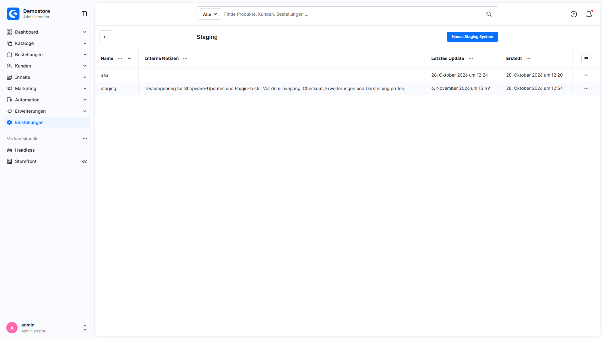
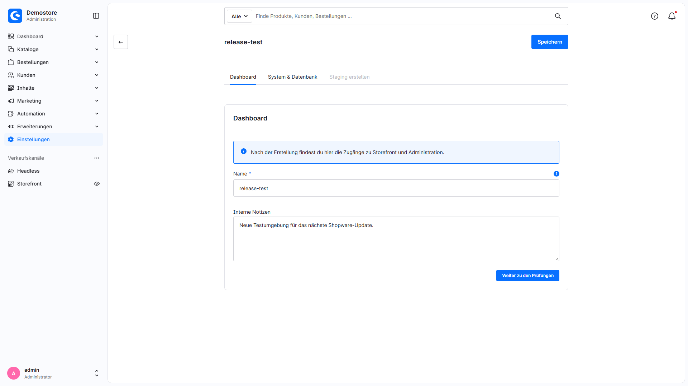
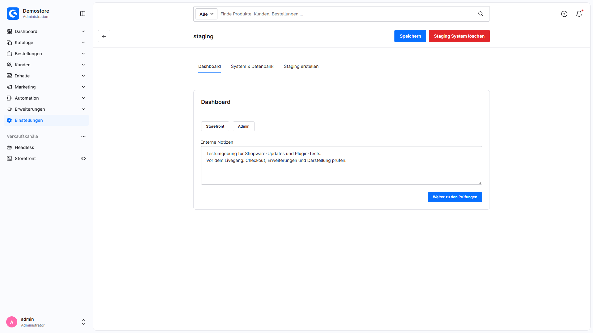
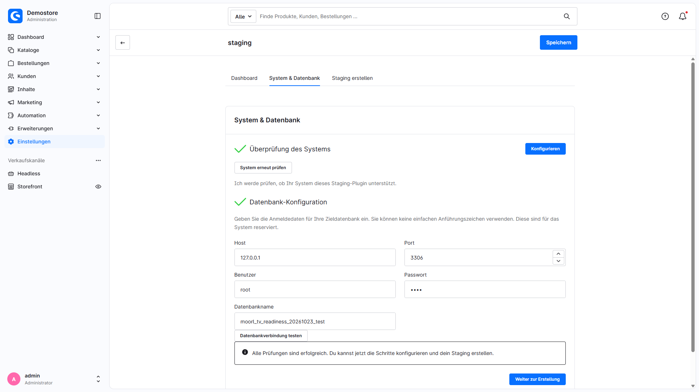
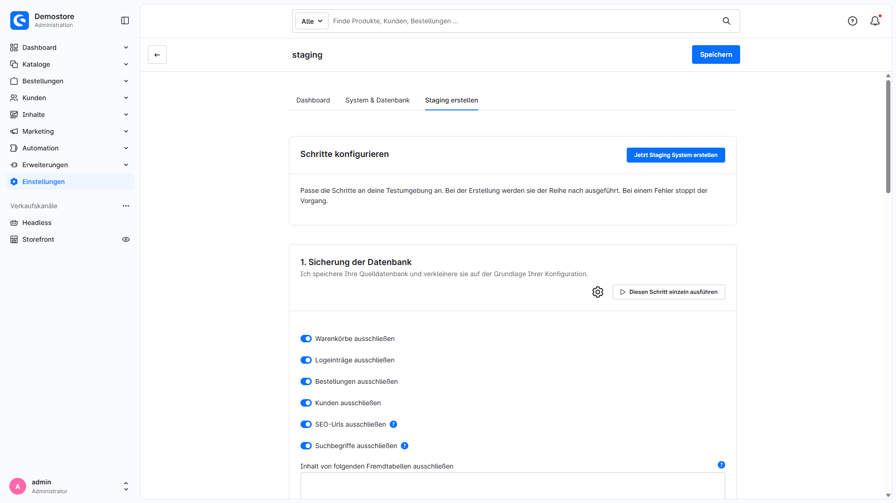
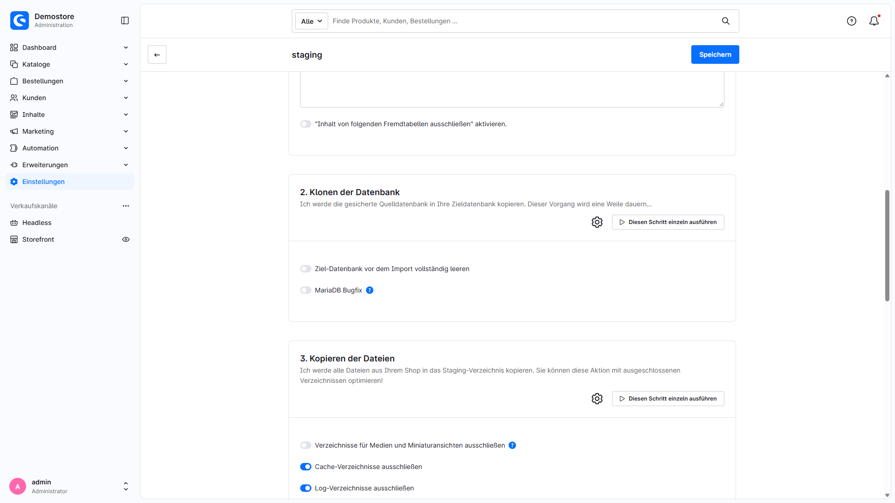
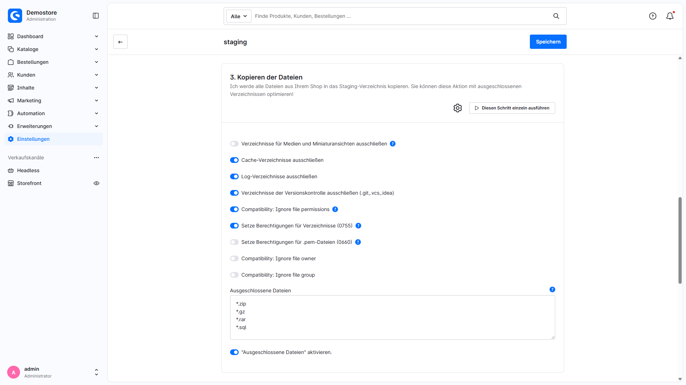
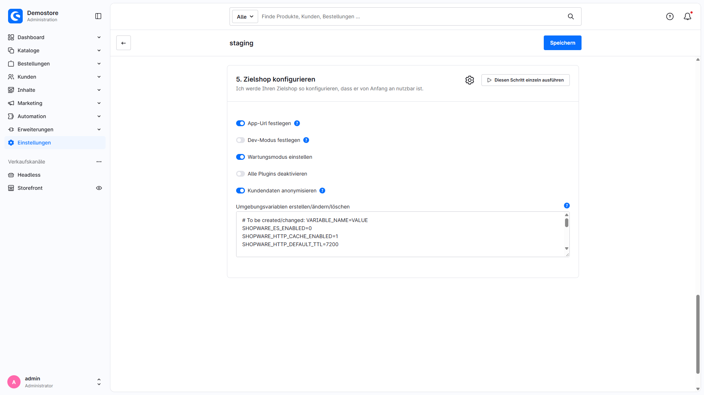

# Staging / Testumgebungen erstellen

MoorlStaging erstellt eine Kopie Ihres Shopware-Shops mit eigener Datenbank und eigenem Shopverzeichnis. Testen Sie Updates, Plugins und Konfigurationen, bevor Sie Änderungen im Produktivshop übernehmen. Datenbankinhalte, Dateiausschlüsse und Zielkonfiguration lassen sich je Staging-System festlegen.

Vorausgesetzt werden Shopware 6.7 und eine geeignete Serverumgebung mit Shell-Werkzeugen. MoorlFoundation wird nicht benötigt. Die Kopien entstehen auf demselben Server; die SSH-Verfahren verbinden sich mit `localhost:22`. Voraussetzungen und Installation sind im [Installations- und Betriebshandbuch](manual.md) beschrieben.

## Ein Staging-System anlegen

Öffnen Sie **Einstellungen → Erweiterungen → Staging** und wählen Sie **Neues Staging System**. Die Detailansicht führt durch drei Tabs:

| Tab | Aufgabe |
| --- | --- |
| Dashboard | Name bei Neuanlage, interne Notizen und nach der Erstellung Zugänge zu Storefront und Administration. Hier befindet sich auch die Löschfunktion. |
| System & Datenbank | Systemprüfung und Zugangsdaten zur separaten Zieldatenbank. Beide Prüfungen müssen erfolgreich sein. |
| Staging erstellen | Fünf konfigurierbare Schritte, Gesamtlauf und einzelne Schrittausführung. |

### Dashboard

Geben Sie einen eindeutigen Namen ein. Er wird als Verzeichnisname und URL-Pfad verwendet; erlaubt sind Buchstaben `A–Z`, `a–z`, Ziffern, Bindestriche und Unterstriche. Reservierte öffentliche Shopware-Verzeichnisse wie `media` oder `theme` sind ausgeschlossen. Der Name wird in der Oberfläche nur bei der Neuanlage angeboten. Interne Notizen halten beispielsweise Testzweck, Zuständigkeit und geplante Änderungen fest.

**Weiter zu den Prüfungen** beziehungsweise der Wechsel in **System & Datenbank** speichert einen neuen Eintrag zuerst. Bei einem Speicherfehler bleiben Sie im Dashboard. **Speichern** sichert Änderungen ohne Erstellungslauf. Nach erfolgreicher Erstellung stehen hier die Zugänge zu Storefront und Administration bereit.

### System & Datenbank

Beim Laden eines gespeicherten Eintrags starten die Systemprüfung und ein Verbindungstest mit den aktuell eingetragenen Daten bereits im Hintergrund. Ein reiner Tab-Wechsel startet die Prüfungen nicht erneut. Die Systemprüfung kontrolliert Dateioperationen und die Ausführbarkeit benötigter Werkzeuge. Sie ersetzt keine Prüfung der Webserver-Konfiguration oder aller späteren Kopiervorgänge.

Tragen Sie **Host**, **Port**, **Benutzer**, **Passwort** und **Datenbankname** einer zuvor angelegten, separaten Zieldatenbank ein. Ersetzen Sie die Beispielwerte durch eigene Zugangsdaten. Die Erweiterung weist einen zur Quelle identischen Datenbanknamen zurück; verwenden Sie für jedes Staging eine eigene Datenbank. Ein einfaches Anführungszeichen (`'`) im Datenbankpasswort wird von der Oberfläche abgelehnt.

Nach jeder Änderung der Datenbankdaten erlischt die erfolgreiche Prüfung. Klicken Sie erneut auf **Datenbankverbindung testen**. Erst wenn Systemprüfung und Verbindungstest erfolgreich beziehungsweise grün sind, werden **Weiter zur Erstellung** und der Tab **Staging erstellen** freigeschaltet. Beim erneuten Öffnen eines Eintrags werden die Prüfungen erneut durchgeführt. **System erneut prüfen** wiederholt die Systemprüfung nach Änderungen an der Serverkonfiguration.

## Die fünf Erstellungsschritte

Die Angaben unten beschreiben die Standardwerte der Schritte. Der Hosting-Kompatibilitätsmodus kann Anfangswerte neuer Staging-Systeme anpassen. Gespeicherte individuelle Einstellungen bleiben erhalten; prüfen Sie vor jedem Lauf die tatsächlich angezeigten Werte.

### 1. Sicherung der Datenbank

Die Quelldatenbank wird nach `backup/backup.sql` gesichert. Tabellenstrukturen bleiben auch dann enthalten, wenn deren Inhalte ausgeschlossen werden. Die Staging-Verwaltungstabelle `moorl_staging` wird ohne ihre Inhalte übernommen.

| Option | Standard | Verwendung |
| --- | --- | --- |
| Warenkörbe ausschließen | An | Inhalt von `cart` auslassen. |
| Logeinträge ausschließen | An | Inhalt von `log_entry` auslassen. |
| Bestellungen ausschließen | An | Inhalte der im Schritt hinterlegten Bestelltabellen auslassen, einschließlich Bestellkunden und Bestelladressen. |
| Kunden ausschließen | An | Inhalte von `customer` und `customer_address` auslassen. |
| SEO-Urls ausschließen | An | Inhalt von `seo_url` auslassen. |
| Suchbegriffe ausschließen | An | Inhalt von `product_search_keyword` auslassen; für Suchtests gegebenenfalls übernehmen oder neu aufbauen. |
| Inhalt von folgenden Fremdtabellen ausschließen | Leer / Aktivierung aus | Exakte Tabellennamen zeilenweise angeben und den zugehörigen Schalter aktivieren. |

Die Ausschlüsse beziehen sich auf festgelegte Tabellen und erfassen nicht automatisch alle abhängigen Tabellen oder Daten anderer Erweiterungen. Prüfen Sie bei eigenen Ausschlüssen Datenbeziehungen und die benötigten Testdaten.

### 2. Klonen der Datenbank

Die Sicherung wird in die Zieldatenbank importiert. **Ziel-Datenbank vor dem Import vollständig leeren** ist standardmäßig ausgeschaltet. Bei Aktivierung werden sämtliche Tabellen der Zieldatenbank gelöscht. Auch der reguläre Import kann vorhandene Tabellen überschreiben; verwenden Sie eine ausschließlich für dieses Staging bestimmte Datenbank.

Der standardmäßig ausgeschaltete **MariaDB Bugfix** entfernt Kollationsangaben für generierte Spalten aus der Sicherung. Aktivieren Sie ihn nur bei entsprechendem Bedarf. Wählen Sie passende Datenbankwerkzeuge für die eingesetzte MySQL-/MariaDB-Version.

### 3. Kopieren der Dateien

`rsync` kopiert den Shop in das Staging-Verzeichnis. Staging-Verzeichnisse selbst werden ausgeschlossen, um rekursive Kopien zu vermeiden.

| Option | Standard | Verwendung |
| --- | --- | --- |
| Medien und Miniaturansichten ausschließen | Aus | `public/media` und `public/thumbnail` auslassen; Schritt 4 kann sie mit der Quelle verlinken. |
| Cache-Verzeichnisse ausschließen | An | Inhalte unter `var/cache` auslassen. |
| Log-Verzeichnisse ausschließen | An | Inhalte unter `var/log` auslassen. |
| Versionskontrolle ausschließen | An | Unter anderem Git-, SVN- und IDE-Dateien auslassen. |
| Berechtigungen / Besitzer / Gruppe nicht übernehmen | Jeweils aus | Entsprechende `rsync`-Optionen an das Rechtekonzept des Hostings anpassen. |
| Berechtigungen für Verzeichnisse setzen | Aus | Bei nicht übernommenen Berechtigungen rekursiv `u+rwX,go+rX,go-w` setzen. |
| Berechtigungen für .pem-Dateien setzen | Aus | Bei nicht übernommenen Berechtigungen `.pem`-Dateien auf `0660` setzen. |
| Ausgeschlossene Dateien | An | Standardmuster `*.zip`, `*.gz`, `*.rar`, `*.sql`; eigene Muster zeilenweise, `*` als Platzhalter. |

**Bei ausgeschlossenen Medien und aktiver Symlink-Erstellung teilen sich Live- und Staging-Shop dieselben Medien und Miniaturansichten. Löschen oder verändern Sie diese Dateien im Staging, betrifft das auch den Live-Shop.** Für unabhängige Medientests übernehmen Sie die Medien als Kopie und prüfen Sie vorhandene Verlinkungen eines bereits erstellten Stagings.

### 4. Setzen von Symlinks

Ein Symlink unter `<shopware_root>/public/<name>` zeigt auf das öffentliche Verzeichnis des Zielshops. Bei ausgeschlossenen Medien werden zusätzlich die Medien- und Thumbnailverzeichnisse mit der Quelle verlinkt.

**PHP zur Erstellung des Symlinks verwenden** ist standardmäßig eingeschaltet. Bei ausgeschalteter Option wird das Shell-Werkzeug `ln` verwendet. **Diesen Schritt überspringen** ist standardmäßig ausgeschaltet; beim Überspringen entstehen auch keine Medienlinks. Richten Sie dann die Erreichbarkeit und gegebenenfalls die Medienversorgung selbst ein.

### 5. Zielshop konfigurieren

Der Zielshop erhält seine eigene `DATABASE_URL` und `APP_ENV` in den vorhandenen `.env`-/`.env.local`-Dateien und ihren vorhandenen PHP-Dumps. Die Verkaufskanal-Domains werden auf den Staging-Pfad umgestellt, wobei bestehende Sprach-/Unterpfade erhalten bleiben. Interne `default.headless`-Platzhalter bleiben bestehen. Die Konfiguration setzt außerdem Shopwares Staging-Kennzeichnung.

| Option | Standard | Verwendung |
| --- | --- | --- |
| App-Url festlegen | An | Ziel-`APP_URL` aus Quell-`APP_URL` und Staging-Namen bilden. Eine gültige Quell-`APP_URL` ist auch für die Zugangslinks erforderlich. |
| Dev-Modus festlegen | Aus | `APP_ENV=dev` statt `prod` verwenden. |
| Wartungsmodus einstellen | An | Verkaufskanäle des Zielshops in Wartung versetzen. |
| Alle Plugins deaktivieren | Aus | Alle Plugin-Datensätze im Zielshop deaktivieren. |
| Kundendaten anonymisieren | Aus | Die unten beschriebenen Kundendaten in der Zieldatenbank ersetzen. |
| Umgebungsvariablen erstellen/ändern/löschen | Vorbelegt | `NAME=WERT` setzt einen Wert, `NAME` ohne Gleichheitszeichen entfernt ihn; ein Eintrag pro Zeile. |

Die vorbelegte ENV-Liste deaktiviert Elasticsearch, setzt HTTP-Cache-Werte und entfernt aufgeführte Messenger-/Redis-Einträge. Passen Sie diese Liste an Ihre Installation an und prüfen Sie zusätzlich systemweit gesetzte Variablen und weitere Integrationen. Wartungsmodus und Staging-Kennzeichnung ersetzen keine Kontrolle von Mailtransport, Zahlungsverfahren, Webhooks oder laufenden Hintergrunddiensten.

### Umfang der Kundenanonymisierung

Die Option arbeitet ausschließlich auf der Zieldatenbank und ist standardmäßig ausgeschaltet. Für Tests mit anonymisierten Kunden und Bestellungen müssen die benötigten Daten in Schritt 1 übernommen werden: **Kunden ausschließen** und gegebenenfalls **Bestellungen ausschließen** ausschalten.

Die Anonymisierung ersetzt Namen, Firma und Titel in `customer`, `customer_address`, `order_customer` und `order_address` durch Testdaten beziehungsweise leere Werte. Kunden-E-Mails werden zu eindeutigen Adressen unter `example.invalid`, Kundennummern zu `ANON-…`. Adressen erhalten Teststraße, Testort und Testpostleitzahl; Telefon, Abteilung und Adresszusätze werden entfernt. Betroffene Zusatzfelder, Geburtsdatum, Umsatzsteuerangaben und IP-Adressen werden geleert. Auch Gastbestellungen, Bestellungen gelöschter Kunden und vorhandene Bestellversionen werden erfasst.

**Bestehende Kundenpasswörter, Legacy-Passwörter und zugehörige Hashwerte werden entfernt; die Tabelle `customer_recovery` wird geleert. Bestehende Kundenzugangsdaten funktionieren danach im Staging nicht mehr.** Kunden- und Bestellverknüpfungen sowie fachliche Bestelldaten bleiben erhalten. Admin-Benutzer werden durch diese Option nicht anonymisiert.

Dokumente, Dateien, Logs, Bewertungen, Newsletterdaten und Daten anderer Plugins werden nicht anonymisiert. Auch die vorher erzeugte SQL-Sicherung wird dadurch nicht nachträglich anonymisiert. Prüfen und schützen Sie diese Daten separat. Die Option ist keine vollständige Anonymisierung des gesamten Shops.

## Ausführen, prüfen und wiederholen

**Jetzt Staging System erstellen** speichert die aktuellen Einstellungen und führt alle fünf Schritte der Reihe nach aus. Status und Fortschrittsanzeige zeigen den laufenden, abgeschlossenen oder fehlgeschlagenen Schritt. Bei einem vom Schritt gemeldeten Fehler stoppt der Gesamtlauf; spätere Schritte werden nicht ausgeführt. Nach erfolgreichem Gesamtlauf öffnet sich das Dashboard mit den Zugangslinks.

**Diesen Schritt einzeln ausführen** wiederholt einen Schritt gezielt und speichert ebenfalls die Einstellungen. Die benötigten Ergebnisse vorheriger Schritte müssen bereits vorhanden sein. Eine Wiederholung ist keine automatische Fortsetzung und kann Daten im Ziel erneut überschreiben.

Öffnen Sie anschließend Storefront und Administration. Prüfen Sie Domains, Wartungsmodus, Plugins, Testdaten, Dateirechte und Verbindungen zu externen Diensten, bevor Sie Tests oder Hintergrunddienste starten. Die Laufzeit hängt von Datenmenge, Dateisystem und Servergrenzen ab.

## Staging löschen

**Staging System löschen** im Dashboard öffnet eine Bestätigung. Die Löschroutine versucht, alle Tabellen der konfigurierten Zieldatenbank, die Kopie samt SQL-Sicherung und den öffentlichen Staging-Symlink zu entfernen; auch der Verwaltungseintrag wird entfernt. Prüfen Sie die gespeicherten Zielzugangsdaten vorher und kontrollieren Sie danach Datenbank und Verzeichnisse, insbesondere nach Fehlern oder geänderten Rechten.

Eine Deinstallation der Erweiterung entfernt vorhandene Staging-Dateien und Zieldatenbanken nicht automatisch. Bei einer Deinstallation ohne Beibehaltung der Benutzerdaten werden die Verwaltungseinträge entfernt. Räumen Sie nicht mehr benötigte Testsysteme vorher gezielt auf.

Weitere Hinweise zu [Serverkonfiguration, Verzeichnisstruktur und Fehlerbehebung](manual.md).
