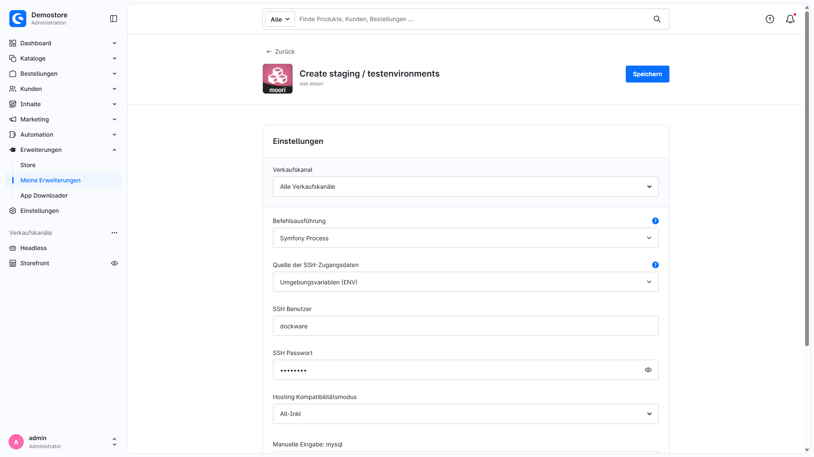

# Installation and operations

## Requirements

MoorlStaging targets Shopware **6.7**. Use PHP and database versions supported by your Shopware installation. MoorlFoundation is not required.

You need:

- A server environment with a Unix shell and tools such as `rsync`, `mysql`, `mysqldump`, `sed`, `touch` and `rm`; depending on options, also `ln`, `chmod` and `find`.
- The PHP functions, extensions and, where applicable, SSH tools required by your selected execution method.
- Read access to the source shop, write access to `_moorl_staging` and the shop's public directory, and permission to create symlinks.
- A dedicated destination database created beforehand, with credentials and sufficient permissions to import and, where needed, drop tables.
- Enough storage for the SQL backup, database copy and shop files.
- A valid source `APP_URL` and web server rules allowing the staging path and its symlinks.
- PHP, web server and proxy runtime limits sufficient for your data volume. There is no fixed creation-time guarantee.

The system check assists with setup. It does not confirm universal hosting compatibility or complete isolation of every integration.

## Installation

1. Back up the production shop and review server requirements.
2. Install and activate **MoorlStaging** under **Extensions → My extensions**.
3. Open the extension configuration and select command execution, SSH credentials where needed, and the hosting compatibility mode.
4. Open **Settings → Extensions → Staging** and create a staging record.
5. Pass the system and database checks, configure the five creation steps and start the full run.
6. Check the destination shop and external services before starting tests or background processes.

See [Create staging / test environments](index.en.md) for the complete guide with screenshots and options.

## Command execution

| Selection | Execution | Requirement |
| --- | --- | --- |
| PHP shell | Locally as the PHP user | PHP `exec` function |
| PHP shell via SSH | As the SSH user on `localhost:22` | PHP `ssh2` extension, username and password |
| Symfony Process | Locally as the PHP user | PHP `proc_open` function |
| Symfony Process via SSH | Through OpenSSH as the SSH user on `localhost:22` | `proc_open`, OpenSSH; password login additionally requires `sshpass` |

New installations start with **PHP shell**. Updates migrate the previous SSH setting to the corresponding execution method. There is no separate SSH activation switch. SSH runs commands as another user on the same server; a configurable remote host is not provided.

For **Symfony Process via SSH**, the PHP user must already trust the `localhost` host key through `known_hosts` or a system-wide file. Unknown or changed host keys abort execution. An empty password uses key authentication through the PHP user's SSH configuration. Password authentication supplies the password to `sshpass` through the `SSHPASS` environment variable.

The Symfony variants do not impose a process timeout. PHP, web server and proxy runtime limits still apply. Error output is captured without rerunning failed commands to collect it.

### SSH credentials from ENV

For both SSH variants, **SSH credentials source** selects **Plugin configuration** or **Environment variables (ENV)**. Set ENV values on the server, for example in `.env.local`:

```dotenv
MOORL_STAGING_SSH_USERNAME=staging
MOORL_STAGING_SSH_PASSWORD='your-ssh-password'
```

Values are read only on the server and are not copied into plugin settings or displayed in Administration. The Administration fields are ignored in ENV mode; missing ENV values do not fall back to those fields. Clear credentials previously saved in Administration after switching so the old values no longer remain accessible through Administration.

Only **Symfony Process via SSH** supports an empty password for key authentication. **PHP shell via SSH** requires a password. ENV changes must take effect for the executing PHP process; also account for existing ENV dumps and service configuration.

## Hosting compatibility mode, binary paths and logging

Select **Hosting compatibility mode** exclusively in the plugin configuration. It controls database binary paths and initial settings for new staging environments. Saved individual process settings are preserved when loading. There is no additional provider selector or load button in the staging screen.

Available profiles are **Default**, **All-Inkl**, **Mittwald**, **Profihost (MariaDB / MySQL / MySQL 8)**, **Timme Hosting (MySQL 8)** and **Manual input**. A listed profile is not a guarantee for all hosting packages or server configurations. Check available tools, database versions, permissions and web server rules for your environment.

**Manual input** lets you supply paths to `mysql` and `mysqldump`. Choose tools suitable for source and destination. **Logger level** controls recorded messages; the default is **ERROR**, with DEBUG, INFO, NOTICE, WARNING and DISABLED also available. Logs are stored under `var/log` in the shop directory. Treat process logs as confidential.



## Directory layout and web server

For an environment named `update-test`, the extension uses:

| Path relative to the Shopware root | Purpose |
| --- | --- |
| `_moorl_staging/update-test/backup/backup.sql` | Source SQL backup with the selected content exclusions |
| `_moorl_staging/update-test/shop` | Shopware shop copy |
| `_moorl_staging/update-test/shop/public` | Destination webroot |
| `public/update-test` | Symlink to the destination webroot |

The web server must support the symlink and required PHP/routing rules. NGINX may require additional server configuration. Coordinate this with your server administrator; creating a symlink alone does not ensure that the destination shop is reachable.

For a custom domain or different routing, destination `APP_URL`, sales channel domains and web server configuration must agree. Automatic configuration inserts the staging path into the source URLs. With multiple domains, those hosts must also resolve correctly and be served by the web server.

## Check data and integrations before testing

Use a destination database dedicated to this environment. Import and recreation may overwrite destination data. The deletion action attempts to remove every table in the saved destination database.

Customer and order contents are excluded by default; these exclusions cover specific tables and do not replace a review of other data. Optional customer anonymization in step 5 affects certain tables in the destination copy and clears existing customer login credentials there. Documents, files, logs, reviews, newsletters, other plugins' data and the SQL backup created beforehand are not anonymized. The [user guide](index.en.md) explains the exact scope.

When media is excluded from copying and linked, live and staging shops share files. Changes or deletions in staging then affect the source. Check existing symlinks when recreating an environment too.

Review mail transport, payment providers, webhooks, search services, cache, Messenger, cron jobs and other integrations specifically for staging. A shop copy also includes configuration and credentials. Maintenance mode and the staging flag do not replace this review.

## Troubleshooting and repeating steps

| Problem | Check |
| --- | --- |
| System check fails | Review execution method, PHP functions, tools/paths and write permissions; then select **Run system check again**. |
| SSH connection fails | Check credentials source, localhost port 22, authentication and, for Symfony/OpenSSH, the host key. |
| Database check fails | Check host, port, database name, permissions and password; avoid a single quotation mark in the password. Select **Test connection** afterwards. |
| Creation remains disabled | Both checks must pass. Changing database credentials requires a new connection test. |
| A creation step fails | Review errors and logs; check free storage, permissions, binary versions and runtime limits. The full run stops on reported step errors. |
| Destination shop is unreachable | Check symlink, webroot, web server routing, domains and `APP_URL`. |
| Search/SEO data is missing | Review exclusions and rebuild required indexes or SEO data in the destination. |

Repeat individual steps after resolving the cause. Check prerequisite outputs and possible overwrites beforehand. There is no automatic rollback of all changes already made.

A successful step status does not replace checking the copy. **PHP shell via SSH** does not evaluate the remote command exit code; the other execution methods accept exit code 23, which rsync can report for a partial transfer. Verify the required files, permissions and functionality in the destination shop.

## Deletion and uninstallation

Use **Kill staging** on the Dashboard and confirm to remove an unneeded environment. Inspect the destination database, shop copy, backup and public symlink afterwards. The management record may be removed even when an individual cleanup action fails.

Uninstallation leaves existing staging files and destination databases in place. Uninstalling without retaining user data deletes management records. Clean up environments before uninstalling where possible.
