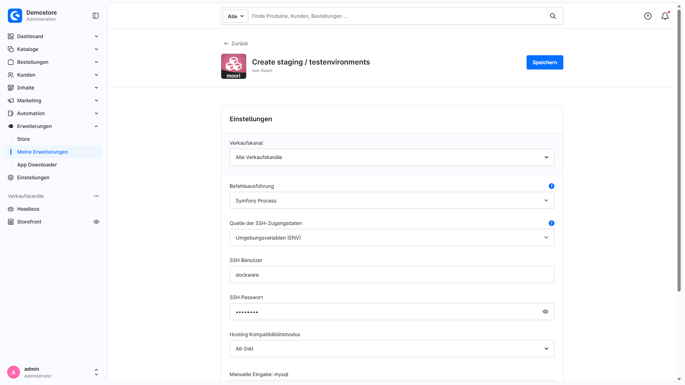

# Installation und Betrieb

## Voraussetzungen

MoorlStaging ist für Shopware **6.7** vorgesehen. Verwenden Sie die zu Ihrer Shopware-Version passenden PHP- und Datenbankversionen. MoorlFoundation ist keine Voraussetzung.

Benötigt werden:

- Eine Serverumgebung mit Unix-Shell und Werkzeugen wie `rsync`, `mysql`, `mysqldump`, `sed`, `touch` und `rm`; je nach Optionen außerdem `ln`, `chmod` und `find`.
- Die für die gewählte Befehlsausführung nötigen PHP-Funktionen, Erweiterungen und gegebenenfalls SSH-Werkzeuge.
- Lesezugriff auf den Quellshop, Schreibzugriff auf `_moorl_staging` und das öffentliche Shopverzeichnis sowie Berechtigungen zur Erstellung von Symlinks.
- Eine eigene, bereits angelegte Zieldatenbank mit Zugangsdaten und ausreichenden Rechten für Import und gegebenenfalls Löschen von Tabellen.
- Ausreichend Speicherplatz für SQL-Sicherung, Datenbankkopie und Shopdateien.
- Eine gültige Quell-`APP_URL` sowie Webserver-Regeln, die den Staging-Pfad und seine Symlinks zulassen.
- PHP-, Webserver- und Proxy-Laufzeitgrenzen, die für die Datenmenge ausreichen. Es gibt keine feste Zusage zur Erstellungsdauer.

Die Systemprüfung hilft bei der Einrichtung. Sie bestätigt keine allgemeine Hosting-Kompatibilität und keine vollständige funktionale Trennung aller Integrationen.

## Installation

1. Sichern Sie den Produktivshop und prüfen Sie die Servervoraussetzungen.
2. Installieren und aktivieren Sie **MoorlStaging** über **Erweiterungen → Meine Erweiterungen**.
3. Öffnen Sie die Konfiguration der Erweiterung und wählen Sie Befehlsausführung, bei Bedarf SSH-Zugangsdaten und Hosting-Kompatibilitätsmodus.
4. Öffnen Sie **Einstellungen → Erweiterungen → Staging** und legen Sie ein Staging-System an.
5. Führen Sie System- und Datenbankprüfung erfolgreich aus. Konfigurieren Sie danach die fünf Erstellungsschritte und starten Sie den Gesamtlauf.
6. Prüfen Sie den Zielshop einschließlich externer Dienste, bevor Sie dort Tests oder Hintergrundprozesse starten.

Die vollständige Anleitung mit Screenshots und Optionen finden Sie unter [Staging / Testumgebungen erstellen](index.md).

## Befehlsausführung

| Auswahl | Ausführung | Voraussetzung |
| --- | --- | --- |
| PHP shell | Lokal als PHP-Benutzer | PHP-Funktion `exec` |
| PHP shell via SSH | Als SSH-Benutzer auf `localhost:22` | PHP-Erweiterung `ssh2`, Benutzername und Passwort |
| Symfony Process | Lokal als PHP-Benutzer | PHP-Funktion `proc_open` |
| Symfony Process via SSH | Über OpenSSH als SSH-Benutzer auf `localhost:22` | `proc_open`, OpenSSH; bei Passwortanmeldung zusätzlich `sshpass` |

Neue Installationen beginnen mit **PHP shell**. Updates übernehmen die frühere SSH-Einstellung in die passende Ausführungsart. Eine separate SSH-Aktivierung ist nicht erforderlich. SSH dient der Ausführung unter einem anderen Benutzer auf demselben Server; ein frei wählbarer Remote-Host ist nicht vorgesehen.

Bei **Symfony Process via SSH** muss der PHP-Benutzer dem Hostschlüssel von `localhost` bereits über `known_hosts` oder eine systemweite Datei vertrauen. Unbekannte oder geänderte Hostschlüssel führen zum Abbruch. Ein leeres Passwort verwendet Schlüsselanmeldung über die SSH-Konfiguration des PHP-Benutzers. Bei Passwortanmeldung wird das Passwort über die Umgebungsvariable `SSHPASS` an `sshpass` übergeben.

Die Symfony-Varianten haben kein eigenes Prozess-Zeitlimit. PHP-, Webserver- und Proxy-Laufzeitgrenzen gelten weiterhin. Fehlerausgaben werden erfasst, ohne fehlgeschlagene Befehle dafür erneut auszuführen.

### SSH-Zugangsdaten aus ENV

**Quelle der SSH-Zugangsdaten** bietet für beide SSH-Varianten **Plugin-Konfiguration** oder **Umgebungsvariablen (ENV)**. Hinterlegen Sie ENV-Werte serverseitig, beispielsweise in `.env.local`:

```dotenv
MOORL_STAGING_SSH_USERNAME=staging
MOORL_STAGING_SSH_PASSWORD='dein-ssh-passwort'
```

Die Werte werden ausschließlich auf dem Server gelesen und nicht in die Plugin-Konfiguration kopiert oder im Admin angezeigt. Im ENV-Modus werden die Admin-Felder ignoriert; fehlende ENV-Werte führen zu keinem Rückgriff auf diese Felder. Leeren Sie zuvor gespeicherte Admin-Zugangsdaten nach dem Wechsel, damit alte Werte nicht weiter über die Administration abrufbar bleiben.

Nur **Symfony Process via SSH** unterstützt ein leeres Passwort für Schlüsselanmeldung. **PHP shell via SSH** benötigt ein Passwort. Änderungen an ENV-Dateien müssen für den ausführenden PHP-Prozess wirksam sein; beachten Sie auch vorhandene ENV-Dumps und Dienstkonfigurationen.

## Hosting-Kompatibilitätsmodus, Binärpfade und Logging

Wählen Sie den **Hosting Kompatibilitätsmodus** ausschließlich in der Plugin-Konfiguration. Er bestimmt die Datenbank-Binärpfade und Anfangswerte neuer Staging-Systeme. Gespeicherte individuelle Prozesseinstellungen werden beim Laden beibehalten. Eine weitere Provider-Auswahl oder ein Lade-Button in der Staging-Maske ist nicht erforderlich.

Die Auswahl umfasst **Default**, **All-Inkl**, **Mittwald**, **Profihost (MariaDB / MySQL / MySQL 8)**, **Timme Hosting (MySQL 8)** und **Manual input**. Das Vorhandensein eines Profils ist keine Zusage für sämtliche Tarife oder Serverkonfigurationen. Prüfen Sie verfügbare Werkzeuge, Datenbankversionen, Benutzerrechte und Webserver-Regeln für Ihre konkrete Umgebung.

Bei **Manual input** können Sie die Pfade zu `mysql` und `mysqldump` ausdrücklich angeben. Wählen Sie Werkzeuge passend zu Quelle und Ziel. Über **Logger level** steuern Sie die protokollierten Meldungen; Standard ist **ERROR**, zusätzlich stehen DEBUG, INFO, NOTICE, WARNING und DISABLED zur Verfügung. Protokolle liegen unter `var/log` im Shopverzeichnis. Behandeln Sie Prozessprotokolle als vertraulich.



## Verzeichnisstruktur und Webserver

Für ein Staging namens `update-test` verwendet die Erweiterung folgende Struktur:

| Pfad relativ zum Shopware-Hauptverzeichnis | Zweck |
| --- | --- |
| `_moorl_staging/update-test/backup/backup.sql` | SQL-Sicherung der Quelle mit den gewählten Inhaltsausschlüssen |
| `_moorl_staging/update-test/shop` | Kopie des Shopware-Shops |
| `_moorl_staging/update-test/shop/public` | Webroot des Zielshops |
| `public/update-test` | Symlink zum Webroot des Zielshops |

Der Webserver muss den Symlink und die benötigten PHP-/Routing-Regeln unterstützen. Bei NGINX kann eine zusätzliche serverseitige Konfiguration erforderlich sein. Stimmen Sie sie mit Ihrer Serveradministration ab; ein erfolgreich erstellter Symlink allein macht den Zielshop nicht zwingend erreichbar.

Bei einer eigenen Domain oder abweichendem Routing müssen Ziel-`APP_URL`, Verkaufskanal-Domains und Webserver-Konfiguration zueinander passen. Die automatische Konfiguration verwendet die Quelladressen mit eingefügtem Staging-Pfad. Bei mehreren Domains müssen auch diese Hosts korrekt aufgelöst und vom Webserver bedient werden.

## Daten und Integrationen vor dem Test prüfen

Verwenden Sie ausschließlich eine für dieses Staging bestimmte Zieldatenbank. Import und erneute Erstellung können vorhandene Zieldaten überschreiben. Die Löschfunktion versucht sämtliche Tabellen der gespeicherten Zieldatenbank zu entfernen.

Standardmäßig werden Kunden- und Bestellinhalte ausgeschlossen; das betrifft definierte Tabellen und ersetzt keine Prüfung anderer Datenbestände. Die optionale Kundenanonymisierung in Schritt 5 betrifft nur bestimmte Tabellen der Zielkopie und entfernt dort bestehende Kundenzugangsdaten. Dokumente, Dateien, Logs, Bewertungen, Newsletter und Daten anderer Plugins sowie die vorher angelegte SQL-Sicherung werden nicht anonymisiert. Der [Benutzerleitfaden](index.md) beschreibt den genauen Umfang.

Wenn Sie Medien vom Kopieren ausschließen und verlinken, teilen sich Live- und Testshop die Dateien. Änderungen oder Löschungen im Staging wirken sich dann auf die Quelle aus. Prüfen Sie bestehende Symlinks auch bei einer erneuten Erstellung.

Prüfen Sie Mailtransport, Zahlungsanbieter, Webhooks, Suchdienste, Cache, Messenger, Cronjobs und weitere Anbindungen gezielt für die Testumgebung. Eine Shopkopie übernimmt auch Konfigurationen und Zugangsdaten. Wartungsmodus und Staging-Kennzeichnung ersetzen diese Prüfung nicht.

## Fehlerbehebung und Wiederholung

| Problem | Prüfung |
| --- | --- |
| Systemprüfung schlägt fehl | Ausführungsart, PHP-Funktionen, Werkzeuge/Pfade und Schreibrechte prüfen; danach **System erneut prüfen**. |
| SSH-Verbindung scheitert | Zugangsdatenquelle, localhost-Port 22, Anmeldung und bei Symfony/OpenSSH Hostschlüssel prüfen. |
| Datenbankprüfung schlägt fehl | Host, Port, Datenbankname, Rechte und Passwort prüfen; einfachen Anführungsstrich im Passwort vermeiden. Danach **Datenbankverbindung testen**. |
| Erstellung bleibt gesperrt | Beide Prüfungen müssen erfolgreich sein. Eine Änderung der Datenbankdaten erfordert einen neuen Verbindungstest. |
| Ein Erstellungsschritt schlägt fehl | Fehlermeldung und Protokolle prüfen; Speicherplatz, Rechte, Binärversionen und Laufzeitgrenzen kontrollieren. Der Gesamtlauf stoppt bei gemeldeten Schrittfehlern. |
| Zielshop nicht erreichbar | Symlink, Webroot, Webserver-Routing, Domains und `APP_URL` prüfen. |
| Fehlende Such-/SEO-Daten | Ausschlüsse prüfen und benötigte Indizes beziehungsweise SEO-Daten im Ziel neu aufbauen. |

Einzelschritte lassen sich nach Behebung der Ursache erneut ausführen. Prüfen Sie vorher die benötigten Ergebnisse vorheriger Schritte und mögliche Überschreibungen. Es gibt keinen automatischen Rücklauf aller bereits erfolgten Änderungen.

Ein erfolgreicher Schrittstatus ersetzt keine Prüfung der Kopie. Bei **PHP shell via SSH** wird der Rückgabecode des entfernten Befehls nicht ausgewertet; die anderen Ausführungsarten akzeptieren unter anderem Rückgabecode 23, den rsync bei einer unvollständigen Übertragung melden kann. Kontrollieren Sie deshalb die benötigten Dateien, Berechtigungen und Funktionen im Zielshop.

## Löschen und Deinstallation

Löschen Sie nicht mehr benötigte Umgebungen über **Staging System löschen** im Dashboard und bestätigen Sie die Aktion. Kontrollieren Sie danach Zieldatenbank, Dateikopie, Sicherung und öffentlichen Symlink. Der Verwaltungseintrag kann auch dann entfernt sein, wenn einzelne Bereinigungsschritte fehlschlagen.

Bei Deinstallation bleiben vorhandene Staging-Dateien und Zieldatenbanken bestehen. Ohne Beibehaltung der Benutzerdaten werden die Verwaltungseinträge gelöscht. Bereinigen Sie Umgebungen deshalb möglichst vor der Deinstallation.
