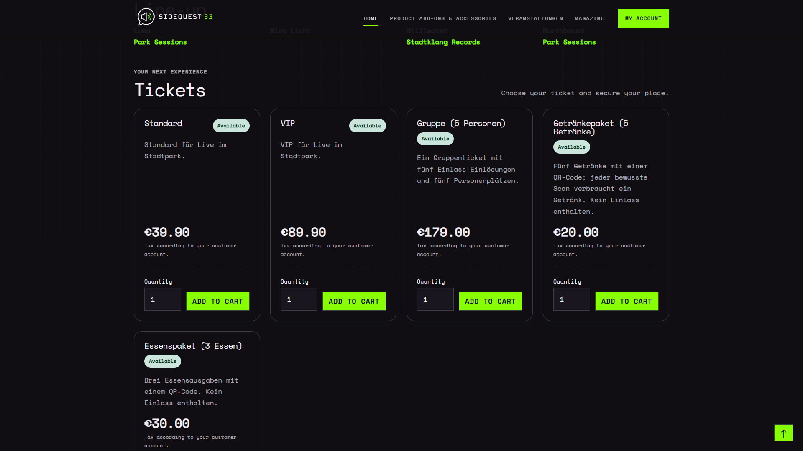

# Your tickets: buy, download and show at the entrance

## Ordering tickets

Open **Events** in the shop, choose an event and ticket category, add the required quantity to your cart and complete checkout using an offered payment method. Each admission ticket has its own number and QR code.

A place is occupied only when checkout is completed. Availability can change while tickets remain in the cart.

## Receiving your tickets

Tickets are activated after confirmed full payment and sent by email as a PDF. An order confirmation alone is not a valid admission ticket. The shop sets its payment deadline; pay promptly and contact the organiser if payment is late.

With a customer account, sign in and open **My account → Tickets** to download your assigned activated tickets. Each ticket email includes a personal link for each ticket. Guest purchasers can use it to edit and download that ticket without a customer account. The link grants access to that ticket; share it only with the person who will use it. Manual invitations may also be emailed or supplied directly as PDFs.

## Personalising tickets

The ticket overview follows the Shopware order history layout, with status, event date, ticket type and venue, plus expandable details. PDF downloads use the ticket number as the filename (for example, `T-10000.pdf`). Expand the ticket details to edit the attendee name and mobile number or download the PDF. **Open ticket** takes you to the individual ticket page.

In your account or through the personal ticket link, enter and save the attendee's **first and last name** for each ticket. The purchaser's name is used initially. Pending and valid tickets can be edited; redeemed, expired and revoked tickets are locked.

Download the updated PDF after saving a change. The name appears on the ticket and in the entrance scanner. Changing the name does not send another email or change the purchaser or delivery recipient. Guest purchasers can make the same changes through the ticket link in their email.

You can optionally add or change a **mobile number** for each ticket under the same editing rules as the attendee name. The number appears in scan results and can be dialled using **Call** in the browser scanner.

## Admission and service packages

1. Open the PDF on your phone or print it legibly.
2. Have the correct QR code for this event ready.
3. Present the QR code in the specified area: admission, drinks or food. A group or service package can contain several redemptions on one code.

A normal single ticket can be redeemed once. Group and service packages allow the number of redemptions printed on the ticket; each deliberate scan uses one. Your account shows the current redeemed and remaining amounts. The PDF shows the state when it was generated. Copies and repeat downloads do not create extra admissions. Keep your PDF safe and share a code only with the person who should use it. The ticket number helps customer support; regular scanning requires the QR code.

## If something goes wrong

- **No email:** Check spam and contact the shop with your order or ticket number. Staff can investigate or resend.
- **Payment pending:** Check payment completion. Activation follows confirmation in the shop system.
- **Expired or revoked:** The ticket is not valid for admission. Contact the organiser.
- **Fully redeemed:** All included redemptions have been used. Printing again does not reset them.
- **Wrong area:** Present the code at the admission, drinks or food station indicated on the ticket.
- **Wrong event:** Check event name and date on the PDF.

Changes, refunds and rebookings are subject to the shop's or organiser's terms. Contact their customer service for assistance.

## Choosing tickets in the shop

The example shows individual tickets and packages in the demo shop. The available categories and design depend on the event.

