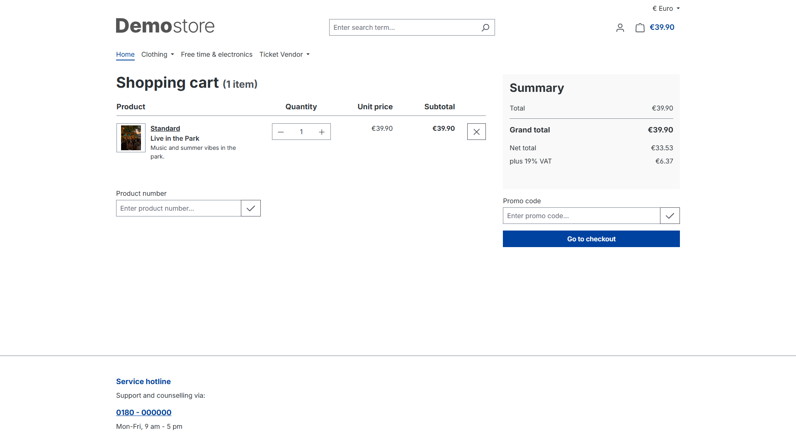

# Ihre Tickets: kaufen, herunterladen und vorzeigen

## Tickets bestellen

Öffnen Sie im Shop **Veranstaltungen**, wählen Sie Ihre Veranstaltung und die gewünschte Ticketkategorie. Legen Sie die Anzahl in den Warenkorb und schließen Sie die Bestellung mit Ihrer bevorzugten angebotenen Zahlungsart ab. Für jede Eintrittskarte erhalten Sie ein eigenes Ticket mit eigener Nummer und eigenem QR-Code.

Ein Platz wird erst beim Bestellabschluss belegt. Die Verfügbarkeit kann sich daher ändern, solange Tickets nur im Warenkorb liegen.

## Tickets erhalten

Nach bestätigter vollständiger Zahlung werden die Tickets freigegeben und als PDF per E-Mail verschickt. Eine Bestellbestätigung allein ist noch kein gültiges Eintrittsticket. Die Zahlungsfrist bestimmt der Shop; bezahlen Sie rechtzeitig und wenden Sie sich bei einer verspäteten Zahlung an den Veranstalter.

Mit einem Kundenkonto finden Sie Ihre zugeordneten Tickets nach Anmeldung unter **Mein Konto → Tickets**. Dort können Sie freigegebene Tickets als PDF herunterladen. Die Ticketmail enthält für jedes Ticket einen persönlichen Link. Damit können auch Gastbesteller das betreffende Ticket ohne Kundenkonto bearbeiten und herunterladen. Der Link gilt nur für dieses Ticket; geben Sie ihn nur an die Person weiter, die es nutzen soll. Eine manuelle Einladung kann ebenfalls direkt per E-Mail oder als ausgehändigtes PDF erfolgen.

## Tickets personalisieren

Die Ticketübersicht ist wie die Shopware-Bestellübersicht aufgebaut: mit Status, Veranstaltungsdatum, Tickettyp und Veranstaltungsort sowie aufklappbaren Details. Der PDF-Download verwendet die Ticketnummer als Dateinamen (zum Beispiel `T-10000.pdf`). Öffnen Sie die Ticketdetails, um Name und Handynummer anzupassen oder das PDF herunterzuladen. Mit **Ticket öffnen** gelangen Sie zur einzelnen Ticketseite.

Im Kundenkonto oder über den persönlichen Ticketlink können Sie für jedes noch nicht eingelöste Ticket den **Vor- und Nachnamen** der teilnehmenden Person eintragen und speichern. Anfangs wird der Name des Käufers verwendet. Offene und gültige Tickets sind bearbeitbar; eingelöste, abgelaufene und widerrufene Tickets sind gesperrt.

Laden Sie nach einer Änderung das aktuelle PDF herunter. Der gespeicherte Name steht auf dem Ticket und erscheint beim Einlass im Scanner. Die Änderung verschickt keine neue E-Mail und ändert weder den Käufer noch den E-Mail-Empfänger. Gastbesteller können dieselben Änderungen über den Ticketlink aus der E-Mail vornehmen.

Optional können Sie pro Ticket eine **Handynummer** ergänzen oder ändern. Für die Bearbeitung gelten dieselben Regeln wie beim Namen. Leerzeichen werden beim Speichern entfernt; eine leere Eingabe entfernt die Nummer. Die Nummer erscheint beim Scan und kann im Browser-Scanner über **Anrufen** gewählt werden.

## Einlass und Verzehrpakete

1. Das PDF auf dem Smartphone öffnen oder gut lesbar ausdrucken.
2. Den passenden QR-Code für die Veranstaltung bereithalten.
   Kann der Code nicht gescannt werden, kann das Personal den direkt darunter gedruckten **Ticket-Token** manuell eingeben.
3. Den passenden Code des Einzel- oder Gruppentickets vorzeigen.

Ein normales Einzelticket kann einmal eingelöst werden. Gruppen- und Verzehrpakete erlauben die auf dem Ticket angegebene Zahl von Einlösungen; jeder bewusste Scan verbraucht eine davon. Das Konto zeigt den aktuellen Verbrauch und Rest. Das PDF zeigt den Stand seiner Erstellung. Zeigen Sie den Code im angegebenen Bereich Einlass, Getränke oder Essen vor. Kopien oder erneute Downloads schaffen keine weiteren Eintritte. Schützen Sie Ihr PDF und teilen Sie den Code nur mit der Person, die das Ticket nutzen soll. Die Ticketnummer dient Rückfragen; beim regulären Scan wird der QR-Code benötigt.

## Wenn etwas nicht funktioniert

- **Keine E-Mail:** Spamordner prüfen und dem Shop Ihre Bestell- oder Ticketnummer nennen. Der Shop kann den Versand prüfen und gegebenenfalls wiederholen.
- **Zahlung ausstehend:** Zahlungsabschluss prüfen. Freigabe erfolgt erst nach Bestätigung im Shopsystem.
- **Abgelaufen oder widerrufen:** Das Ticket ist nicht für den Einlass freigegeben. Klärung mit dem Veranstalter ist erforderlich.
- **Bereits eingelöst:** Das Ticket wurde bereits verwendet. Ein neuer Ausdruck setzt es nicht zurück.
- **Andere Veranstaltung:** Veranstaltungsname und Datum auf dem PDF prüfen.

Für Umbuchungen, Erstattungen und Änderungen gelten die Bedingungen des jeweiligen Shops beziehungsweise Veranstalters. Wenden Sie sich dafür an dessen Kundenservice.

## Ticketwahl im Shop

Wählen Sie ein Einzelticket oder Paket und die gewünschte Menge.

