# Ticket Vendor

Manage events and sell tickets in Shopware with quotas, PDF/QR tickets, payment activation, artist booking, line-ups, guest lists and online check-in.

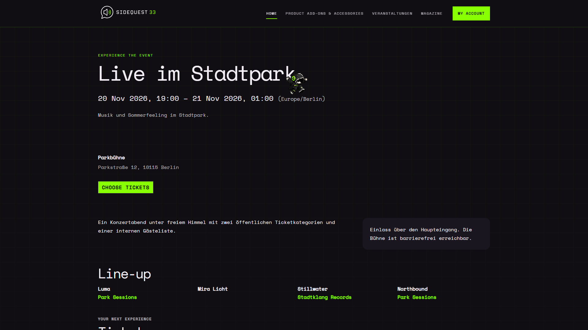

---

## Plugin Demo

A storefront demo is available for testing this plugin. The plugin can be tested at the following link:

- [https://demo-sw67.moori.net/MoorlTicketVendor](https://demo-sw67.moori.net/MoorlTicketVendor)

## Purchase the Plugin

This plugin can be purchased in the **Shopware Community Store**.

- [Shopware Community Store](https://store.shopware.com/en/search?search=MoorlTicketVendor)

**Important note:** You need the Foundation Plugin, which is available free of charge: [moori Foundation](../MoorlFoundation/index.md)

## Quickstart

A **demo package** is available for testing this plugin.

Go to `Settings` → [`Demo Assistant`](../MoorlFoundation/demo-assistant.md) and select `MoorlTicketVendor`.

**Note:** In some cases, new categories and pages will be added to your shop. Please note that the demo data is provided for testing purposes only. The images included may be protected by copyright and must not be made publicly available.

## Requirements and first walkthrough

Ticket Vendor requires Shopware 6.7 with Storefront and MoorlFoundation 1.7. Foundation supplies forms, grids, CMS helpers and data packages. Install and activate Foundation first. Scheduled tasks and message consumers must run for payment deadlines and automatic delivery.

1. Create an event under **Catalogues → Ticket Vendor - Events**.
2. Enter its start, end, location and content; activate it.
3. Assign an active ticket type with price, tax and quota.
4. Create a category with the CMS event listing and select it under **Page with events (list)** in the plugin configuration. Open the event through that category and place a test order.
5. Test the actual payment process. Tickets become valid and are queued for delivery when Shopware reports the relevant transaction as `paid`.
6. Open the PDF in the customer account or Administration.
7. Choose the event and redemption area in the scanner. A single ticket is exhausted after one scan; packages stay valid until their final redemption.

## Managing events

The event list provides access to all created events. Event details combine general information, public content, location, assigned ticket types, customer tickets and check-in records.

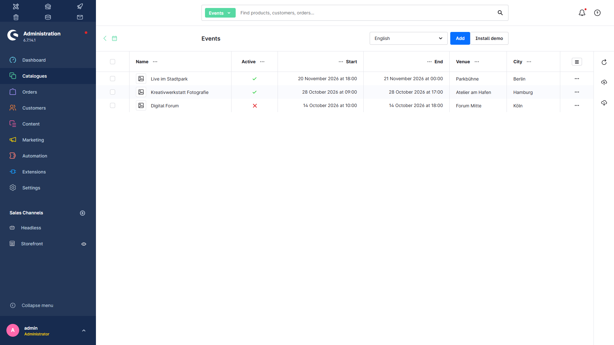

| Section | Purpose |
| --- | --- |
| Name and description | Public title and detailed information. Maintain translated content for your shop languages. |
| Active | This switch controls event availability. Public sales also require valid time windows. |
| Start and end | Event times. A configured end time also closes admission validation. |
| Timezone | IANA identifier such as `Europe/Berlin`. Technical timestamps are stored in UTC; use UTC when importing. |
| Show from/until | Separate public visibility and sales window, in addition to event times. |
| Location and address | Venue name, visitor instructions, street, postcode, city and country. |
| Media and SEO | Images, teaser, metadata and other Foundation content. |
| Shopping Experience | Optional CMS page for event details. |

Public visibility requires a matching sales window. When an end time is configured, public sales end at that time; otherwise they end at the event start. Set “Show until” for an earlier sales cutoff.

Events do not have a technical name. Their ID identifies them; the translated name is for display. Existing ticket and audit references restrict deletion. Deactivate the event or restrict its selling window to stop sales.

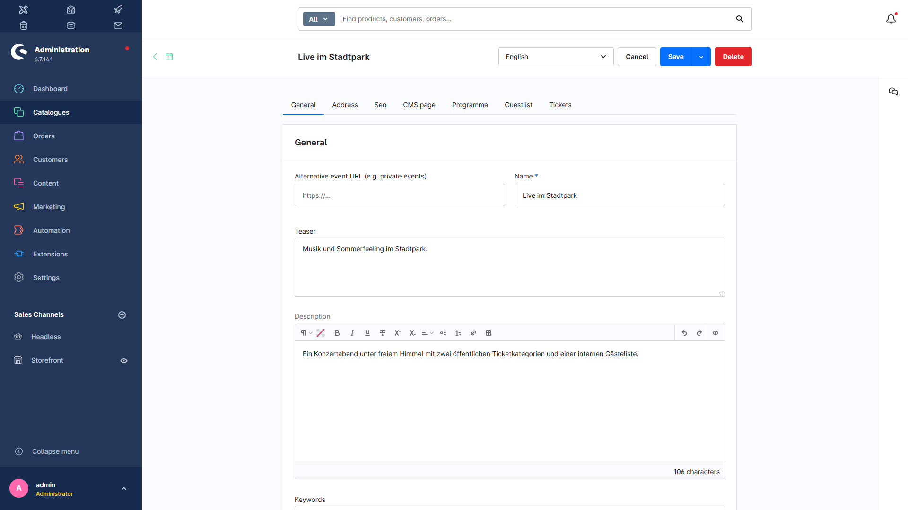

## Ticket types, prices and quotas

Ticket types are available under **Settings** and within their event. Each type belongs to exactly one event, for example Standard, VIP or Guest list.

| Field | Meaning |
| --- | --- |
| Event | Assigned event. Types with issued tickets cannot be moved to another event. |
| Name | Public and administrative label. |
| Active | Active types can be sold publicly. Inactive types can be used for internal invitations. |
| Price and tax | Shopware prices and tax rate; the server calculates prices in the cart currency. |
| Total quota | Maximum occupied places for this type. |
| Occupied quota units | System-managed, read-only occupancy including pending and redeemed tickets. |
| Redemption area | Admission, drinks or food. One ticket belongs to exactly one area. |
| Redemptions per ticket | Whole number from 1; each deliberate scan consumes one. |
| Person places per ticket | At least 1 for admission; exactly 0 for drinks/food. |
| Minimum/maximum purchase | Allowed aggregate quantity of this type in a purchase. |
| Show from/until | Optional type sales window in addition to the event window. |
| Position | Ordering of ticket types. |

`pending`, `valid` and `redeemed` occupy quota; `expired` and `revoked` release it. Redeeming a ticket does not release a place for another sale. A cart does not reserve places. Quota is occupied when the order is completed, with final availability checks and ticket creation in the same transaction to protect the last place against competing purchases.

Manual tickets are subject to the same quota checks. Total quota cannot be reduced below current occupancy.

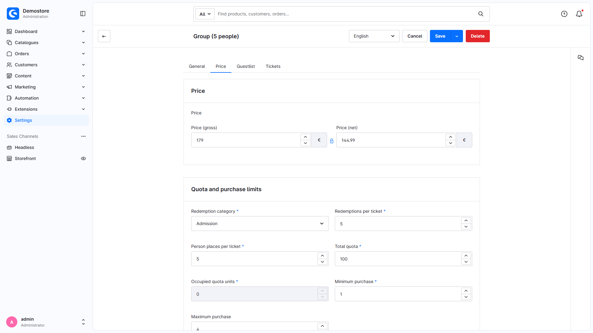

## Packages and fixed ticket values

A five-person admission ticket occupies five type quota units and five event places and includes five redemptions on one QR code. A five-drink package occupies one type quota unit and no event places. A quota of 100 therefore permits 20 group tickets or 100 drink packages. With four event places free, the group ticket is unavailable while a drink package can remain available. Price and purchase quantity count complete tickets/packages.

Each ticket stores its area, limit and person places from its type. Later type changes apply to new tickets. An unbound manual ticket can change type before first use, with fresh snapshots and quota checks; after first use its type/event are fixed. Revocation and reactivation preserve consumption. Fully consumed tickets cannot be made redeemable again. Account/PDF show the stored entitlement; the account shows current consumption.

## Storefront, CMS and SEO

The Shopware category selected through `category` in the plugin configuration uses a shopping experience with the `moorl-tv-ticket-sale-listing` element. It lists available events with pagination and is the destination of the back link on event details. The `/tickets/{saleId}` detail page uses the CMS layout assigned to the event or the configured default `cmsPageId`. Without a CMS selection, the basic detail view is used; without a category selection, the back link is hidden. Purchases use Shopware's normal cart and checkout. Ticket line items are digital and do not require physical shipping.

The Foundation **Events** CMS element (`moorl-tv-ticket-sale-listing`) embeds an event listing in Shopping Experiences. Event detail pages can also load an assigned CMS page.

The supplied native SEO template uses `tickets/<event-name>/<ID>`. Keep SEO indexes current after changes. Existing customised SEO templates are preserved when importing the data package again.

Use **Events with archive (static)** (`moorl-tv-ticket-sale-static-listing`) for a fixed overview of all active events. Ongoing and upcoming events appear first, with the nearest date at the top; past events follow in descending order with a grey appearance. Ticket selling windows do not restrict this overview. Set **Alternative event URL** on an event to link private events to a community, for example. Without an alternative URL, available events link to their event page. Past events have no purchase button. Add the optional nullable `moorl_tv_ticket_sale.alternative_url` column (`VARCHAR(2048)`) using the schema tool, then rebuild Administration and the theme.

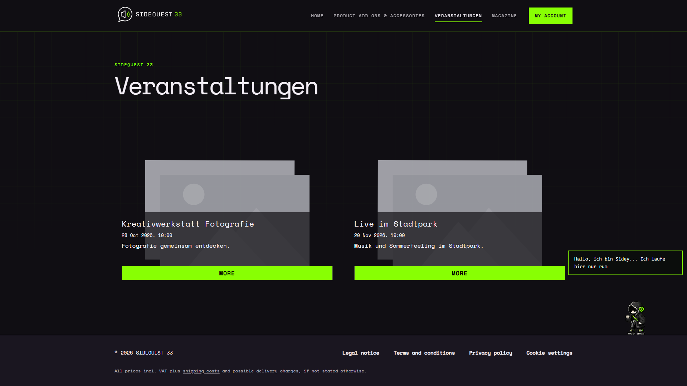

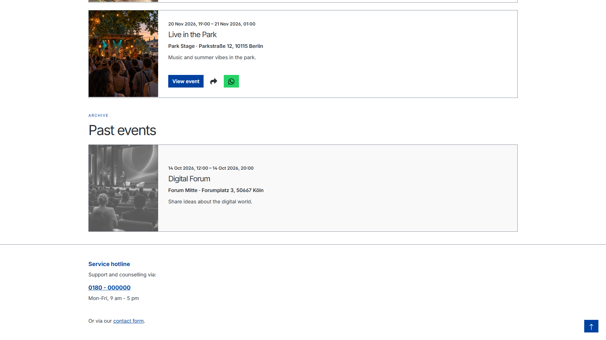

## Orders, payments and activation

One individual ticket is created for each purchased unit. A line item with quantity three therefore produces three ticket numbers and QR codes. An order may contain different categories and events.

Order tickets start as **Payment pending**. The default payment deadline is 30 minutes, configurable through **Payment deadline in minutes** in the extension settings. Only the native `paid` transaction state activates tickets. An open, authorised or partially paid transaction is insufficient. Even a zero-price checkout needs the corresponding native payment completion; use manual creation for invitations that should be valid immediately.

The expiry task checks the actual payment state again. Overdue unpaid orders are cancelled through native transitions and their tickets expire, releasing quota. This can affect the entire order, including other items. Account for mixed carts and payment methods that need longer to settle.

Order cancellation, full refund and chargeback revoke tickets that still occupy quota. A late payment does not automatically reactivate an already cancelled order. Reconcile such cases manually in Shopware and with the payment provider. The plugin does not initiate its own provider refund.

## Individual tickets and statuses

Tickets are shown in event details and in the ticket tabs on order and customer details. Columns include number, event, type, recipient, order association, validity and delivery status.

| Ticket status | Meaning |
| --- | --- |
| `pending` | Occupies quota but is not yet valid for admission or a valid PDF. |
| `valid` | Activated and redeemable for the matching open event. |
| `redeemed` | Already used; another independent scan is rejected. |
| `expired` | Payment deadline expired; no admission. |
| `revoked` | Blocked, for example after cancellation or manual revocation. |

The native **Ticket numbers** number range (`moorl_tv_ticket`) defaults to `T-{n}` starting at 10000. Numbers are generated on save and immutable afterwards. The QR code contains a separate random token. The visible ticket number is not a substitute for the QR code or token at check-in.

## Manual tickets and guest lists

Create a customer ticket directly within an event. The event is preselected and the type selector only offers its types. Neither an order nor a customer account is required. Manual tickets default to **Valid** without waiting for payment.

For an internal guest list:

1. Create a Guest list ticket type with price zero and its own quota.
2. Leave the type **inactive** to exclude it from public sales. The event itself must remain active for admission.
3. Create one ticket per guest.
4. Optionally assign a customer or recipient email address.
5. Print/download or send the PDF and scan it normally at the entrance.

Tickets without an account or order are supported. Without an email recipient they can be saved and issued as PDFs, but require a recipient before delivery. The automatic recovery task also considers undelivered valid manual tickets, so saving a ticket with a recipient is not a permanent “save only” mode.

The guest-list tab of a free ticket type also provides a private registration form with name, email, optional phone number and voluntary support options. Registrations can be confirmed and individually converted into tickets. Registration does not reserve capacity. Companion counts and admission lookup by name are not provided.

## PDFs and email delivery

Ticket actions provide **Download PDF**, **Resend** and **Revoke ticket**, subject to permissions. PDFs can be issued for valid and redeemed tickets. Downloading a redeemed ticket again does not restore admission rights.

Recipient resolution uses this order:

1. Explicit ticket recipient email.
2. Assigned customer email.
3. Order customer snapshot email.

Order delivery groups by actual recipient and sales channel, keeping tickets for different recipients out of the same attachment. The supplied **Ticket delivery** template has German and English content and can be adjusted in Shopware's mail management. Its `tickets` context contains `ticketNumber`, `eventName` and `typeName`; it does not expose QR tokens. The plugin generates the PDF attachment separately.

| Delivery status | Meaning |
| --- | --- |
| `pending` | No successful delivery has been recorded yet. |
| `sent` | Accepted by the mail transport; not proof of inbox delivery or reading. |
| `failed` | A delivery attempt failed. Check recipient, template, SMTP and workers. |

The recovery task requeues pending/failed valid tickets with fewer than five attempts, at least five minutes after their last modification. Messenger additionally uses its configured retry strategy. The Administration action can explicitly resend previously delivered tickets.

Concurrent delivery attempts are serialised. A process crash after SMTP acceptance but before saving success can still result in a duplicate email on retry.

## Flow Builder

The **Send tickets** action is available for events with an order context. It needs no additional action configuration and queues valid or redeemed tickets belonging to that order. Previously delivered tickets are skipped. A flow does not replace payment activation or running workers.

## Admission with the browser scanner

1. Sign in as a user with the **Ticket Vendor – Scanner** role.
2. Open **Dashboard → Ticket scanner**.
3. Select the correct event and area: admission, drinks or food.
4. Start **Scan QR with camera** and allow camera access, or enter the complete ticket token manually/use a compatible scanner that enters it as text.
5. Check the result. Only **Check-in accepted** confirms a new redemption.

The scanner fills the screen and adapts its controls to smartphones and tablets. **Camera** and **Manual** switch the capture mode. After a result, **Next ticket** restarts the camera or focuses the manual input. Successful redemption, an already redeemed ticket and a refusal use distinct text, icons and colours.

Use **Open fullscreen** to activate the browser's fullscreen mode if supported by the device. **Back to Administration** leaves the scanner. Leaving the scanner or switching to manual input stops the camera. After a connection failure, the token and request ID are retained for **Try again**.

Camera scanning needs a secure browser context, normally HTTPS, and camera permission. The bundled jsQR fallback decodes camera frames when native QR detection is unavailable. Manual token entry remains available without camera recognition. An online connection to the shop is required.

| Result | Entrance action |
| --- | --- |
| Check-in accepted | Admit the attendee; the ticket was redeemed. |
| Wrong area | Use the required area shown; no redemption was consumed. |
| Already redeemed | Do not grant another admission based on that code; consult the event manager. |
| Wrong event | Check the selected event. |
| Event closed | Ask an administrator to check event activation and end time. |
| Not valid | Ask an administrator to check payment, expiry or revocation. |
| Unknown ticket | Check the complete code and contact administration if necessary. |
| Network error | No reliable outcome yet. Retry the same scan request. |

Each deliberate scan uses one redemption and shows consumed, total and remaining amounts. A ticket stays valid until its final redemption. The camera pauses after results until **Next ticket**. Changing event or area resets camera, input and pending retries. The API prevents spending the last redemption twice during concurrent scans. Retrying the same request returns its original outcome; a new independent scan of a redeemed ticket reports “already redeemed”. The audit records outcome, time, request ID and optionally device and authenticated user/integration. There is no dedicated check-in reset operation.

Admission requires an active event whose configured end time has not passed. There is no separate configurable admission opening time: a future start time alone does not prevent scanning.

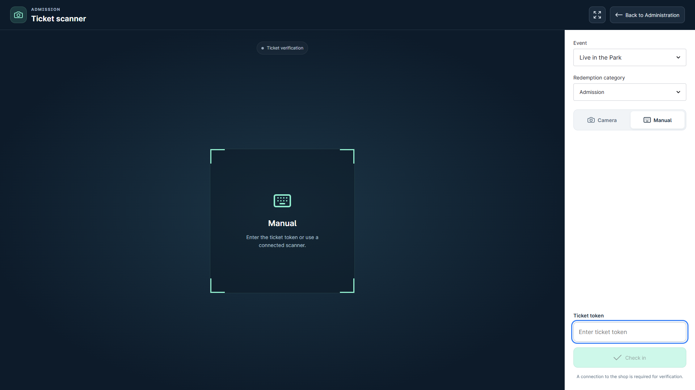

## Users and scanner role

The **scanner-role** Foundation package creates **Ticket Vendor – Scanner**. Assign it under **Settings → System → Users & permissions** to a separate user with administrator access switched off.

Its only privileges are `moorl_tv_ticket_sale:read` and `moorl_tv_ticket:scan`. It can read events and perform the fixed check-in action, without general ticket read/write, PDF, send, revoke, customer or order access. Shopware's default authenticated Administration privileges still apply.

Privileges from multiple roles add together. Check all assignments and avoid administrator accounts for entrance staff. The role is not restricted to individual events. Reimporting preserves changes to the role's name, privileges and assignments.

The additional permission **Ticket Vendor → Scan tickets and read events** is available for custom roles. Existing operators who only have `moorl_tv_ticket:update` and `moorl_tv_ticket_checkin:create` need the new scan privilege or role. General ticket update rights are no longer necessary. Sign in again after changing roles.

## Data and demo packages

The optional **standard** package adds a standalone demo site below the shop navigation. The existing shop homepage and its category are retained. In Foundation's demo assistant, select **MoorlTicketVendor → standard** and the intended storefront sales channel.

| Page | SEO path | Content |
| --- | --- | --- |
| Home | `/MoorlTicketVendor` | Three columns of event copy and social links |
| Events | `/MoorlTicketVendor/Events` | Static event listing |
| Booking | `/MoorlTicketVendor/Booking` | Artist roster with booking enquiries |
| Contact | `/MoorlTicketVendor/Kontakt` | Native Shopware contact form |

All three events and four artists receive individual JPEG images at **1080 × 1350 px (4:5)**. Package files are located in `media/moorl_tv_ticket_sale` and `media/moorl_tv_artist` and imported explicitly into their respective entity folders. Social links are identifiable demo placeholders; replace them with your own profiles before use. The past Digital Forum remains an inactive administration example.

Empty event-category and booking-contact-category settings are initialised with the demo categories in the selected sales channel. Existing selections are retained. Removing the package only deletes its own categories without merchant subcategories and demo CMS pages that are not used elsewhere. Base CMS templates and merchant-created categories are retained. Demo layouts reused by your own categories or products also survive subsequent plugin uninstallation.

Regular Foundation packages install media folders, import/export profiles, number range, mail template, SEO template and scanner role. They are installed during normal activation/update and can also be loaded individually through Foundation's data management.

The optional **standard** demo contains three events, ten ticket types, twelve tickets and three check-in examples. “Live im Stadtpark” includes Standard, VIP and an internal Guest list with twenty places and three valid example tickets. A future photography workshop and a past forum demonstrate other status cases.

No order is needed. A configured Foundation demo customer is associated optionally. Numbers, tokens and delivery/check-in states are fixed examples, unsuitable for real admission. Import itself does not send emails. Running workers may subsequently process undelivered valid demo tickets; use a test environment with a test mail transport.

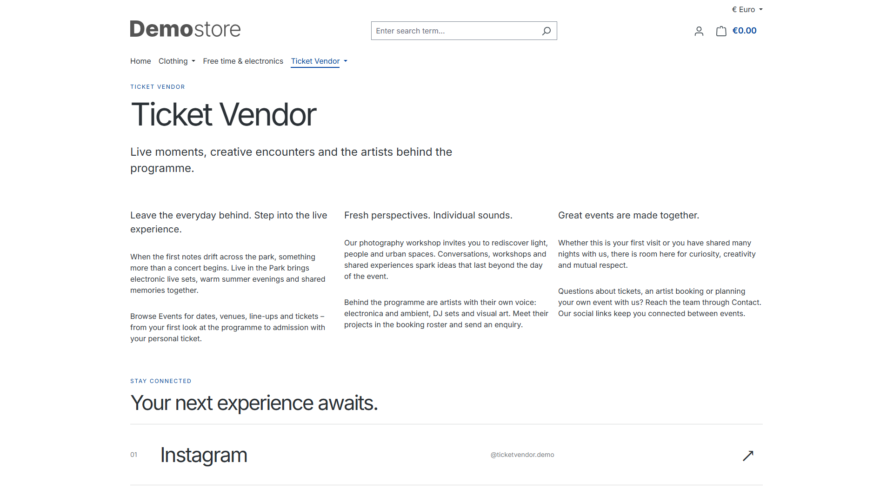

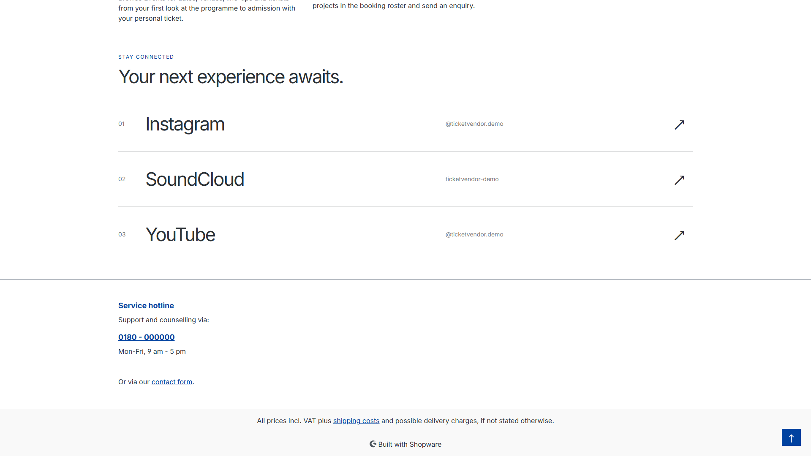

## Frequently asked questions

**Why is an event missing from the shop?** Check Active, visibility window and event end. Without an end time, public sales stop at the start.

**Why is a ticket type missing?** It must belong to the event, be active and fall within its sales window. An internal guest-list type deliberately remains inactive.

**Why is an ordered ticket not valid?** Confirmed payment controls activation, not order creation or payment initiation alone.

**Why is no email arriving?** Check recipient, delivery state, template, SMTP, Messenger and scheduled tasks. Downloading an eligible PDF can work independently of email delivery.

**Can guest customers receive tickets?** Yes, through the order email. Each ticket email also contains a personal link allowing guest purchasers to manage that ticket without logging in and download its PDF when valid. Keep this link private.

**Are assigned seats or offline admission available?** The current implementation uses quotas per type, without seat maps or offline approval. The standalone mobile app is not available yet.

## Artists, stages and private guest registration

Manage artist profiles under **Settings → Extensions → Ticket Vendor - Artists**. “Offer for booking on the website” controls the public booking selection; inquiries use the existing contact page or an optional external booking contact. Fees and internal notes remain private. The “Artists available for booking” CMS element and /artists/booking share this selection; no booking workflow is introduced.

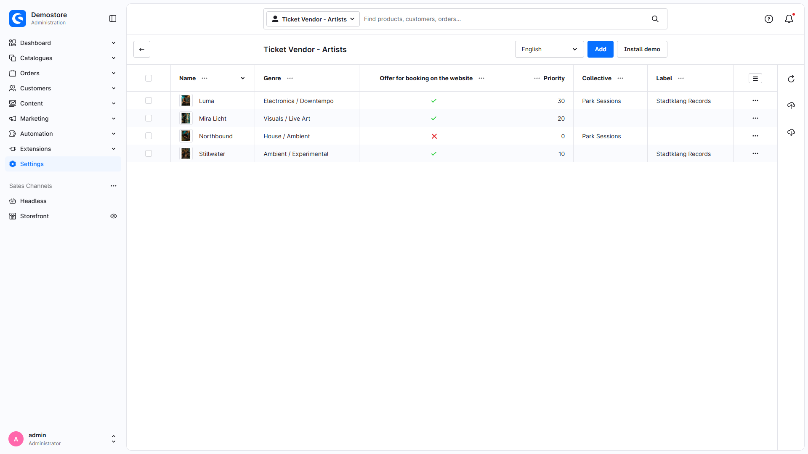

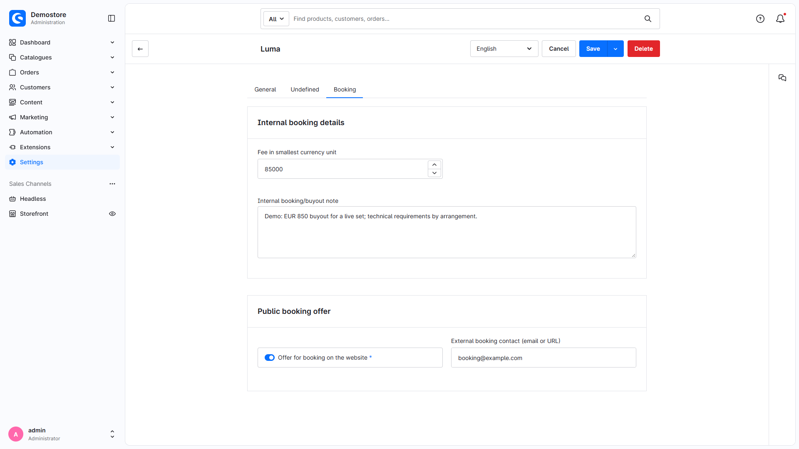

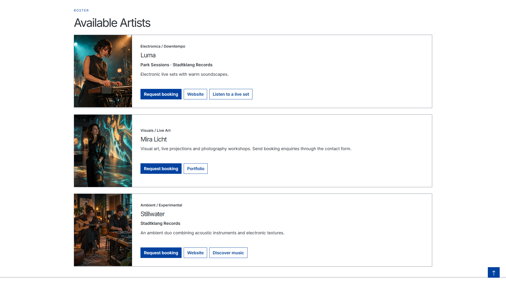

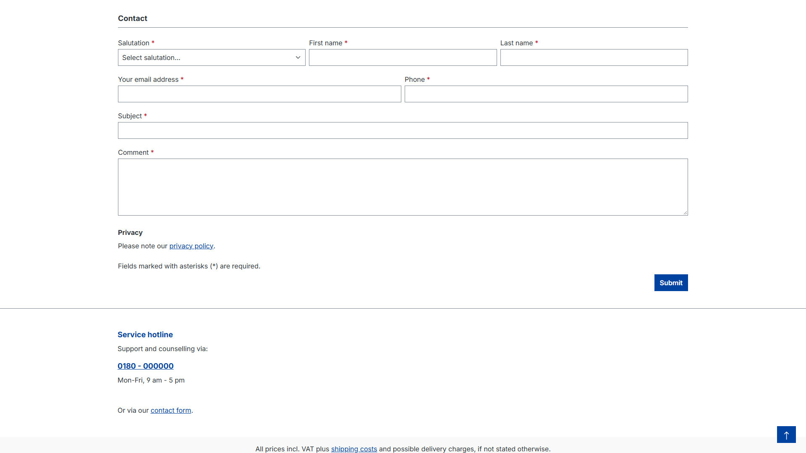

Add event stages and sets under Programme. Artists may have multiple sets, with optional stage and times. The native date/time picker supports full timestamps and sets across midnight. Publish the line-up and timetable independently. The event-wide line-up lists each artist once, with their collective or fallback label highlighted in the primary colour. Each stage has its own timetable with fixed columns for time, artist and genre; unassigned sets appear under “Without stage”. Collectives and labels appear only in the line-up. Start and end each include a date and time and remain independently optional. Editing and display use the event timezone; storage uses UTC. The public timetable shows times only; dates are used internally for sorting. The timetable sorts by start, then ID, with missing starts last. There is no separate performance date. Optional event capacity limits all ticket categories together. Disabling “Show in public lists” removes the event from lists/search/sitemap while its direct URL remains reachable.

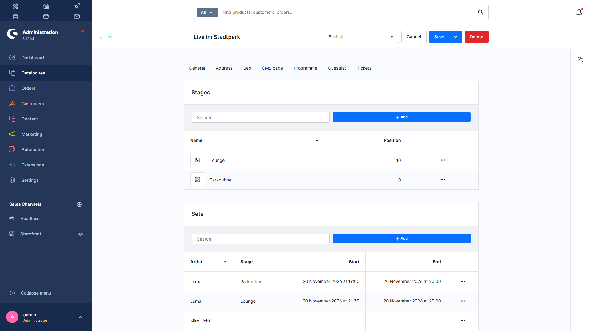

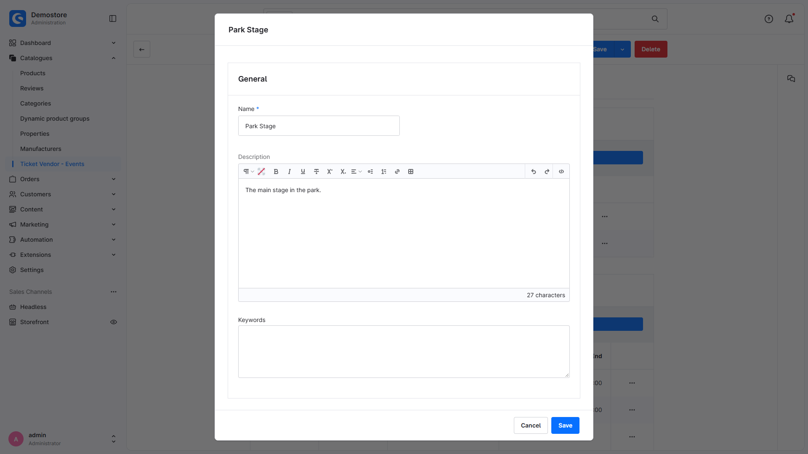

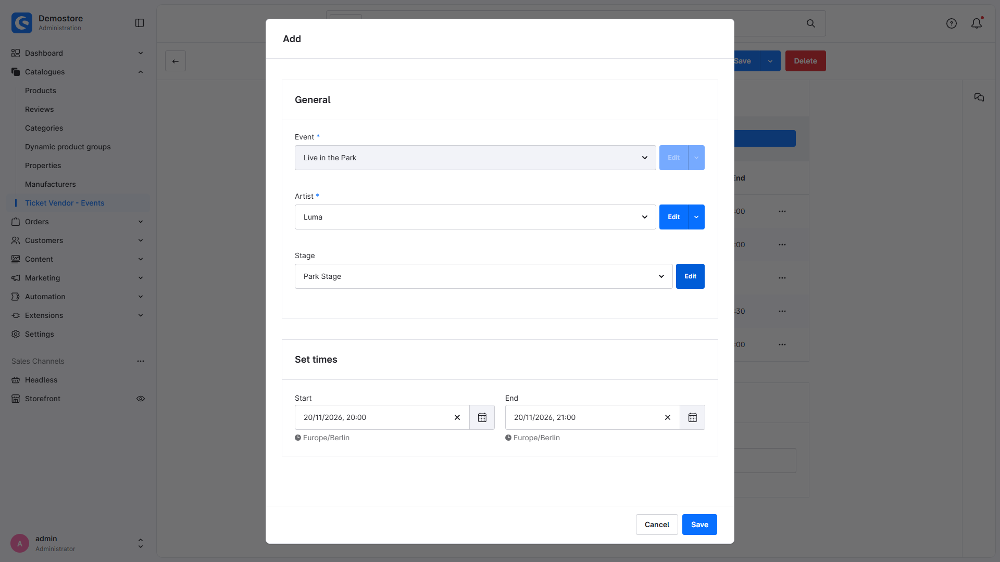

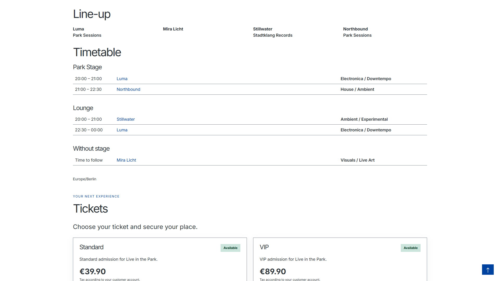

Enable guestlist registration on the free ticket category, configure voluntary roles and copy its secret link. Introduction and event rules remain on the event. With multiple storefront domains, choose the link address to copy; the actual form request remains stored as the registration origin. Tickets and registrations require a sales channel; select it for manual entries or map it during CSV import. An omitted language defaults to the Shopware system language. New guestlist tickets copy both values from the registration. Existing tickets keep their saved delivery context. Mobile phone is optional and separate registration time windows are no longer used. Registrations do not reserve admission. The form closes automatically when the category quota or event capacity is exhausted and reopens when places become available. After review, Create and send ticket issues one normal ticket and queues its email; retries keep that ticket. Multiple guests may share an email address. In the guestlist entry editor, use the multi-select to assign any available voluntary roles. The selection can be added to, changed or cleared even after a ticket has been issued. Create and send each ticket individually from the registration row context menu. Use Send confirmation link in the row context menu to request or resend confirmation for manual and imported registrations. This requires the additional permission to send confirmation links. The action is unavailable for registrations that are already confirmed. After a new storefront registration, the “Ticket Vendor - Neue Gästelisten-Anmeldung” flow notifies administrators with the name, email, mobile number and a direct Administration link to the ticket type. Adjust recipients and the template in Flow Builder; CSV/admin entries and repeated requests do not trigger this notification.

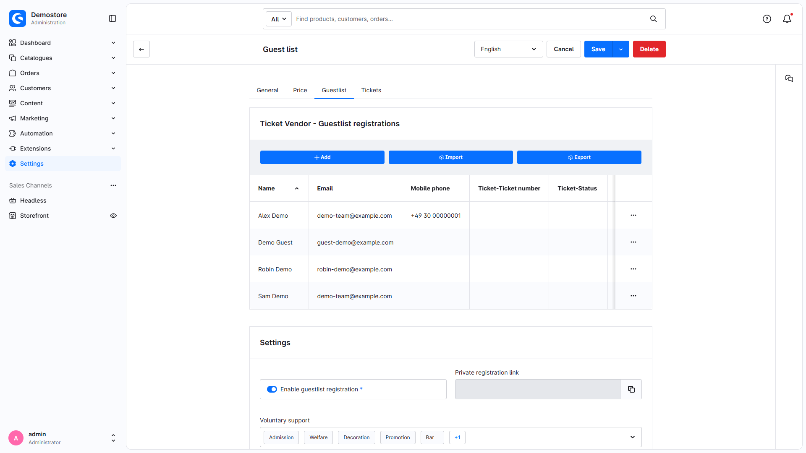

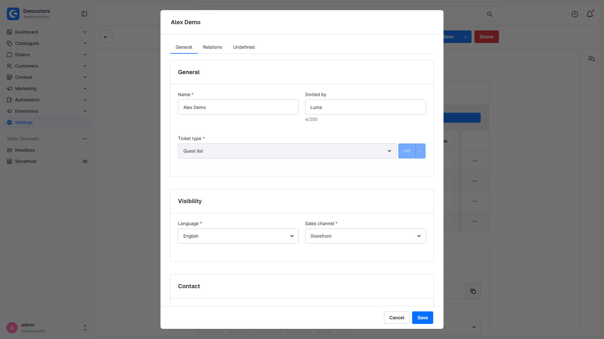

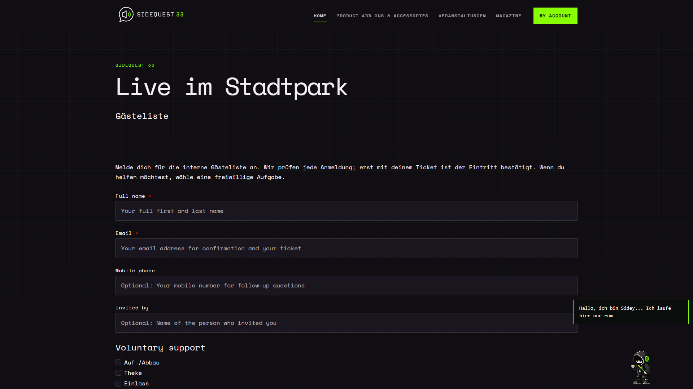

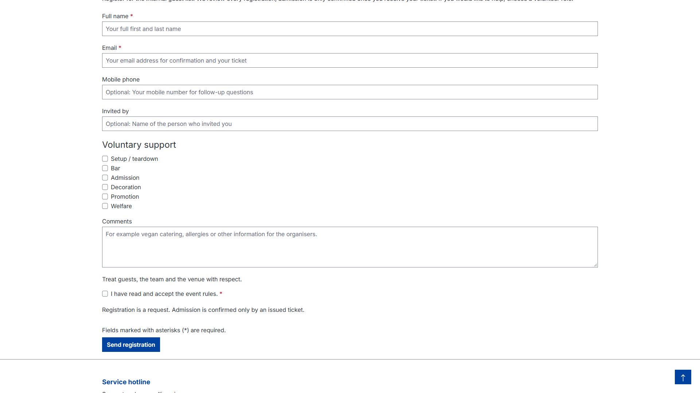

New storefront registrations also receive a guest acknowledgment with an individual Confirm registration link. Each registration must be confirmed separately, even when guests share an email address. Opening the signed link directly records Registration confirmed at; no further action is required. This does not approve a ticket; manual ticket issuance remains available. The separate guest flow and DE/EN template are included in guestlist-mail. Existing, CSV and demo entries receive no automatic confirmation email. Before deployment, add the two guestlist fields for existing databases as described in schema.md; new installations use the supplied SQL migrations.

Guestlist entries and tickets can be deleted individually through the normal Administration row action. Deleting a guestlist entry preserves its issued ticket. Deleting a ticket retains the registration and check-in history and clears their ticket links. Occupied quota is released; orders and customers remain. The Decision field and rejection/cancellation actions have been removed. Before using deletion, update the schema externally as described in schema.md, including both nullable ticket foreign keys with ON DELETE SET NULL.

New installations use the supplied SQL migrations. Existing schemas require a separate update before deployment. Backfill existing order-position references before removing legacy columns; moorl-tv:backfill-ticket-orders is read-only unless --apply is explicitly supplied. See [schema and backfill instructions](schema.md). Rebuild assets and restart workers after the transition.
