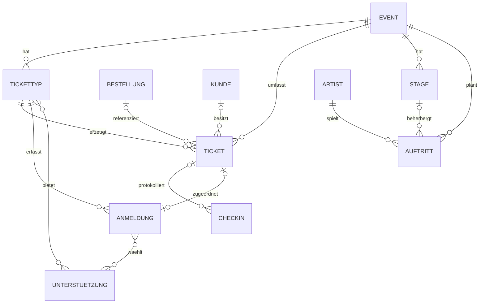

# Ticket Vendor: Datenmodell und Schemaübergang

Stand: 23.10.2026. Das Plugin liefert sechzehn native SQL-Initialmigrationen unter `src/Migration`. Jede Initialmigration legt eine Tabelle mit einem direkten `CREATE TABLE IF NOT EXISTS` an; die Reihenfolge berücksichtigt Tabellenabhängigkeiten. Die anschließende Migration `Migration1792713600EventDeletion` aktualisiert die Löschregeln auch für bestehende Tabellen. Nach Ausführung aller Migrationen beschreiben DAL und SQL denselben Stand. MoorlDevTools-Migrationsfunktionen werden nicht verwendet. Andere historische Schemaänderungen und Datenübernahmen benötigen weiterhin einen gesonderten Abgleich.

## Mehrfacheinlösung und gewichtete Kontingente

Typ und Ticket enthalten `redemption_category` (VARCHAR(32), Default `admission`), `max_redemptions` (INT, Default 1) und `capacity_units` (INT, Default 1). Kategorien sind `admission`, `drinks`, `food`. Das Limit ist mindestens 1. Einlass benötigt mindestens einen Personenplatz; Getränke und Essen exakt 0. Das Ticket speichert diese Ausstellungswerte zentral aus seinem Typ. Allgemeine Schreibzugriffe ändern weder diese Snapshots noch `redemption_count` (INT, Default 0). Es gilt `0 <= redemption_count <= max_redemptions`; SQL-CHECKs sichern Kategorien, Grenzen und Personenplätze zusätzlich ab. Nach dem ersten Verbrauch bleiben Typ und Event fest.

Der Typverbrauch pro belegtem Ticket beträgt `GREATEST(1, capacity_units)`, der Eventverbrauch exakt `capacity_units`. `quantity_sold` summiert Typkontingent-Einheiten in `pending`, `valid`, `redeemed`, keine Ticketanzahl. `moorl_tv_ticket_checkin.redemption_category` speichert den angefragten Bereich; die Metadaten enthalten tatsächlichen Bereich, Verbrauch, Limit und Rest nach Verarbeitung. Ein Scan erhöht den Zähler atomar um eins. Nur die letzte Einlösung setzt `redeemed` und `redeemed_at`. Widerruf und Reaktivierung löschen keinen Verbrauch.

Die Initialmigrationen für Tickettyp, Ticket und Check-in enthalten alle Einlösefelder und SQL-CHECKs direkt im CREATE-Statement. Neue Tickets beginnen mit Zähler 0. Die sechzehn Initialmigrationen übernehmen keine historischen Einlösungen und verändern keine vorhandenen Tabellen. Die zusätzliche Migration `Migration1792713600EventDeletion` ändert ausschließlich die dokumentierten Fremdschlüssel-Löschregeln.

Die Migrationstests prüfen die Erstinstallation und Wiederholung ausschließlich in einer ausdrücklich benannten isolierten Testdatenbank. Sie führen keine Migration am laufenden Shop aus.

## Sechzehn Tabellen

| Tabelle | Aufgabe |
|---|---|
| moorl_tv_ticket_sale | Event mit Foundation-Inhalten, Adresse, Zeiten, Zeitzone, Kapazität und Veröffentlichung |
| moorl_tv_ticket_sale_translation | Übersetzte Inhalte, Meta-/Ortsdaten, schemaOrg, guestlistIntroduction und guestlistRules |
| moorl_tv_volunteer | Globaler Katalog ehrenamtlicher Unterstützung mit Reihenfolge |
| moorl_tv_volunteer_translation | Übersetzte Namen, Beschreibungen und Suchbegriffe |
| moorl_tv_ticket_type | Eventkategorie mit Preis/Steuer, Kontingent, Kaufgrenzen und Gästelistenkonfiguration |
| moorl_tv_ticket_type_translation | Übersetzte Typtexte |
| moorl_tv_ticket | Einzelnes Ticket mit optionaler direkter Bestellung, Kunde/Empfänger, Personalisierung, Status und Versandtracking |
| moorl_tv_ticket_checkin | Unveränderter Scan-Audit einschließlich abgewiesener Versuche und Anfrage-ID |
| moorl_tv_artist | Profil, Medien/Logo, Social Links, Kollektiv/Label, Bookingangebot und interne Angaben |
| moorl_tv_artist_translation | Foundation-Basistexte, Name/Beschreibung/Teaser mit Fallback |
| moorl_tv_stage | Eventbezogene Bühne/Area, Bild und Reihenfolge |
| moorl_tv_stage_translation | Name und Beschreibung |
| moorl_tv_performance | Artist-Auftritt am Event mit optionaler Stage und optionalem Beginn/Ende als DATETIME(3) |
| moorl_tv_guestlist_entry | Persönliche Anfrage an einen Tickettyp, Regel-Snapshot, Bestätigung und optionales Ticket |
| moorl_tv_ticket_type_volunteer | ManyToMany: im Formular angebotene Optionen eines Tickettyps |
| moorl_tv_guestlist_volunteer | ManyToMany: tatsächlich ausgewählte Optionen einer Anmeldung |

UUIDs sind BINARY(16), vollständige Zeitpunkte UTC und Event-Zeitzonen IANA-Namen. Timetable-Beginn und -Ende sind vollständige optionale UTC-Zeitpunkte mit Anzeige in der Event-Zeitzone. FK-Storage-Namen folgen Foundation: saleId = moorl_tv_ticket_sale_id, typeId = moorl_tv_ticket_type_id, artistId = moorl_tv_artist_id, stageId = moorl_tv_stage_id. Native Core-Bezüge verwenden ihre Core-Spaltennamen.

Tickettypen verwenden ihre UUID und den übersetzten Namen; `technicalName`/`technical_name` entfällt aus Modell, Administration, Demo und Import-/Exportmapping. Die bisherige erforderliche Spalte `moorl_tv_ticket_type.technical_name` vor Verwendung der geänderten Definition bei bestehenden Tabellen gezielt per SQL entfernen und generierte Migrationen entsprechend abgleichen. Vorhandene Import-/Exportprofile ebenfalls aktualisieren. Die SQL-Initialmigrationen ändern bestehende Tabellen nicht automatisch.

## Ticket und Bestellung

orderId/order_id ist nullable. orderVersionId/order_version_id ist nativ erforderlich mit Live-Default, auch ohne Bestellung. Association order ersetzt orderLineItem. Die aktuelle Definition enthält keine order_line_item_id oder order_line_item_version_id mehr.

unitIndex ist eine technische Einheit innerhalb Bestellung/Version/Tickettyp. Der Unique-Key umfasst moorl_tv_ticket_type_id, order_id, order_version_id und unit_index. Mengen gleicher Typen aus mehreren Positionen werden aggregiert. Wiederholungen berücksichtigen alle vorhandenen historischen Ticketzustände. Auch bestellgebundene Tickets können explizit gelöscht werden; bei bestehenden Tickets bleiben Herkunft/Einheit unveränderlich.

saleId und typeId sind erforderlich und müssen zusammenpassen. customerId, recipientEmail, attendeeName (511), attendeePhone (64) bleiben eigenständige Angaben. salesChannelId und languageId sind Pflichtfelder. Der Verkaufskanal muss ausgewählt werden; eine fehlende Sprache wird bei neuen Datensätzen auf Defaults::LANGUAGE_SYSTEM gesetzt. Neue Gästetickets übernehmen den Anmeldekontext, Bestelltickets speichern den Bestellkontext. Explizite Empfängeradresse hat Vorrang vor Kunde und Bestellkunde.

Ticketnummer aus NumberRange, QR-token und persönlicher deeplink bleiben getrennt. Token, Deeplink und Versandfehler erscheinen nicht in allgemeinen API-Ausgaben. Ticketzustände: pending, valid, expired, redeemed, revoked. Versandzustände: pending, sent, failed. Pending/valid/redeemed belegen Plätze; expired/revoked geben sie frei. quantitySold ist abgeleitet und schreibgeschützt. expiresAt ist die Zahlungsfrist, issuedAt der fachliche Ausstellungszeitpunkt.

## Neue Eventfelder

listed (Default true), lineupPublished/timetablePublished (Default false), capacity nullable. lineupPublished gibt das gemeinsame Event-Line-up frei; timetablePublished steuert unabhängig die Timetable je Stage. listed ist nur Auffindbarkeit, kein Geheimhaltungsschutz. capacity gilt zusätzlich zu Typkontingenten für alle belegenden Tickets.

Einleitung (`guestlistIntroduction`) und Regeln (`guestlistRules`) bleiben übersetzbare Eventtexte. Am Tickettyp liegen `guestlistEnabled` (Default false), `guestlistAccessKey` (nullable VARCHAR(40), intern) und die ManyToMany-Relation `volunteerRoles`. `guestlistTicketTypeId`, Registrierungszeitfenster, konfigurierter Registrierungs-Verkaufskanal und `phoneRequired` entfallen. Telefonnummern bleiben optional. Ein freigegebener Gästelistentyp muss kostenlos sein, darf für den öffentlichen Verkauf aber `active=false` haben.

Die Anmeldung besitzt required, unveränderlichen `typeId` (`moorl_tv_ticket_type_id`, FK CASCADE); ihr Event ergibt sich über `type.sale`. Der bisherige direkte Event-FK der Anmeldung entfällt. Beim Löschen eines Tickettyps werden dessen Anmeldungen mitgelöscht. Vorhandene Tickets verhindern weiterhin das Löschen des Typs. Typen mit Anmeldungen lassen sich nicht auf andere Events verschieben. Auch kundenlose verknüpfte Tickets behalten ihren Typ/Event. Die zyklische Event-/Typreferenz entfällt vollständig.

## Artist, Stage und Auftritt

Artist hat bookingEnabled (false), bookingContact (E-Mail/HTTP(S)), priority (höher zuerst), media/Logo, Social-Link-Liste, genre und Kollektiv/Label. genre ist ein optionales, nicht übersetztes StringField (moorl_tv_artist.genre, nullable VARCHAR(255)), wird in Administration und öffentlichen Artistkarten angezeigt und ist im Import-/Exportprofil enthalten. Die Spalte wird bei bestehenden Tabellen gezielt per SQL ergänzt. feeAmount ist optional und nichtnegativ in kleinster Geldeinheit ohne Währungsrelation; bookingNote ist intern. Artist.currencyId/currency und die Spalte currency_id entfallen. Keine zusätzliche Artist-/Stage-/Auftrittsaktivierung.

Stage und Performance haben saleId, CustomFields und Zeitstempel. Nur Stages besitzen position für die Reihenfolge; Auftritte haben kein Positionsfeld. Performance hat erforderlichen Artist, optionale Stage und unabhängig optionale startAt/endAt als native DateTimeFields (start_at/end_at DATETIME(3) NULL). Das separate performance_date-Feld entfällt. Der Admin lädt die Event-Zeitzone und verwendet den nativen mt-datepicker mit dateType=datetime; ISO-Zeitpunkte werden unverändert an den DAL weitergegeben und in UTC gespeichert. Die Timetable sortiert nach Beginn und ID; fehlender Beginn steht zuletzt. Stage muss demselben Event angehören; belegte Stages werden nicht auf andere Events verschoben. Mehrere Sets desselben Artists sind erlaubt. Die öffentliche Ausgabe ist eine explizite Projektion ohne interne Angaben.

Die Initialmigration legt start_at und end_at unmittelbar als DATETIME(3) NULL an. performance_date wird nicht angelegt. Die früheren Uhrzeit-/Datums-Upgrade-Migrationen sind entfernt.

## Gästelistenintegrität und Rechte

Die Bestätigung gehört zum einzelnen `moorl_tv_guestlist_entry`, niemals zur E-Mail-Adresse. Bei bestehenden Tabellen gezielt per SQL ergänzen: `confirmation_key` nullable VARCHAR(64), interner zufälliger Signierschlüssel, und `confirmed_at` nullable DATETIME(3), Bestätigungszeitpunkt in UTC. Beide Felder sind gegen allgemeine DAL-Schreibzugriffe geschützt; der Schlüssel wird weder über die API noch über JSON ausgegeben. Neue Storefront-Anmeldungen erhalten einen eigenen Schlüssel. Bestands-, CSV-, Admin- und Demoeinträge bleiben ohne automatische Bestätigung und ohne automatische Bestätigungsmail. Die dedizierte Adminaktion `send-confirmation` mit Zusatzrecht `moorl_tv_guestlist_entry:send_confirmation` initialisiert einen fehlenden Schlüssel für eine unbestätigte Anmeldung und löst denselben Bestätigungs-Flow aus. Wiederholungen behalten den Schlüssel; die API-Antwort enthält weder Schlüssel noch Link. Eine Änderung der E-Mail-Adresse setzt beide Werte zurück und entwertet den bisherigen Link. Die E-Mail-Adresse bleibt ausdrücklich nicht eindeutig. Im initialen SQL-Migrationssatz enthalten; bestehende Tabellen werden nicht automatisch abgeglichen.

Unique-Keys auf submission_id und nullable moorl_tv_ticket_id. Keine Eindeutigkeit auf E-Mail. Gleiche Anfrage-ID erzeugt keinen zweiten Eintrag; eine Wiederholung an einem anderen Typ ist ein Konflikt. Mehrere Gäste dürfen dieselbe Adresse verwenden. Ein separates Entscheidungsfeld entfällt; der Ausstellungsstatus folgt ticketId. Versand- und Ticketstatus werden nicht dupliziert.

CSV-Importe benötigen weder `id` noch `submissionId`: Shopware erzeugt die Datensatz-ID; fehlende, NULL- oder leere Anfrage-IDs werden pro neuer Anmeldung vor der DAL-Pflichtfeldprüfung als zufällige UUID mit 32 Hexzeichen erzeugt. Mitgelieferte Anfrage-IDs und bestehende Werte bei Updates bleiben erhalten. Kein zufälliger Datenbank-Default und keine Schemaänderung. Ohne mitgelieferte Datensatz-ID legt ein erneuter Import neue Anmeldungen an; gleiche E-Mail-Adressen werden nicht zusammengeführt.

CSV-Importe benötigen weder `id` noch `submissionId`: Shopware erzeugt die Datensatz-ID; fehlende, NULL- oder leere Anfrage-IDs werden pro neuer Anmeldung vor der DAL-Pflichtfeldprüfung als zufällige UUID mit 32 Hexzeichen erzeugt. Mitgelieferte Anfrage-IDs und bestehende Werte bei Updates bleiben erhalten. Kein zufälliger Datenbank-Default und keine Schemaänderung. Ohne mitgelieferte Datensatz-ID legt ein erneuter Import neue Anmeldungen an; gleiche E-Mail-Adressen werden nicht zusammengeführt.

Für größere Gästelisten bei bestehenden Tabellen gezielt per SQL zusätzlich die Suchindizes `(moorl_tv_ticket_type_id, created_at)` für gefilterte Listen und `(moorl_tv_ticket_type_id, email)` für die E-Mail-Suche vorsehen. Der generierte Typ-FK-Index allein begrenzt bereits auf den Typ; EXPLAIN auf dem isolierten Endschema zeigt für Listen jedoch zusätzliches Sortieren und für die Duplikatübersicht eine temporäre Gruppierung nach Name/E-Mail. Die zusätzlichen Indizes mit repräsentativen Daten und den tatsächlich verwendeten Filtern prüfen; sie beseitigen nicht automatisch jede Gruppierung oder Sortierung.

Unterstützungsoptionen (`volunteerRoles`) können im Admin auch nach der Ticketausstellung hinzugefügt, entfernt oder vollständig geleert werden. Ticketverknüpfung und Kontingent bleiben erhalten.

Anmeldung speichert Name, E-Mail, optional Telefon/Einladenden/Ehrenämter/Bemerkung, separate interne Notiz, Sprache/Verkaufskanal und bestätigten Regeltext. Eingabegrenzen und Auswahlwerte werden serverseitig validiert. Tickettyp, Anfrage-ID und Regeltext sind unveränderlich. Sprache und Verkaufskanal sind Pflichtfelder und können im Admin jederzeit geändert werden, auch mit verknüpftem Ticket. Leeren ist nicht erlaubt. Der Versandkontext bereits ausgestellter Tickets bleibt dabei erhalten. Die beiden Felder bleiben ausschließlich über die Admin-API lesbar.

Dedizierte Adminrechte `moorl_tv_guestlist_entry:issue` und `moorl_tv_ticket_type:guestlist_link` schützen die begrenzten Aktionen. Scannerrechte bleiben unverändert. Ticketverknüpfung, Ausstellungszeitpunkt und ausstellender Benutzer sind keine frei beschreibbaren CRUD-Felder. Interne Artist-/Event-/Typdaten bleiben generisch gefiltert; der Admin-JSONAPI-Adapter stellt nur vom Core autorisierte Attribute und Beziehungen wieder her. Geheimschlüssel wird ausschließlich durch die dedizierte Aktion herausgegeben.

Registrierungen reservieren keine Plätze. Formulare schließen bei erschöpftem Typkontingent oder voller Eventkapazität und öffnen bei wieder freien Plätzen automatisch, solange der Schalter gesetzt und das Event aktiv/nicht beendet ist. Bestehende Anfragen dürfen bei abgeschalteter Registrierung weiterhin nach den normalen Regeln bearbeitet werden. Typ- und Eventkontingent zählen `pending`, `valid`, `redeemed`; der Schalter wird durch Vollbelegung nicht umgeschrieben. Wiederholungen bereits erfolgreicher Anmeldungen werden auch bei Vollbelegung bestätigt.

Neue Storefront-Anmeldungen speichern Kanal und Sprache des tatsächlichen Aufrufs. Im Admin und CSV-Import muss der Verkaufskanal ausgewählt bzw. zugeordnet werden; eine fehlende Sprache wird beim Anlegen auf `Defaults::LANGUAGE_SYSTEM` gesetzt. Die Ausstellung übernimmt beide gespeicherten Werte aus der Anmeldung. Es gibt keine globalen Plugin-Vorgaben und keine automatische Wahl eines Verkaufskanals. Bestehende Tickets und Wiederholungen behalten ihren gespeicherten Versandkontext. Die Adminaktion erzeugt Domainlinks unter `/guestlist/type/{typeId}/{accessKey}`; die Wahl einer Linkdomain wird nicht am Typ gespeichert.

## Events, Gästelisteneinträge und Tickets löschen

`Decision` samt Ablehnungs-/Stornoaktion entfällt vollständig. Die Spalte `moorl_tv_guestlist_entry.decision` und gegebenenfalls darauf basierende Indizes bei bestehenden Tabellen gezielt per SQL entfernen. Das alte Zusatzrecht `moorl_tv_guestlist_entry:decide` wird nicht mehr verwendet.

Events können gelöscht werden, sobald keine Tickets mehr vorhanden sind. Jeder Ticketstatus blockiert die Eventlöschung; Tickets müssen vorher ausdrücklich gelöscht werden. Beim Eventdelete werden Tickettypen, deren Gästelistenanmeldungen und Helferzuordnungen, Bühnen, Auftritte, Übersetzungen sowie verbleibende Event-Check-ins mitgelöscht. Globale Künstler und Helferrollen bleiben erhalten.

Tickets sind unabhängig von einer Bestellung und von vorhandenen Check-ins löschbar. Für ihre abhängigen Daten gelten folgende Regeln:

| Tabelle | Ticket-FK und Löschregel |
| --- | --- |
| `moorl_tv_guestlist_entry` | `moorl_tv_ticket_id`: ON DELETE SET NULL |
| `moorl_tv_ticket_checkin` | `moorl_tv_ticket_id`: ON DELETE CASCADE |

Die inverse DAL-Relation `ticket.guestlistEntries` trägt `SetNullOnDelete`, `ticket.checkins` trägt `CascadeDelete`. Die Anmeldung bleibt ohne Ticketbezug erhalten; alle dem Ticket zugeordneten Check-in-Protokolle werden gelöscht. Das Löschen einer Anmeldung löscht ihr ausgestelltes Ticket nicht automatisch. Normale DAL-Ticketlöschungen aktualisieren den verkauften Zähler und geben belegtes Typ-/Eventkontingent frei. Bestellungen und Kunden bleiben bestehen.

Die Initialmigrationen legen die sechs betroffenen Fremdschlüssel direkt mit CASCADE an. `Migration1792713600EventDeletion` stellt sie bei bestehenden Installationen auf CASCADE um, ohne bestehende Datensätze zu löschen. Bereits passende Fremdschlüssel werden übersprungen. Die Ticket-Fremdschlüssel zu Event und Typ bleiben RESTRICT. Die Migration muss auch bei bestehenden Installationen ausgeführt werden, damit DAL und Datenbank dieselben Löschregeln verwenden.

## Bestehende Event-Gästelisten übernehmen

Zuerst an einer Datenbankkopie prüfen. Bei bestehenden Tabellen gezielt per SQL additiv die drei Typfelder und eine zunächst nullable `moorl_tv_guestlist_entry.moorl_tv_ticket_type_id` ergänzen. Die bisherigen Eventfelder und der alte Event-FK der Anmeldung müssen für die Übernahme erhalten bleiben. Registrierungen, Checkout, Ticketänderungen und Worker während der tatsächlichen Übernahme anhalten.

    bin/console moorl-tv:backfill-guestlist-types

Die Vorschau schreibt nichts. Ausgestellte Einträge erhalten ihren tatsächlichen Tickettyp, übrige Einträge den bisherigen `event.guestlistTicketTypeId`. Eventkonfiguration, Geheimschlüssel und Ehrenämter werden übernommen; `phoneRequired` entfällt. Fehlende oder widersprüchliche Zuordnungen, fehlende Ursprünge und abweichende bereits gepflegte Typkonfigurationen werden als Konflikte ausschließlich mit Datensatz-IDs gemeldet. Es werden keine Ersatztypen oder Verkaufskanäle geraten.

    bin/console moorl-tv:backfill-guestlist-types --apply

Nur dieses Flag schreibt Daten; bei Konflikten wird nichts übernommen. Wiederholung ist stabil und erhält Verarbeitungsdaten, Ticket-IDs, Regeltexte und Versandursprünge. Der Befehl führt kein DDL aus und wird nie automatisch vom Plugin-Lifecycle gestartet. Nach vollständiger Prüfung `entry.typeId` required machen und FK CASCADE aktivieren; erst danach alten Anmeldungs-Event-FK und obsolete Eventkonfiguration über das externe Werkzeug entfernen. `guestlistIntroduction` und `guestlistRules` bleiben bestehen. Eigene Exportprofile auf `typeId` umstellen.

In bestehenden ACL-Rollen das bisherige `moorl_tv_ticket_sale:guestlist_link` gezielt durch `moorl_tv_ticket_type:guestlist_link` ersetzen und `moorl_tv_ticket_type:read` ergänzen; andere Rechte/Zuweisungen erhalten. Aktuelle Administration bauen, Cache und Worker aktualisieren. Alte gültige Eventlinks leiten auf den passenden Typ weiter; bereits geöffnete alte Formulare müssen neu geladen werden. Eine Rotation entwertet beide Linkformen. Vor Entfernen alter Felder ist ein Rückweg über die gesicherten Werte möglich; danach ist für ein Rollback ein geprüftes Backup erforderlich.

Der Benutzer, der ein Ticket ausstellt, wird über userId/user mit UserDefinition referenziert (nullable user_id, ON DELETE SET NULL). Nur die dedizierte Ticketausstellung schreibt diese Zuordnung. Beim Löschen eines Benutzers bleiben Anmeldung, Ticket und processedAt erhalten. Der bisherige Name processedById/processed_by_id entfällt; vorhandene Bearbeiter-IDs bei einer Umstellung vor dem Entfernen der alten Spalte nach user_id übernehmen. Der initiale SQL-Migrationssatz enthält die aktuellen Spalten und Fremdschlüssel; vorhandene Tabellen separat abgleichen.

Restriktive inverse Relationen schützen Events, Typen, Artists, Stages und relevante Core-Referenzen. Übersetzungen folgen ihren Eltern. Tickets verhindern das Löschen ihres Events und Typs. Check-in-Protokolle ohne Ticketzuweisung dürfen einzeln gelöscht werden; bei zugewiesenem Ticket verhindert `TicketCheckinDeleteSubscriber` das direkte Löschen über das DAL. Beim Löschen eines Tickets wird sein Protokoll weiterhin kaskadierend entfernt.

Die TaxExtension schützt Steuern, die von Tickettypen verwendet werden, bereits im DAL. Der generierte FK moorl_tv_ticket_type.tax_id verwendet RESTRICT statt CASCADE; auch unverkaufte Typen werden beim Löschen einer Steuer nicht entfernt. Die inverse Steuerrelation wird nicht als zusätzliche öffentliche API-Association angeboten.

## Bestehende Bestellpositionsdaten übernehmen

Diesen Ablauf zuerst mit einer Kopie der Datenbank prüfen. Während der eigentlichen Umstellung Checkout, Ticketänderungen und Worker anhalten, damit alter und neuer Aussteller nicht gleichzeitig arbeiten.

1. Bei bestehenden Tabellen gezielt per SQL nur neue Tabellen/Spalten ergänzen, bestehende Positionsspalten und deren Daten behalten. Am Ticket neue nullable order_id sowie native order_version_id ergänzen. Den neuen Gruppierungsindex erst nach Übernahme aktivieren oder sicherstellen, dass die neuen Bestell-IDs zunächst NULL sind.
2. Vorschau aus dem Shopware-Projekt ausführen:

       bin/console moorl-tv:backfill-ticket-orders

3. Der Befehl prüft erforderliche Spalten, erkennt fehlende Bestellpositionsreferenzen und widersprüchliche bereits vorhandene direkte Zuordnungen. Ohne --apply werden keine Daten oder Schemata geändert.
4. Den bisherigen Unique-Key über Positions-ID/Versions-ID/unit_index mit dem externen Werkzeug entfernen, seinen FK zunächst behalten. Sonst können verschobene Stückzähler mit noch vorhandenen alten Werten kollidieren.
5. Explizit anwenden:

       bin/console moorl-tv:backfill-ticket-orders --apply

6. Der Befehl überträgt in einer Transaktion Bestell-ID/Version und vergibt pro Bestellungsversion/Tickettyp neue stabile Einheiten. Sortierung ist alte Positions-ID, alter Stückzähler und Ticket-ID. Ticket-ID, Nummer, Token, Empfänger und Status werden nicht ersetzt. Manuelle Tickets ohne alte Positionszuordnung bleiben unverändert.
7. Vollständigkeit, historische Zustände, direkte Bestellbezüge und neue Eindeutigkeit prüfen. Anschließend neue FKs/Unique-Indizes aktivieren und erst dann alte Positions-FKs/-Spalten entfernen. Quelle ist nun die OrderExtension statt OrderLineItemExtension.
8. Cache/Assets aktualisieren und Worker neu starten. Vorhandene Ticket-URLs und QR-Codes bleiben erhalten.

Der Befehl führt keinerlei DDL aus und wird nie automatisch durch Aktivierung/Update aufgerufen. Ein generierter Schemaabgleich allein ersetzt diese Datenübernahme nicht. In dieser Sitzung wurde nur gegen eine isolierte Testdatenbank gearbeitet, keine bestehende Shopdatenbank umgebaut.

## Schema-Prüfungen

`tests/create-schema.php` akzeptiert ausschließlich eine explizite `moorl_tv_*_test`-Datenbank und verweigert das Ersetzen nichtleerer Plugin-Tabellen. Es führt die ausgelieferten SQL-Migrationen in Zeitstempelreihenfolge aus. Fremdschlüssel und Indizes stehen direkt in den `CREATE TABLE`-Statements, einschließlich der Suchindizes `(moorl_tv_ticket_type_id, email)` und `(moorl_tv_ticket_type_id, created_at)` für Anmeldungen. Die aktuelle Gästelistenstruktur benötigt keinen Event-/Typ-FK-Zyklus mehr.

Die Tests gleichen die tatsächlich durch diese Migrationen erzeugten Spalten aller sechzehn Tabellen mit den persistenten DAL-Feldern ab. Weitere Prüfungen decken Fremdschlüssel, Löschregeln, eindeutige Indizes, individuelle Ticketwerte und die Wiederholung der Initialmigrationen ohne Datenverlust ab. Für bestehende Datenbanken zuerst die unten beschriebenen Datenübergänge planen und sichern; `CREATE TABLE IF NOT EXISTS` ersetzt keine gezielte Aktualisierung bereits vorhandener Tabellen. Die sechzehn Initialmigrationen enthalten keine `DROP`-, `ALTER`- oder Datenübernahmeschritte. Die zusätzliche Migration `Migration1792713600EventDeletion` verwendet `ALTER TABLE`, um vorhandene Fremdschlüssel auf die dokumentierten Löschregeln umzustellen; sie übernimmt keine Daten.

    docker exec -e MOORL_TV_TEST_DATABASE_NAME=moorl_tv_extension_20261019_test -w /var/www/html shopware_6.7.14.1 php custom/plugins/MoorlTicketVendor/tests/create-schema.php
    docker exec -e MOORL_TV_TEST_DATABASE_NAME=moorl_tv_extension_20261019_test -w /var/www/html shopware_6.7.14.1 php vendor/bin/phpunit -c custom/plugins/MoorlTicketVendor/phpunit.xml.dist

Der Testname ist eine Entwicklungsreferenz; niemals eine reguläre Shopdatenbank als Testdatenbank verwenden. Native Mailtransporte werden in Versandtests ersetzt. `GuestlistNotificationTest` übernimmt die Abhängigkeiten der tatsächlich installierten `SendMailAction` aus dem Container und ersetzt nur den Mailtransport; die interne Konstruktorsignatur unterscheidet sich innerhalb von Shopware 6.7. Der Sidequest-spezifische Header-Test benötigt das aktive optionale Theme und wird sonst mit Begründung übersprungen. Für die Audit-Tests zusätzlich `MOORL_TV_AUDIT_REFERENCE_DATABASE` auf eine getrennte aktuelle `moorl_tv_*_test`-Referenz setzen. Weitere Laufzeitdetails und offene Fehler stehen in runtime.md.

## Ehrenamtliche Unterstützung als eigener Katalog

Die vier neuen Tabellen bei bestehenden Tabellen gezielt per SQL aus den DAL-Definitionen erzeugen. Die kurzen Tabellennamen halten auch die daraus erzeugten Fremdschlüsselnamen unter der MySQL-Grenze von 64 Zeichen. Die Zuordnungstabellen verwenden zusammengesetzte Primärschlüssel aus `moorl_tv_ticket_type_id` beziehungsweise `moorl_tv_guestlist_entry_id` und `moorl_tv_volunteer_id`. Beim Löschen einer Option werden nur die Zuordnungen kaskadierend entfernt; Tickettypen, Anmeldungen und Tickets bleiben erhalten.

Unter **Kataloge → Ehrenamtliche Unterstützung** lassen sich Optionen mit Namen, Beschreibung, Übersetzungen und Reihenfolge verwalten. Am Tickettyp und an der Anmeldung verwendet `volunteerRoles` dieselbe EntityCollection. Beide Adminfelder bieten den gesamten Katalog. Die Unterstützungsoptionen bleiben auch nach der Ticketausstellung bearbeitbar, einschließlich direkter Mappingzugriffe. Geschützt bleiben Ticketverknüpfung und Ausstellungsmetadaten; die Änderung von Optionen beeinflusst weder Ticket noch Kontingent. Das Formular lädt nur am Typ zugeordnete Optionen in seiner Sprache mit Shopware-Sprachfallback. Ohne Zuordnung bleibt die Auswahl leer; es gibt keine impliziten Standardoptionen. Beim Absenden werden nur UUIDs aus dieser Typzuordnung akzeptiert.

Bestandsübernahme vor dem Entfernen alter Spalten separat durchführen: `moorl_tv_ticket_type.guestlist_config` und `moorl_tv_guestlist_entry.volunteer_roles` exportieren und sichern. Für jeden bisherigen Schlüssel samt Beschriftungen passende Katalogeinträge anlegen und eine eindeutige Zuordnung vom alten Schlüssel zur neuen UUID festhalten. Bei gleichen Schlüsseln mit unterschiedlichen Beschriftungen getrennte Optionen erhalten. Bisherige implizite Standardoptionen bei Bedarf ausdrücklich anlegen und den betroffenen Typen zuordnen; ausdrücklich leere Konfigurationen bleiben leer. Gespeicherte Auswahlwerte einschließlich historischer, nicht mehr am Typ angebotener Werte auf die neuen Anmeldungszuordnungen übertragen. Ursprungsdaten, ausgestellte Tickets und Metadaten erhalten. Erst nach geprüftem Abgleich der Auswahlwerte und Zuordnungen die beiden alten JSON-Spalten extern entfernen. Die Anwendung liest sie anschließend nicht mehr. Der ältere Befehl `moorl-tv:backfill-guestlist-types` ist nur für den früheren Event-zu-Typ-Übergang gedacht und muss gegebenenfalls davor mit dessen vollständigem additiven Altschema ausgeführt werden. Die SQL-Initialmigrationen übernehmen keine historischen Daten.

Das optionale Standard-Demopaket enthält sechs Katalogoptionen und passende Typ-/Anmeldungszuordnungen.

## Pflichtfelder für den Versandkontext

`moorl_tv_ticket` und `moorl_tv_guestlist_entry` speichern `sales_channel_id` und `language_id` als `BINARY(16) NOT NULL`. Nur `language_id` hat den festen SQL-Default `0x2FBB5FE2E29A4D70AA5854CE7CE3E20B` (Shopware-Systemsprache); der Verkaufskanal hat keinen Default. Die DAL-Definitionen verwenden dieselbe Sprachvorgabe. Explizit leere Pflichtfelder werden abgewiesen. Verwendete Sprachen und Verkaufskanäle sind durch Fremdschlüssel mit `ON DELETE RESTRICT` geschützt, auch bei Anmeldungen ohne Ticket.

Die initialen SQL-Migrationen beschreiben diesen Stand für neue Tabellen. Bei bestehenden Tabellen vor der Umstellung alle fehlenden Verkaufskanäle bewusst zuordnen und fehlende Sprachen auf die Systemsprache setzen. Erst danach die Spalten auf `NOT NULL`, den festen Sprachdefault und die Fremdschlüssel auf `RESTRICT` umstellen. Die Initialmigrationen erledigen keinen Bestandsumbau; ein Verkaufskanal wird dafür nicht geraten.


## Vollständige Auftrittszeitpunkte

Die Erstinstallation verwendet für start_at und end_at unabhängig optionale DATETIME(3)-Spalten ohne performance_date. UTC-Zeitpunkte werden direkt gespeichert; Bearbeitung und Timetable verwenden die Event-Zeitzone. Der Migrationssatz enthält keine Umrechnung alter Uhrzeittexte.

Vor dem Einsatz dieses Modellstands in einer bestehenden Datenbank alte Uhrzeittexte und performance_date separat sichern und in vollständige UTC-Zeitpunkte überführen. Der neue Initialmigrationssatz erledigt keinen Bestandsumbau.

## Beziehungen und Integritätsgrenzen

Die Übersicht zeigt die fachlichen Hauptbeziehungen. Übersetzungstabellen ergänzen Event, Typ, Artist, Stage und Unterstützungsoption; die beiden Zuordnungstabellen verbinden Unterstützungsoptionen mit Typen und Anmeldungen.



| Regel | Sicherung |
| --- | --- |
| Referenzierte Datensätze existieren; definierte Löschregeln gelten | SQL-Fremdschlüssel und DAL-Relationen |
| Nummer, QR-Token, Bestelleinheit, Scan- und Anmeldeanfrage sind eindeutig | SQL-Unique-Indizes |
| Bereich, Einlöselimit, Personenplätze und Verbrauch sind zulässig | DAL-Validierung und SQL-CHECKs |
| Tickettyp und Ticket gehören zum selben Event; Stage und Auftritt ebenfalls | DAL-Schreibsubscriber |
| Typ-/Eventkontingente werden eingehalten und `quantitySold` bleibt aktuell | Transaktionale Subscriber mit Event-/Typsperren |
| Ticketverbrauch darf nur der Scanner ändern | Geschütztes Feld und begrenzte Freigabe im Scannerpfad |

Importe und Integrationen müssen den DAL verwenden. Direkte SQL-Schreibzugriffe können trotz gültiger Fremdschlüssel fachlich falsche Kombinationen oder veraltete Verkaufszähler erzeugen. Die Kontingentzählung umfasst `pending`, `valid` und `redeemed`; Typen zählen `GREATEST(1, capacity_units)`, Events ausschließlich `capacity_units`.

## Betrieb bei wachsendem Datenbestand

Scans und Ticketänderungen halten weiterhin gemeinsame Event-/Typsperren. Belegungsneutrale Änderungen an Einlösung, Personalisierung oder Versandtracking zählen den gesamten Typ-/Eventbestand jedoch nicht erneut und schreiben keinen unveränderten Verkaufszähler. Auch `pending → valid` und `valid → redeemed` behalten dieselbe Belegung. Ausstellung, Ablauf, Widerruf, Löschung, erlaubter Typwechsel und Kontingentabsenkung werden weiterhin gegen den aktuellen gesperrten Bestand geprüft. Nach belegungsrelevanten Änderungen wird der Verkaufszähler vollständig abgeglichen.

Die Initialmigration enthält zwei gemessene Jobindizes: `idx.moorl_tv_ticket.expiry` auf `(status, expires_at, order_id, order_version_id)` und `idx.moorl_tv_ticket.delivery` auf `(delivery_status, status, created_at)`. Sie unterstützen Ablauf und Versandwiederherstellung. Versuchslimit, Änderungszeit und Sortierung können weiterhin Restprüfungen erfordern. Die Zahl sichtbarer Ergebniszeilen oder das Joblimit von 500 begrenzt nicht die intern untersuchten Datensätze. Die lokale Messung ersetzt keine Prüfung der eigenen Datenverteilung.

Lesender Abgleich am 21.10.2026: Die aktuellen Spalten stimmten in Typ, Pflichtfeldern, Default und Kollation zwischen lokalem Demoshop und isolierter Neuinstallation überein. Beide besitzen 45 Fremdschlüssel und acht CHECKs. Im Demoshop existiert zusätzlich noch die alte Spalte `moorl_tv_performance.position`. Es wurden keine fehlerhaften Ticket-/Event- oder Stage-/Eventbezüge, abweichenden Verkaufszähler, Überbelegungen oder fehlenden Versandkontexte gefunden. Dieser Befund gilt für die geprüfte Installation und ersetzt keinen Schemaabgleich anderer Shops.

## Lesender Schema- und Bestandsabgleich

Der Entwicklungscheckout enthält `tests/audit-schema.php`. Das Werkzeug benötigt MySQL 8 und eine auf demselben Server getrennt vorbereitete, aktuelle Referenzinstallation mit den 16 Plugin-Tabellen. Der geprüfte Stand ist MySQL 8.0.46; MariaDB ist damit nicht verifiziert. `tests/` ist im Store-ZIP nicht enthalten. Das Werkzeug hat keinen Reparaturmodus und startet weder Shopware-Kernel noch Migrationen auf der Zielverbindung.

Vom Pluginverzeichnis aus, bei korrekt konfigurierter Shopware-`DATABASE_URL`:

```sh
php tests/audit-schema.php --reference=moorl_tv_remediation_reference_test --output=/tmp/ticket-schema-audit.json
```

Die Zielverbindung stammt aus der Shopware-Umgebung. Die Referenz muss einen anderen Namen im Format `moorl_tv_*_test` haben und zuvor mit den aktuellen Initialmigrationen erzeugt worden sein. `tests/create-schema.php` ausschließlich auf einer ausdrücklich ausgewählten leeren Testdatenbank ausführen. Eine bestehende Datenbank nie mit diesem Setup-Skript vorbereiten. Ein lesender Datenbankzugang mit Zugriff auf beide Schemata genügt für den Abgleich.

Der JSON-Bericht vergleicht Spalten, Indizes, zusammengesetzte Fremdschlüssel samt Bestellversionen/Löschregeln und CHECK-Ausdrücke einschließlich Aktivierung. Datenprüfungen umfassen fachliche Querbezüge, Fremdschlüsselziele, Eindeutigkeit, Kontexte, Einlösegrenzen und Kontingente. Zusätzliche harmlose Altspalten oder nicht eindeutige Indizes werden als Warnung erhalten; zusätzliche Pflichtspalten ohne Default, Unique-/FK-/CHECK-Regeln benötigen eine manuelle Prüfung. Fehlende Voraussetzungen werden als ausgelassene Prüfung gemeldet. Betroffene Datensätze erscheinen mit Anzahl und bis zu 20 IDs; Tokens und Personendaten werden nicht ausgegeben.

Exitcodes: **0** vollständig geprüft, gegebenenfalls Warnungen; **1** Struktur-/Datenabweichung oder ausgelassene Datenprüfung; **2** Aufruf-/Verbindungs-/Ausgabefehler. Während eines verbindlichen Abgleichs kein paralleles DDL ausführen. Zähler lassen sich aus Tickets ableiten; widersprüchliche Herkunft, fehlende Kanäle oder bestehende Überbelegung verlangen eine konkrete fachliche Klärung. Keine Kanäle erraten, keine Personen nach E-Mail zusammenführen und keine Tickets automatisch löschen oder umschreiben.

## Jobindizes bei bestehenden Installationen ergänzen

`CREATE TABLE IF NOT EXISTS` ergänzt die beiden neuen Indizes **nicht** in vorhandenen Tabellen. Die folgenden Statements sind ein gesonderter Betriebsschritt; sie werden nicht automatisch vom Plugin ausgeführt.

1. Sicherung erstellen und deren Wiederherstellung getrennt prüfen. Schema-/Bestandsbericht mit einer aktuellen Referenz erzeugen.
2. `SHOW INDEX FROM moorl_tv_ticket` prüfen: bereits identische Indizes auslassen. Bei gleichem Namen und anderer Spaltenfolge/Eindeutigkeit abbrechen und gezielt klären.
3. Nur die fehlenden Indizes zuerst auf einer befüllten Kopie ergänzen; Laufzeit und Sperrwirkung messen. Die Statements können auf Metadatensperren warten und gehören in ein geeignetes Wartungsfenster.

```sql
ALTER TABLE moorl_tv_ticket
  ADD INDEX `idx.moorl_tv_ticket.expiry`
    (`status`, `expires_at`, `order_id`, `order_version_id`);

ALTER TABLE moorl_tv_ticket
  ADD INDEX `idx.moorl_tv_ticket.delivery`
    (`delivery_status`, `status`, `created_at`);
```

4. Bericht und Bestandswerte erneut vergleichen, danach den passenden Code bereitstellen und die fachlichen Abläufe prüfen. Bei erneuter Bereitstellung bereits identische Indizes nach erneuter Prüfung auslassen; die rohen SQL-Statements selbst sind nicht idempotent. Das Audit führt selbst kein SQL zur Anpassung aus.

Der getestete Bestandsweg erhält alle Datensatzwerte einschließlich alter QR-Tokens, Deeplinks, Einlösungen und wiederholbarer Scanantworten. Eine Altspalte wie `moorl_tv_performance.position` bleibt erhalten. Die additiven Indizes sind mit dem bisherigen Code vereinbar; ein Code-Rollback benötigt keinen Indexabbau. Ein PHP-Transaktionsrollback macht DDL nicht rückgängig, und ein alter Dump darf zwischenzeitlich ausgestellte Tickets nicht überschreiben.

## QR-Codes

Neue Standard- und Gästelistentickets erhalten einheitlich **achtstellige** zufällige Tokens über denselben DAL-Standardwert. Bereits ausgestellte Gästelistentickets behalten ihre bisherigen Codes. `VARCHAR(64)`, eindeutiger Tokenindex und `utf8mb4_unicode_ci` bleiben unverändert. Vorhandene Codes werden weder verlängert noch neu erzeugt; die PDF-Ausgabe codiert weiterhin nur den Token. Das im Audit beschriebene Zufallskollisionsrisiko kurzer Tokens wird durch diese Änderung nicht beseitigt.
